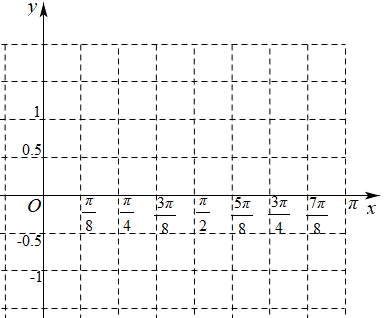

# Mathematics - 题目 2942

**ID**: 8be7274a1e1244918988c12a7623835e
**年级**: Grade 10
**难度**: Easy
**题型**: Calculation

## 题目
设函数 $f\left ({x}\right )=\sin \left ({2x+\frac {\mathrm{π}}{4}}\right )$ .​​​​​​​‌（1）在给出的直角坐标系中画出函数 $y=f\left ({x}\right )$ 在区间 $\left [0,π\right ]$ 上的图象；（2）求出函数 $y=f\left ({x}\right )$ 在 $\left [0,π\right ]$ 上的单调区间和最值.

## 解答

1. （1）解：列表：
2. $x$
3. 0
4. $\frac {π}{8}$
5. $\frac {3π}{8}$
6. $\frac {5π}{8}$
7. $\frac {7π}{8}$
8. $π$
9. $2x+\frac {π}{4}$
10. $\frac {π}{4}$
11. $\frac {π}{2}$
12. $π$
13. $\frac {3π}{2}$
14. $2π$
15. $\frac {9π}{4}$
16. $\sin (2x+\frac {π}{4})$
17. $\frac {\sqrt {2}}{2}$
18. 1
19. 0
20. $-1$
21. 0
22. $\frac {\sqrt {2}}{2}$
23. 描点得图象：
24. 
25. （2）解：单调增区间： $[0,\frac {π}{8}],[\frac {5π}{8},π]$ ，单调减区间： $[\frac {π}{8},\frac {5}{8}π]$ ，
26. 函数的最大值是：1，函数的最小值是： $-1$ ．

## 知识点

**中文**:
  - 五点作图法
  - 函数y=Asin（ωx＋φ）的图象和性质

**English**:
  - Five-Point Method for Plotting
  - Graph and Properties of y=Asin(ωx+φ)

---
