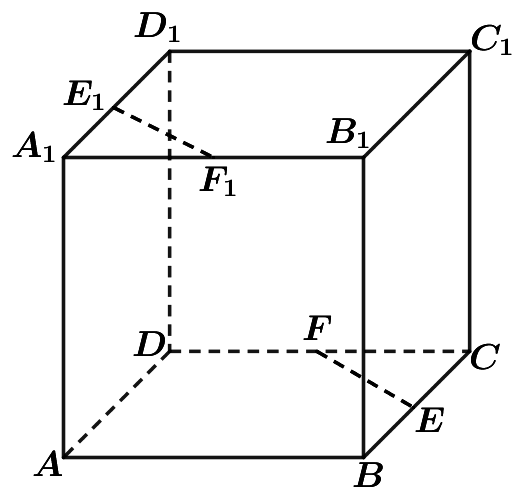

# Mathematics - 题目 724

**ID**: 2dc7379c4c4247618b9d38b154ceae8a
**年级**: Grade 10
**难度**: Easy
**题型**: 习题13.2（2）

## 题目
如图，在正方体 $ABCD-A{{}_{1}}B{{}_{1}}C{{}_{1}}D{{}_{1}}$ 中， $A{{}_{1}}E{{}_{1}}=CE$ ， $A{{}_{1}}F{{}_{1}}=CF$ ．求证： $E{{}_{1}}F{{}_{1}}{\underline{{\underline{{\rm{/}}{\rm{/}}\,\,}}}}EF$ ．​​​​​​​‌

## 解答

1. 如图所示，分别在AD，AB上取 $AE{{}_{2}}=A{{}_{1}}E{{}_{1}}$ ， $AF{{}_{2}}=A{{}_{1}}F{{}_{1}}$ ，
2. 
3. 则四边形 $AF{{}_{2}}F{{}_{1}}A{{}_{1}}$ 和四边形 $AE{{}_{2}}E{{}_{1}}A{{}_{1}}$ 均为平行四边形，
4. 从而 $E{{}_{1}}E{{}_{2}}{\mathop {\parallel }\limits_{=}^{}}F{{}_{1}}F{{}_{2}}$ ，四边形 $F{{}_{1}}E{{}_{1}}E{{}_{2}}F{{}_{2}}$ 为平行四边形，
5. 故 $E{{}_{1}}F{{}_{1}}{\mathop {\parallel }\limits_{=}^{}}E{{}_{2}}F{{}_{2}}$
6. 又 $AE{{}_{2}}=A{{}_{1}}E{{}_{1}}=CE$ ， $AF{{}_{2}}=A{{}_{1}}F{{}_{1}}=CF$ ，
7. 则在四边形 $EFE{{}_{2}}F{{}_{2}}$ 中， $E{{}_{2}}F{{}_{2}}=EF$ ， $E{{}_{2}}F=EF{{}_{2}}$ ，
8. 则四边形 $EFE{{}_{2}}F{{}_{2}}$ 是平行四边形，从而 $E{{}_{2}}F{{}_{2}}{\mathop {\parallel }\limits_{=}^{}}EF$ ，
9. 所以 $E{{}_{1}}F{{}_{1}}{\mathop {\parallel }\limits_{=}^{}}EF$

## 知识点

**中文**:
  - 基本事实4（平行公理）与空间等角定理

**English**:
  - Parallel Axiom and Spatial Equiangular Theorem

---
