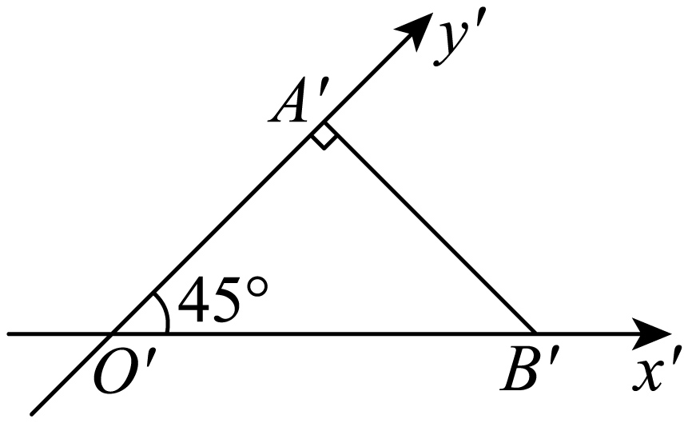

# Mathematics - 题目 3218

**ID**: d0c4c30ae91540eb861f4f405e7a733a
**年级**: Grade 10
**难度**: Easy
**题型**: Fill-in-the-blank

## 题目
如图，等腰直角三角形 $O^{′}A^{′}B^{′}$ 是一个平面图形的直观图，直角边 $O^{′}A^{′}=1$ ，则原图形的面积是.​​​​​​​‌

## 解答

1. 利用斜二测画法的定义，画出原图形，
2. 
3. 由 ${\rm{R}}{\rm{t}}\mathrm{△}O^{′}A^{′}B^{′}$ 是等腰直角三角形，直角边 $O^{′}A^{′}=1$ ，得斜边 $O^{′}B^{′}=\sqrt {2}$ ，
4. 因此 $OB=O^{′}B^{′}=\sqrt {2},OA=2O^{′}A^{′}=2$ ， $\angle AOB=90{^{\circ }}$ ，
5. 所以原平面图形的面积是 $\frac {1}{2}\times 2\times \sqrt {2}=\sqrt {2}$ .

## 知识点

**中文**:
  - 根据直观图求原图

**English**:
  - Reconstructing Original Figure

---
