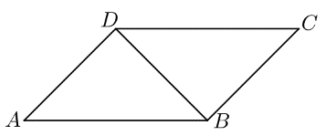

# Mathematics - 题目 3635

**ID**: 20d2f8a6ffc9401abf742904f88029c8
**年级**: Grade 10
**难度**: Easy
**题型**: Multiple-choice

## 题目
设如图，在平行四边形 $ABCD$ 中，下列结论正确的是（      ）​​​​​​​‌

## 解答

1. 根据相等向量的概念可得 $\overrightarrow {{AB}}=\overrightarrow {{DC}}=-\overrightarrow {{CD}}$ ，即A错误；
2. 由向量的三角形法则可得 $\overrightarrow {{AB}}+\overrightarrow {{DA}}=\overrightarrow {{DB}}=-\overrightarrow {{BD}}$ ，即B错误；
3. 易知 $\overrightarrow {{AD}}=\overrightarrow {{BC}}$ ，所以可得 $\overrightarrow {{AD}}+\overrightarrow {{BC}}=2\overrightarrow {{AD}}$ ，即C错误；
4. 由向量的减法法则可得 $\overrightarrow {{AB}}-\overrightarrow {{AD}}=\overrightarrow {{DB}}$ ，所以D正确；
5. 故选D

## 知识点

**中文**:
  - 向量线性综合运算

**English**:
  - Comprehensive Linear Operations

---
