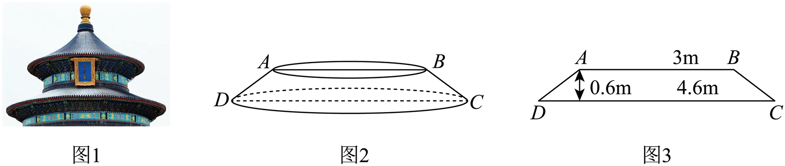

# Mathematics - 题目 1698

**ID**: 3735652832eb4fffa13acdda58cb17f0
**年级**: Grade 10
**难度**: Easy
**题型**: Multiple-choice

## 题目
亭是我国古典园林中最具特色的建筑形式，它是逗留赏景的场所，也是园林风景的重要点缀．重檐圆亭（图1）是常见的一类亭，其顶层部分可以看作是一个圆锥以及一个圆台（图2）的组合体．已知某重檐凉亭的圆台部分的轴截面如图3所示，则该圆台部分的侧面积为（      ）​​​​​​​‌

## 解答

1. 圆台的上底圆直径为3，上底圆直径为4.6，高为0.6，
2. 过点 $A,B$ 作 $AE\bot CD,BF\bot CD$ ，垂足分别为 $E,F$ ，
3. 故 $DE=CF=\frac {4.6-3}{2}=0.8$ ，故 $AD=BC=\sqrt {0.8{^{2}}+0.6{^{2}}}=1$ ，
4. 
5. 故该圆台部分的侧面积为 $\frac {\left ({3{\rm{π}}+4.6{\rm{π}}}\right )\times 1}{2}=3.8{\rm{π}}{\rm{m}}{^{2}}$ .
6. 故选B

## 知识点

**中文**:
  - 圆柱、圆锥、圆台的表面积（侧面积）

**English**:
  - Surface Area of Revolving Solids

---
