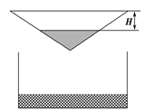
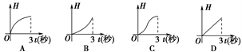

# Mathematics - 题目 3027

**ID**: 432b8a2bcd144c7a843fddc790a65e96
**年级**: Grade 10
**难度**: Easy
**题型**: Multiple-choice

## 题目
如图所示，液体从一个圆锥形漏斗漏入一个圆柱形桶中，开始时漏斗中盛满液体，经过3秒漏完，圆柱形桶中液面上升速度是一个常量，则漏斗中液面下降的高度H与下降时间t之间的函数关系的图象只可能是（      ）​​​​​​​‌

## 解答

1. 由于所给的圆锥形漏斗上口大于下口，
2. 当时间取t时，漏斗中液面下落的高度不会达到漏斗高度的，对比四个选项的图象可得结果．故选B.

## 知识点

**中文**:
  - 建立拟合函数模型解决实际问题

**English**:
  - Fitting Function Models for Real Problems

---
