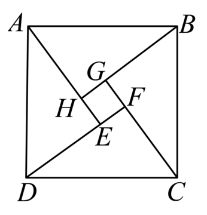

# Mathematics - 题目 1019

**ID**: 6fb7ae56a170470cac51a294b360c5f5
**年级**: Grade 10
**难度**: Easy
**题型**: Multiple-choice

## 题目
我国古代数学家赵爽创制了一幅“勾股圆方图”，后人称为“赵爽弦图”.​​​​​​​‌他用数形结合的方法给出了勾股定理的证明，极富创新意识.“赵爽弦图”是由四个全等的直角三角形与中间的小正方形拼成的一个大正方形.如图，若大正方形的面积是25，小正方形的面积是1，则 $\overrightarrow {{AD}}\cdot \overrightarrow {{FC}}=$ （      ）

## 解答

1. 因为大正方形的面积是25，小正方形的面积是1，所以 $AD=5,EH=1$ ,
2. 设 $DE=AH=x$ ，则 $AE=AH+EH=x+1$ ，
3. 在 ${\rm{R}}{\rm{t}}△AED$ 中， $AD{^{2}}=DE{^{2}}+AE{^{2}}$ ，即 $25=x{^{2}}+{\left({x+1}\right)^{2}}$ ，解得 $x=3$ 或 $-4$ （舍去），
4. 所以 ${\cos}\angle DAE=\frac {AE}{AD}=\frac {4}{5}$ ，
5. 易知在正方形 $ABCD$ 中， $\overrightarrow {{AD}}=\overrightarrow {{BC}}$ ， $\angle BCF=\angle DAE$ ， $FC=DE=3$ ，
6. 所以 $\overrightarrow {{AD}}\cdot \overrightarrow {{FC}}=\overrightarrow {{BC}}\cdot \overrightarrow {{FC}}=\left |{\overrightarrow {{BC}}}\right |\cdot \left |{\overrightarrow {{FC}}}\right |\cdot {\cos}\angle BCF=5\times 3\times \frac {4}{5}=12$ .
7. 故选B.

## 知识点

**中文**:
  - 数量积的计算

**English**:
  - Calculation of Scalar Product

---
