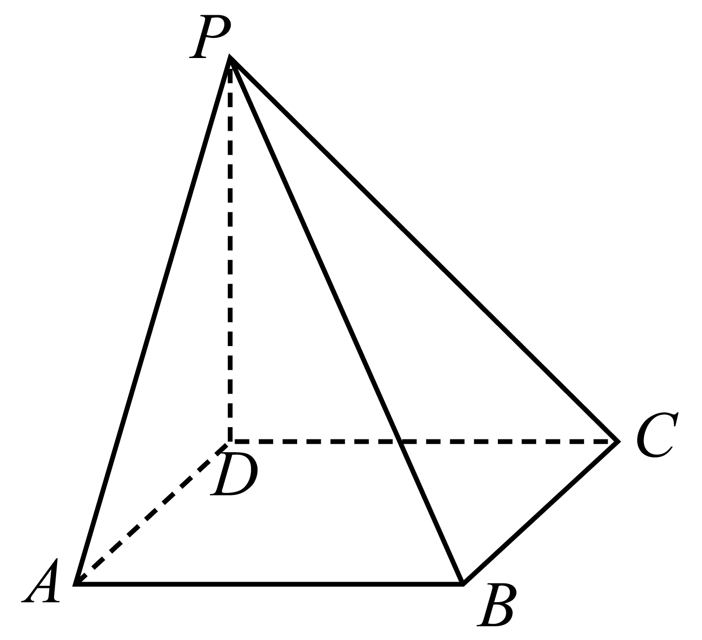

# Mathematics - 题目 3129

**ID**: 8a659b81a39a449b8aaa7df160a193be
**年级**: Grade 10
**难度**: Easy
**题型**: Multiple-choice

## 题目
如图，在四棱锥 $P-ABCD$ 中，底面 $ABCD$ 为矩形， $PD\bot $ 底面 $ABCD$ ，若 $AB=PD=3$ ， $AD=2$ ，则该四棱锥的体积为（      ）​​​​​​​‌

## 解答

1. 由题意可得该四棱锥的体积为 $\frac {1}{3}\times S{{}_{矩形ABCD}}\times PD=\frac {1}{3}\times 2\times 3\times 3=6$ .
2. 故选D.

## 知识点

**中文**:
  - 棱柱、棱锥、棱台的体积

**English**:
  - Volume of Polyhedra

---
