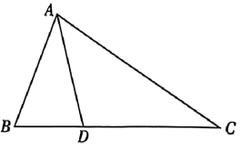

# Mathematics - 题目 875

**ID**: 9f6650180a5e41628b0f006d4833aa9e
**年级**: Grade 10
**难度**: Easy
**题型**: Multiple-choice

## 题目
如图，在 $\vartriangle ABC$ 中， $D$ 是BC上靠近 $B$ 的一个三等分点，记 $\overrightarrow {{AB}}=\overrightarrow a$ ， $\overrightarrow {{AC}}=\overrightarrow {{b}}$ ，则 $\overrightarrow {{AD}}$ 可以用 $\overrightarrow a$ ， $\overrightarrow {{b}}$ 表示为（      ）​​​​​​​‌

## 解答

1. 由题意， $\overrightarrow {{AD}}=\overrightarrow {{AB}}+\overrightarrow {{BD}}$  $=\overrightarrow {{AB}}+\frac {1}{3}\overrightarrow {{BC}}$  $=\overrightarrow {{AB}}+\frac {1}{3}\left ({\overrightarrow {{AC}}-\overrightarrow {{AB}}}\right )$  $=\frac {2}{3}\overrightarrow {{AB}}+\frac {1}{3}\overrightarrow {{AC}}$  $=\frac {2}{3}\overrightarrow {{a}}+\frac {1}{3}\overrightarrow {{b}}$ .
2. 故选C.

## 知识点

**中文**:
  - 平面向量基本定理的应用

**English**:
  - Applications of Fundamental Theorem

---
