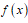

# Mathematics - 题目 1482

**ID**: b76551a5311e480e9240e725e1e23c0b
**年级**: Grade 10
**难度**: Easy
**题型**: Multiple-choice

## 题目
已知函数的—个零点附近的函数值的参考数据如表：00.​​​​​​​‌50.531250.56250.6250.7510.0660.2150.5121.099由二分法求得方程的近似解（精确度为0.05）可能是（      ）

## 解答

1. 解：设方程的近似解为，
2. 因为，，所以，
3. 因为，
4. 所以方程的近似解可取为0.5625.
5. 故选：C．

## 知识点

**中文**:
  - 二分法求方程的近似解
  - 函数零点的存在性定理及应用

**English**:
  - Bisection Method for Approximate Solutions
  - Existence Theorem of Zero Points and Applications

---
