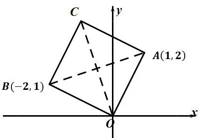

# Mathematics - 题目 1388

**ID**: d3672f1bf8d046cb80cda91ae822ab7b
**年级**: Grade 10
**难度**: Easy
**题型**: Multiple-choice

## 题目
如图在复平面上，一个正方形的三个顶点对应的复数分别是 $1+2{\rm i},-2+{\rm i},0$ ，那么这个正方形的第四个顶点对应的复数为（      ）．​​​​​​​‌

## 解答

1. ∵ $ \overrightarrow {{OC}}＝\overrightarrow {{OA}}+\overrightarrow {{OB}}$  ，
2. ∴ $\overrightarrow {{ OC}}$  对应的复数为： $1+2{\rm i}-2+{\rm i}=-1+3{\rm i}$ ，
3. ∴点 $C$ 对应的复数为 $-1+3{\rm i}$ ．
4. 故选D．

## 知识点

**中文**:
  - 复数的向量表示

**English**:
  - Vector Representation

---
