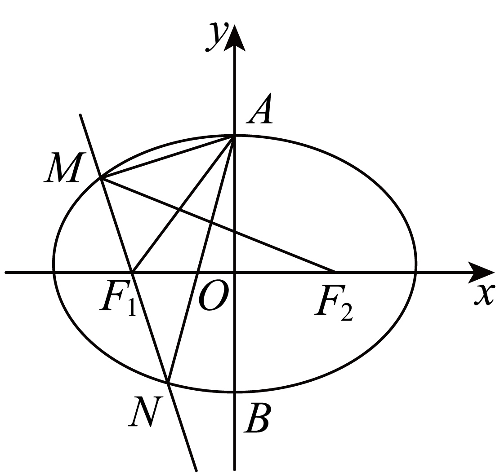

# Mathematics - 题目 536

**ID**: faeb5630dd22463e8791a9525de26d09
**年级**: Grade 10
**难度**: Hard
**题型**: Calculation

## 题目
已知椭圆 $E:\frac {x{^{2}}}{a{^{2}}}+\frac {y{^{2}}}{b{^{2}}}=1(a>b>0)$ 的离心率为 $\frac {\sqrt {2}}{2},F{{}_{1}},F{{}_{2}}$ 分别为椭圆 $E$ 的左､右焦点， $A,B$ 分别为椭圆 $E$ 的上､下顶点，且 $\left |{AB}\right |=2$ .​​​​​​​‌（1）求椭圆 $E$ 的方程；（2）已知过 $F{{}_{1}}$ 的直线 $l$ 与椭圆 $E$ 交于 $M,N$ 两点，且直线 $l$ 不过椭圆四个顶点.${\rm （i）}$ 设 $\vartriangle MF{{}_{1}}F{{}_{2}},\vartriangle MAB$ 的面积分别为 $S{{}_{1}},S{{}_{2}}$ ，若 $S{{}_{1}}\leqslant S{{}_{2}}$ ，求 $\left |{AM}\right |$ 的最大值；${\rm （ii）}$ 若 $M$ 在 $x$ 轴上方， $AF{{}_{1}}$ 为 $∠MAN$ 的角平分线，求直线 $l$ 的方程.

## 解答

1. （1）由题意知 $\begin{cases}a{^{2}}=b{^{2}}+c{^{2}}\\\frac {c}{a}=\frac {\sqrt {2}}{2}\\b=1\end{cases}$ ， $\therefore \begin{cases}a=\sqrt {2}\\b=1\end{cases}$ ，
2. $\therefore $ 椭圆方程为 $\frac {x{^{2}}}{2}+y{^{2}}=1$ ，
3. （2）（i）设 $M\left ({x{{}_{0}},y{{}_{0}}}\right )$ ，
4. 则 $S{{}_{1}}=S{{}_{{\rm{Δ}}MF{{}_{1}}F{{}_{2}}}}=\frac {1}{2}\times \left |{F{{}_{1}}F{{}_{2}}}\right |\times \left |{y{{}_{0}}}\right |=\frac {1}{2}\times 2\times \left |{y{{}_{0}}}\right |=\left |{y{{}_{0}}}\right |$ ，
5. $S{{}_{2}}=S{{}_{\vartriangle MAB}}=\frac {1}{2}\times \left |{AB}\right |\times \left |{x{{}_{0}}}\right |=\frac {1}{2}\times 2\times \left |{x{{}_{0}}}\right |=\left |{x{{}_{0}}}\right |$ ，
6. $\because S{{}_{1}}\leqslant S{{}_{2}}$ ， $\therefore \left |{y{{}_{0}}}\right |\leqslant \left |{x{{}_{0}}}\right |$ ， $\therefore y{{}_{0}}{^{2}}\leqslant x{{}_{0}}{^{2}}$ ，
7. 又 $\because M\left ({x{{}_{0}},y{{}_{0}}}\right )$ 在椭圆上， $\therefore \frac {x{{}_{0}}{^{2}}}{2}+y{{}_{0}}{^{2}}=1$ ，
8. $\therefore x{{}_{0}}{^{2}}=2-2y{{}_{0}}{^{2}}$ ， $\therefore y{{}_{0}^{2}}\leqslant 2-2y{{}_{0}}{^{2}}$ ，即 $y{{}_{0}^{2}}\leqslant \frac {2}{3}$ ，
9. $\because |AM|{^{2}}=x{{}_{0}^{2}}+{\left({y{{}_{0}}-1}\right)^{2}}=2-2y{{}_{0}^{2}}+y{{}_{0}^{2}}-2y{{}_{0}}+1$ ，
10. $=-y{{}_{0}^{2}}-2y{{}_{0}}+3,y{{}_{0}}\in \left [{-\frac {\sqrt {6}}{3},0}\right )\cup \left ({0,\frac {\sqrt {6}}{3}}\right ]$ ，
11. $\therefore |AM|{{}_{{\rm \max }}^{2}}$  $=-\frac {2}{3}+\frac {2\sqrt {6}}{3}+3=\frac {7+2\sqrt {6}}{3}=\frac {(\sqrt {6}+1){^{2}}}{3}$ ，
12. $\therefore |AM|{{}_{{\rm{m}}{\rm{a}}{\rm{x}}}}=\frac {3\sqrt {2}+\sqrt {3}}{3}$ ；
13. ${\rm （ii）}$ 设 $∠MAF{{}_{1}}=∠NAF{{}_{1}}=θ$ ，直线 $AN$ 的倾斜角为 $α$ ，直线 $AM$ 的倾斜角为 $β$ ，
14. $\because A\left ({0,1}\right ),F\left ({-1,0}\right )$ ， $\therefore $ 直线 $AF{{}_{1}}$ 的倾斜角为 $\frac {{\rm{π}}}{4}$ ，
15. $\therefore α=\frac {{\rm{π}}}{4}+θ,β=\frac {{\rm{π}}}{4}-θ$ ， $\therefore α+β=\frac {{\rm{π}}}{2}$ ，
16. 又 $k{{}_{AN}}={\rm{t}}{\rm{a}}{\rm{n}}α,k{{}_{AM}}={\rm{t}}{\rm{a}}{\rm{n}}β={\rm{t}}{\rm{a}}{\rm{n}}\left ({\frac {{\rm{π}}}{2}-α}\right )$ ，
17. $\therefore k{{}_{AN}}\cdot k{{}_{AM}}=1$ ，
18. 由题意 $l$ 的斜率不为0，设直线 $l$ 的方程为： $x=my-1,m\ne 1$ ，
19. 由 $\begin{cases}x=my-1\\\frac {x{^{2}}}{2}+y{^{2}}=1\end{cases}$ ，得 $\left ({m{^{2}}+2}\right )y{^{2}}-2my-1=0$ ，
20. 设 $M\left ({x{{}_{1}},y{{}_{1}}}\right )N\left ({x{{}_{2}},y{{}_{2}}}\right )$ ，
21. 则 $\begin{cases}{\rm{Δ}}=8m{^{2}}+8>0\\y{{}_{1}}+y{{}_{2}}=\frac {2m}{m{^{2}}+2}\\y{{}_{1}}y{{}_{2}}=\frac {-1}{m{^{2}}+2}\end{cases}$ ，又 $k{{}_{AN}}\cdot k{{}_{AM}}=1$ ，
22. $\therefore \frac {y{{}_{2}}-1}{x{{}_{2}}}\cdot \frac {y{{}_{1}}-1}{x{{}_{1}}}=1$ ，
23. 即 $\left ({y{{}_{1}}-1}\right )\left ({y{{}_{2}}-1}\right )=x{{}_{1}}x{{}_{2}}=\left ({my{{}_{1}}-1}\right )\left ({my{{}_{2}}-1}\right )$ ，
24. 整理得 $\left ({m{^{2}}-1}\right )y{{}_{1}}y{{}_{2}}=\left ({m-1}\right )\left ({y{{}_{1}}+y{{}_{2}}}\right )$ ，
25. $\therefore \frac {-\left ({m+1}\right )}{m{^{2}}+2}=\frac {2m}{m{^{2}}+2}$ ， $\therefore m=-\frac {1}{3}$ ，
26. $\therefore l$ 的方程为 $3x+y+3=0$ .

## 知识点

**中文**:
  - 弦长面积问题
  - 由椭圆的几何性质求方程
  - 直线与椭圆的位置关系

**English**:
  - Chord Length and Area Problems
  - Finding Equation from Properties
  - Line-Ellipse Relationship

---
