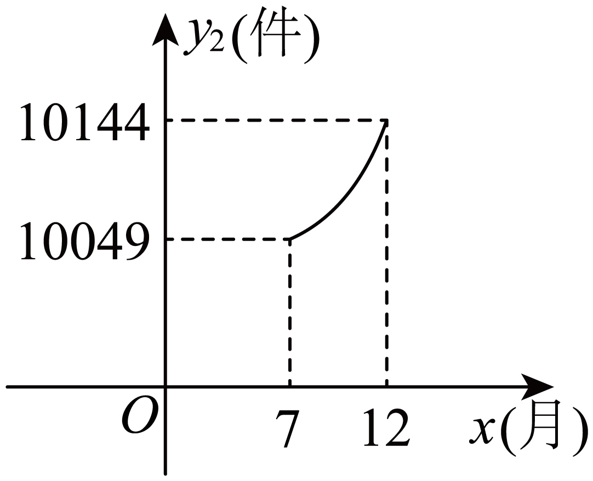

# Mathematics - 题目 2848

**ID**: 17b5da90e02c41ad85ba9ae987b45583
**年级**: Grade 10
**难度**: Medium
**题型**: Calculation

## 题目
某工厂进行加工生产所的工料两种供应方式，一种是从市场上直接采购工料，另一种是通过工厂自身生产工料，该工厂去年（2月至12月）每月所需的工料总量均为12000件，由于工厂生产车间处于调试阶段，自身生产的工料有限，于是工厂从市场上采购一部分工料作为补充，两种供应方式同时进行，2月至6月，该工厂从市场上采购的工料量 $y{{}_{1}}$ （件）与月份x（ $2\leqslant x\leqslant 6$ ，且x为整数）之间满足的函数关系如下表月份x（月）23456市场采购工料量 $y{{}_{1}}$ （件）600040003000240020007月至12月，该工厂自身生产的工料量 $y{{}_{2}}$ （件）与月份x（ $7\leqslant x\leqslant 12$ ，且x为取整数）之间满足二次函数关系式为 $y{{}_{2}}=ax{^{2}}+c(a\ne 0)$ ．其图象如图所示.​​​​​​​‌2月至6月，该工厂每件工料的市场采购成本 $z{{}_{1}}$ （元）与月份x之间满足函数关系式 $z{{}_{1}}=\frac {1}{2}x$ ，该工厂自身生产的每件工料的成本 $z{{}_{2}}$ （元）与月份x之间满足函数关系式： $z{{}_{2}}=\frac {3}{4}x-\frac {1}{12}x{^{2}}$ ；7月至12月的每一个月份，该工厂从市场采购的工料成本均为3元/件，该工厂自身生产的工料成本为1.5元/件．（1）请观察题中的表格和图象，用所学过的一次函数、反比例函数或二次函数的有关知识，分别求出 $y{{}_{1}},y{{}_{2}}$ 与x之间的函数关系式；（2）请你求出该工厂去年（2月至12月）哪个月份所需的工料总费用W（元）最多，并求出这个最多费用．

## 解答

1. （1）根据表格中数据可以得出 $xy{{}_{1}}=$ 定值，则 $y{{}_{1}}$ 与x之间的函数关系为反比例函数关系
2. 设 $y{{}_{1}}=\frac {k}{x}$ ，将 $(2,6000)$ 代入得： $k=2\times 6000=12000$ ，
3. 故 $y{{}_{1}}=\frac {12000}{x}$ （ $2\leqslant x\leqslant 6$ ，且x取整数）
4. 根据图象可以看出： $y{{}_{2}}=ax{^{2}}+c(a\ne 0)$ 的图象过 $(7,10049)$ ， $(12,10144)$ 两个点，
5. 代入 $y{{}_{2}}=ax{^{2}}+c(a\ne 0)$ 得：
6. $\begin{cases}10049=49a+c\\10144=144a+c\end{cases}$ 解得： $\begin{cases}a=1\\c=10000\end{cases}$
7. 故 $y{{}_{2}}=x{^{2}}+10000$ （ $7\leqslant x\leqslant 12$ ，且x取整数）
8. （2）当 $2\leqslant x\leqslant 6$ ，且x取整数时：
9. $W=y{{}_{1}}\cdot z{{}_{1}}+\left ({12000-y{{}_{1}}}\right )\cdot z{{}_{2}}=\frac {12000}{x}\cdot \frac {1}{2}x+\left ({12000-\frac {12000}{x}}\right )\cdot \left ({\frac {3}{4}x-\frac {1}{12}x{^{2}}}\right )$
10. $=-1000x{^{2}}+10000x-3000$ ,则开口向下，且对称轴为 $x=5,2\leqslant x\leqslant 6$ ，
11. 当 $x=5$ 时， $W{{}_{最大}}=22000$ （元）
12. 当 $7\leqslant x\leqslant 12$ 时，且x取整数时，
13. $W=3\times \left ({12000-y{{}_{2}}}\right )+1.5\cdot y{{}_{2}}=3\times \left ({12000-x{^{2}}-10000}\right )+1.5\left ({x{^{2}}+10000}\right )$
14. $=-\frac {3}{2}x{^{2}}+21000$ 为开口向下，对称轴为 $y$ 轴，
15. 当 $7\leqslant x\leqslant 12$ 时，W随x的增大而减小，
16. $\therefore $ 当 $x=7$ 时， $W{{}_{最大}}=21000-\frac {3}{2}\times 49<22000$ （元）
17. $\therefore $ 去年5月用于所需工料的总费用最多，最多费用是22000元．

## 知识点

**中文**:
  - 二次函数模型及应用
  - 分式型函数模型及应用

**English**:
  - Quadratic Function Model
  - Fractional Function Model

---
