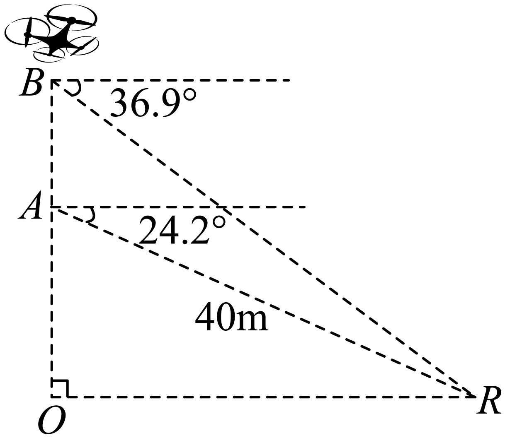

# Mathematics - 题目 205

**ID**: 24072750089d4f7385be1b7f30e184a2
**年级**: Grade 10
**难度**: Medium
**题型**: Calculation

## 题目
如图， $O,R$ 是同一水平线上的两点，无人机从 $O$ 点竖直上升到A点时，测得A到 $R$ 点的距离为 $40{\rm{m}},R$ 点的俯角为 $24.​​​​​​​‌2{^{\circ }}$ ，无人机继续竖直上升到 $B$ 点，测得 $R$ 点的俯角为 $36.9{}\degree $ ．求无人机从A点到 $B$ 点的上升高度 $AB$ （精确到 $0.1{\rm{m}}$ ）．参考数据： ${\rm{s}}{\rm{i}}{\rm{n}}24.2{^{\circ }}\approx 0.41,{\rm{c}}{\rm{o}}{\rm{s}}24.2{^{\circ }}\approx 0.91,{\rm{t}}{\rm{a}}{\rm{n}}24.2{^{\circ }}\approx 0.45$ ， ${\rm{s}}{\rm{i}}{\rm{n}}36.9{^{\circ }}\approx 0.60,{\rm{c}}{\rm{o}}{\rm{s}}36.9{^{\circ }}\approx 0.80,{\rm{t}}{\rm{a}}{\rm{n}}36.9{^{\circ }}\approx 0.75$ ．

## 解答

1. 依题意， $\angle ARO=24.2{^{\circ }}$ ， $\angle BRO=36.9{^{\circ }}$ ， $AR=40$ ，
2. 在 ${\rm{R}}{\rm{t}}\vartriangle AOR$ 中， $\angle ARO=24.2{^{\circ }}$ ，
3. ∴ $AO=AR\times \sin \angle ARO=40\times \sin 24.2{^{\circ }}$ ，
4. $RO=AR\times {\cos}\angle ARO=40\times {\cos}24.2{^{\circ }}$ ，
5. 在 ${\rm{R}}{\rm{t}}\vartriangle BOR$ 中， $OB=OR\times {\tan}\angle BRO=40\times {\cos}24.2{^{\circ }}\times {\tan}36.9{^{\circ }}$ ，
6. ∴ $AB=BO-AO$
7. $=40\times {\cos}24.2{}\degree \times {\tan}36.9{}\degree -40\times \sin 24.2{}\degree $
8. $\approx 40\times 0.91\times 0.75-40\times 0.41$
9. $\approx 10.9$ （米）,
10. 答：无人机从A点到 $B$ 点的上升高度 $AB$ 约为 $10.9$ 米.

## 知识点

**中文**:
  - 图形的性质

**English**:
  - Properties of Geometric Figures

---
