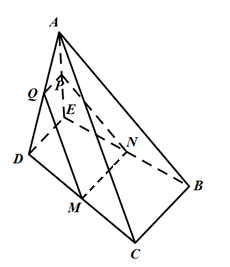

# Mathematics - 题目 2591

**ID**: 3149f048c9c94b209f0ba3ac5816d1d6
**年级**: Grade 10
**难度**: Medium
**题型**: Calculation

## 题目
在四棱锥 $A-BCDE$ 中,底面 $BCDE$ 为梯形, $BC//DE$ .​​​​​​​‌设 $CD,BE,AE,AD$ 的中点分别为 $M,N,P,Q$ .(1)求证: $M,N,P,Q$ 四点共面;(2)若 $AC\bot DE$ ,且 $AC=\sqrt {3}BC$ ,求异面直线 $DE$ 与 $PN$ 所成角的大小.

## 解答

1. 解析 (1)证明:因为 $CD$ , $BE$ , $AE$ , $AD$ 的中点分别为 $M,N,P,Q$ ,
2. 所以 $PQ$ 为 $ΔADE$ 的中位线, $MN$ 为梯形 $BCDE$ 的中位线.
3. 所以 $PQ//DE$ , $MN//DE$ ,
4. 所以 $PQ//MN$ ,
5. 所以 $M,N,P,Q$ 四点共面.
6. (2)因为 $PN$ 为 $\Delta ABE$ 的中位线,
7. 所以 $PN//AB$ .
8. 又 $BC//DE$ ,所以 $\angle ABC$ (或其补角)即为异面直线 $DE$ 与 $PN$ 所成的角.
9. 又 $AC\bot DE$ ,所以 $AC\bot BC$ .
10. 在 ${\rm{R}}{\rm{t}}\mathrm{△}ACB$ 中, ${\tan}\angle ABC=\frac {AC}{BC}=\frac {\sqrt {3}BC}{BC}=\sqrt {3}$ ,所以 $\angle ABC=60^\circ $ .
11. 所以异面直线 $DE$ 与 $PN$ 成的角为60°.

## 知识点

**中文**:
  - 异面直线所成角

**English**:
  - Angle between Skew Lines

---
