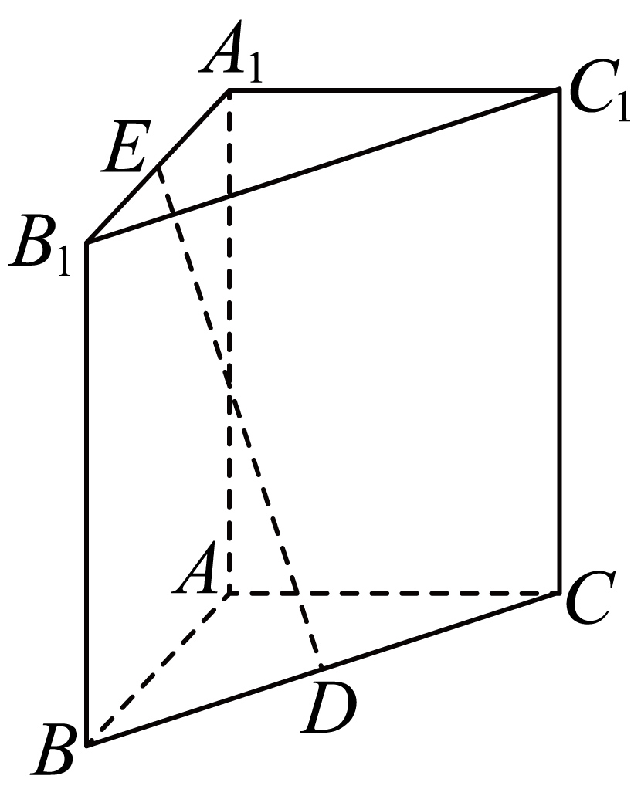

# Mathematics - 题目 368

**ID**: 32bef3ba699445f98f4c3727c17994b1
**年级**: Grade 10
**难度**: Medium
**题型**: Calculation

## 题目
如图，在直三棱柱 $ABC-A{{}_{1}}B{{}_{1}}C{{}_{1}}$ 中， $AB\mathrm{⊥}AC$ ， $D$ ， $E$ 分别为 $BC$ ， $A{{}_{1}}B{{}_{1}}$ 的中点.​​​​​​​‌（1）求证： $DE//$ 平面 $A{{}_{1}}ACC{{}_{1}}$ ；（2）求证： $AB\bot DE$ ；（3）若 $AA{{}_{1}}=6$ ， $AB=AC=4$ ，求三棱锥 $A-BCE$ 的体积.

## 解答

1. （1）证明：取 $A{{}_{1}}C{{}_{1}}$ 的中点 $F$ ，连接 $EF,FC$ ，又 $D$ ， $E$ 分别为 $BC$ ， $A{{}_{1}}B{{}_{1}}$ 的中点，
2. 所以 $EF//DC$ 且 $EF=DC$ ，故四边形 $EFCD$ 为平行四边形，
3. 所以 $DE//CF$ ， $DE\not\subset $ 平面 $A{{}_{1}}ACC{{}_{1}}$ ， $CF\subset $ 平面 $A{{}_{1}}ACC{{}_{1}}$ ，则 $DE//$ 平面 $A{{}_{1}}ACC{{}_{1}}$ ；
4. （2）证明：取 $AB$ 中点 $H$ ，连 $EH,HD$ ，结合中位线及直三棱柱的性质知 $AB\bot EH,AB\bot HD$ ，
5. 由 $EH\cap HD=H$ 且都在平面 $EHD$ 内，则 $AB\bot $ 平面 $EHD$ ，
6. 由 $DE\subset $ 平面 $EHD$ ，则 $AB\bot DE$ ；
7. （3）由 $AA{{}_{1}}=6$ ， $AB=AC=4$ ， $AB\bot AC$ ，则 $V{{}_{A-BCE}}=V{{}_{E-ABC}}=\frac {1}{3}\times 6\times \frac {1}{2}\times 4\times 4=16$ .
8. 

## 知识点

**中文**:
  - 棱柱、棱锥、棱台的体积
  - 直线与平面平行的判定
  - 直线与平面垂直的判定
  - 直线与平面垂直的性质

**English**:
  - Volume of Polyhedra
  - Line-Plane Parallelism Determination
  - Line-Plane Perpendicularity Determination
  - Properties of Line-Plane Perpendicularity

---
