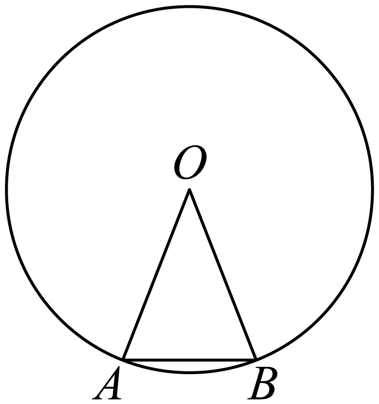

# Mathematics - 题目 2321

**ID**: 4f4254b4a1df48a08b9d3ef8189b20a7
**年级**: Grade 10
**难度**: Medium
**题型**: Calculation

## 题目
如图，已知A，B是半径为1的圆O上两点，且 $\left |{\overrightarrow {{AO}}+\overrightarrow {{AB}}}\right |=\sqrt {2}\left |{\overrightarrow {{AO}}-\overrightarrow {{AB}}}\right |$ ．（1）求 $\angle AOB$ 的余弦值；​​​​​​​‌（2）若点 $C{{}_{1}}$ ， $C{{}_{2}}$ ，…， $C{{}_{2024}}$ ， $C{{}_{2025}}$ 依次将线段AO平均分成2026份，设 $\overrightarrow {{BA}}=\overrightarrow a$ ， $\overrightarrow {{BO}}=\overrightarrow b$ ， $\overrightarrow {{BC{{}_{1}}}}+\overrightarrow {{BC{{}_{2}}}}+\overrightarrow {{BC{{}_{3}}}}+\ldots +\overrightarrow {{BC{{}_{2024}}}}+\overrightarrow {{BC{{}_{2025}}}}=\overrightarrow c$ ，求 $\left |{\overrightarrow a+\overrightarrow b+\overrightarrow c}\right |$ 的值．

## 解答

1. （1）设 $\angle AOB=θ$ ，由 $\left |{\overrightarrow {{AO}}+\overrightarrow {{AB}}}\right |=\sqrt {2}\left |{\overrightarrow {{AO}}-\overrightarrow {{AB}}}\right |$ 可得 $\left |{\overrightarrow {{AO}}+\overrightarrow {{OB}}-\overrightarrow {{OA}}}\right |=\sqrt {2}\left |{\overrightarrow {{AO}}-(\overrightarrow {{OB}}-\overrightarrow {{OA}})}\right |$ ，
2. 即 $\left |{\overrightarrow {{OB}}-2\overrightarrow {{OA}}}\right |=\sqrt {2}\left |{\overrightarrow {{OB}}}\right |=\sqrt {2}$ ，
3. 平方得 $\overrightarrow {{OB{^{2}}}}-4\left |{\overrightarrow {{OB}}}\right |\left |{\overrightarrow {{OA}}}\right |{\cos}θ+4\overrightarrow {{OA{^{2}}}}=2$ ，解得 ${\cos}θ=\frac {3}{4}$ ，
4. 故 $\angle AOB$ 的余弦值为 $\frac {3}{4}$ ．
5. （2）由题知AO的中点为 $C{{}_{1013}}$ ， $C{{}_{1013}}$ 也为线段 $C{{}_{1}}C{{}_{2025}}$ ，线段 $C{{}_{2}}C{{}_{2024}}$ ，…，线段 $C{{}_{1012}}C{{}_{1014}}$ 的中点，
6. 因为 $\overrightarrow {{BA}}+\overrightarrow {{BO}}=\overrightarrow {{BC{{}_{1}}}}+\overrightarrow {{BC{{}_{2025}}}}=\overrightarrow {{BC{{}_{2}}}}+\overrightarrow {{BC{{}_{2024}}}}=\overrightarrow {{BC{{}_{3}}}}+\overrightarrow {{BC{{}_{2023}}}}=\cdots =2\overrightarrow {{BC{{}_{1013}}}}$ ，
7. 所以 $\overrightarrow a+\overrightarrow b+\overrightarrow c=\overrightarrow {{BA}}+\overrightarrow {{BC{{}_{1}}}}+\overrightarrow {{BC{{}_{2}}}}+\overrightarrow {{BC{{}_{3}}}}+\cdots +\overrightarrow {{BC{{}_{2024}}}}+\overrightarrow {{BC{{}_{2025}}}}+\overrightarrow {{BO}}=2027\overrightarrow {{BC{{}_{1013}}}}$ ，
8. 而 $\overrightarrow {{BC{{}_{1013}}}}=\frac {1}{2}(\overrightarrow {{BA}}+\overrightarrow {{BO}})=\frac {1}{2}(\overrightarrow {{OA}}-\overrightarrow {{OB}}+\overrightarrow {{BO}})=\frac {1}{2}(\overrightarrow {{OA}}-2\overrightarrow {{OB}})$ ，
9. 平方得 $\overrightarrow {{BC{{}_{1013}}}}{^{2}}=\frac {1}{4}(\overrightarrow {{OA{^{2}}}}-4\left |{\overrightarrow {{OA}}}\right |\left |{\overrightarrow {{OB}}}\right |{\cos}θ+4\overrightarrow {{OB{^{2}}}})=\frac {1}{2}$ ，
10. 即 $\left |{\overrightarrow {{BC{{}_{1013}}}}}\right |=\frac {\sqrt {2}}{2}$ ，
11. 故 $\left |{\overrightarrow a+\overrightarrow b+\overrightarrow c}\right |=2027\left |{\overrightarrow {{BC{{}_{1013}}}}}\right |=\frac {2027\sqrt {2}}{2}$ ．

## 知识点

**中文**:
  - 向量夹角的计算
  - 向量模的计算

**English**:
  - Calculation of Vector Angle
  - Calculation of Vector Modulus

---
