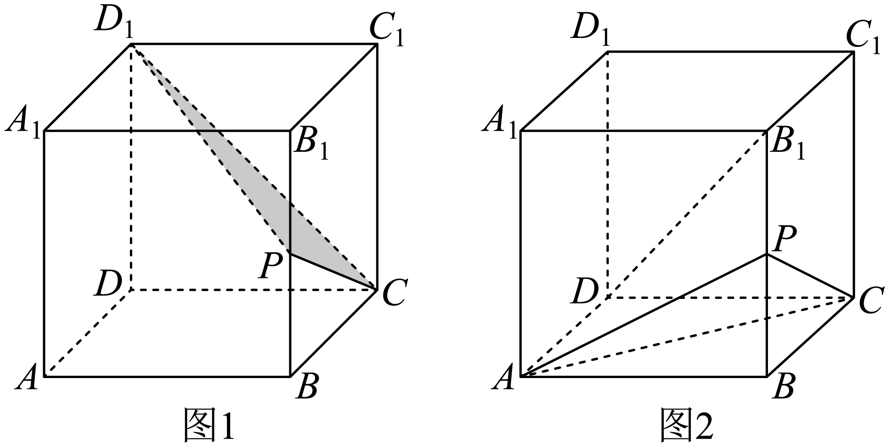

# Mathematics - 题目 2919

**ID**: 59a796b582a0407fb5598117f403d4da
**年级**: Grade 10
**难度**: Medium
**题型**: Calculation

## 题目
如图，在正方体 $ABCD-A{{}_{1}}B{{}_{1}}C{{}_{1}}D{{}_{1}}$ 中，若 $P$ 为棱 $BB{{}_{1}}$ 的中点，（1）判断平面 $D{{}_{1}}PC$ 与平面 $ABCD$ 是否相交．如果相交，在图1作出这两个平面的交线，并说明理由；​​​​​​​‌（2）如图2，求证： $DB{{}_{1}}//$ 平面 $PAC$ ．

## 解答

1. （1）平面 $D{{}_{1}}PC$ 与平面ABCD相交，
2. 因为 $DD{{}_{1}}{\rm{/}}{\rm{/}}BP,DD{{}_{1}}{\rm{=}}{{2}}BP$ ，
3. 所以 $D,D{{}_{1}},B,P,$ 四点共面，且 $DB$ 与 $D{{}_{1}}P$ 不平行则必相交，
4. 如图，连接 $DB$ 、 $D{{}_{1}}P$ 并延长交于 $Q$ ，连接 $CQ$ ，
5. 则平面 $D{{}_{1}}PC\cap $ 平面 $ABCD=CQ$ .
6. 
7. （2）连接 $BD$ ，交 $AC$ 与点 $O$ ，连接 $OP$ ，
8. 在 $\mathrm{△}BB{{}_{1}}D$ 中，点 $O,P$ 分别是 $BD,BB{{}_{1}}$ 的中点，所以 $OP{\rm{/}}{\rm{/}}DB{{}_{1}}$ ，
9. 而 $OP\subset $ 平面 $PAC$ ， $DB{{}_{1}}\not\subset $ 平面 $PAC$ ，
10. 所以 $DB{{}_{1}}//$ 平面 $PAC$ .
11. 

## 知识点

**中文**:
  - 平面与平面的位置关系
  - 直线与平面平行的判定

**English**:
  - Plane-Plane Relationships
  - Line-Plane Parallelism Determination

---
