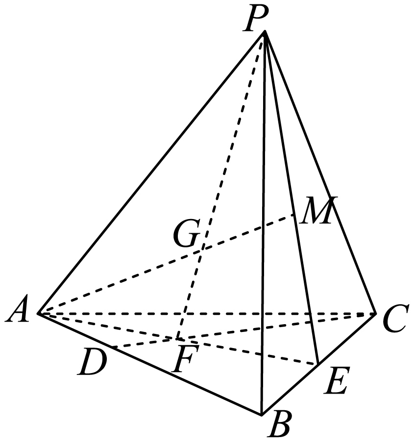

# Mathematics - 题目 2487

**ID**: 6065cfe7a9e541acb79614353e2c34ee
**年级**: Grade 10
**难度**: Medium
**题型**: Calculation

## 题目
如图，在三棱锥 $P-ABC$ 中， $AB=2$ ， $AC=2\sqrt {2}$ ，且三棱锥 $P-ABC$ 的体积 $V=\frac {4}{3}$ ， $D$ 是 $AB$ 上靠近点A的三等分点，E是 $BC$ 中点，连接 $CD$ 、 $AE$ 交于点F，G在线段 $PF$ 上，直线 $AG$ 交平面 $PBC$ 于点M，且 $\frac {AG}{GM}=\frac {PG}{GF}$ .​​​​​​​‌（1）若 $AF=λFE$ ，求 $λ$ 的值；（2）求三棱锥 $P-FBM$ 的体积；（3）若 $PA+PC=4$ ，求此三棱锥 $P-ABC$ 的高.

## 解答

1. （1）设 $\overrightarrow {{BF}}=x\overrightarrow {{BA}}+y\overrightarrow {{BC}}=\frac {3}{2}x\overrightarrow {{BD}}+y\overrightarrow {{BC}}$ ，
2. ∵F，D，C三点共线，故 $\frac {3}{2}x+y=1$ ①，
3. 同理 $\overrightarrow {{BF}}=x\overrightarrow {{BA}}+y\overrightarrow {{BC}}=x\overrightarrow {{BA}}+2y\overrightarrow {{BE}}$ ，
4. ∵A，F，E三点共线，故 $x+2y=1$ ②，
5. 由①②可得 $x=\frac {1}{2}$ ， $y=\frac {1}{4}$ ，故 $\overrightarrow {{BF}}=\frac {1}{2}\overrightarrow {{BA}}+\frac {1}{2}\overrightarrow {{BE}}$ ，
6. 故F为 $AE$ 中点，故 $AF=FE$ ，即 $λ=1$ .
7. （2）连接 $PE$ ， $M\in AG$ ， $AG\subset $ 平面 $PAE$ ，∴ $M\in $ 平面 $PAE$
8. 又 $M\in $ 平面 $PBC$ ，且平面 $PAE\cap $ 平面 $PBC=PE$ ，∴ $M\in PE$
9. 
10. 连接 $MF$ ，
11. 在 $\mathrm{△}GAP$ 和 $\mathrm{△}GMF$ 中， $\frac {AG}{GM}=\frac {PG}{GF}$ ，且 $\angle AGP=\angle MGF$ ，
12. 故 $\vartriangle GAP\sim \vartriangle GMF$ ，故 $\angle GAP=\angle GMF$ ，故 $AP//MF$ ，
13. 又F为 $AE$ 中点，故M为 $PE$ 中点，
14. $V{{}_{P-FBM}}=V{{}_{F-PBM}}=\frac {1}{3}S{{}_{\vartriangle PBM}}h{{}_{F-PBM}}=\frac {1}{3}\times \left ({\frac {1}{4}S{{}_{\vartriangle PBC}}}\right )\times \left ({\frac {1}{2}h{{}_{A-PBM}}}\right )$
15. $=\frac {1}{8}\times \frac {1}{3}S{{}_{\vartriangle PBC}}h{{}_{A-PBC}}=\frac {1}{8}\times \frac {4}{3}=\frac {1}{6}$ ；
16. （3） $S{{}_{\mathrm{△}ABC}}=\frac {1}{2}AC\cdot AB\cdot \sin \angle BAC=2\sqrt {2}\sin \angle BAC\leqslant 2\sqrt {2}$ ，当 $\angle BAC=90{}\degree $ 时，取到等号，
17. 在 $\vartriangle PAC$ 中，设 $PA=x$ ， $PC=y$ ， $\angle APC=θ$ ， $AC$ 边上的高为 $h$ ，
18. 则 ${\cos}θ=\frac {x{^{2}}+y{^{2}}-8}{2xy}=\frac {{\left({x+y}\right)^{2}}-2xy-8}{2xy}=\frac {8-2xy}{2xy}=\frac {4-xy}{xy}$ ，
19. 则 $\sin θ=\frac {\sqrt {x{^{2}}y{^{2}}-{\left({4-xy}\right)^{2}}}}{xy}=\frac {\sqrt {8xy-16}}{xy}$ ，则 $\frac {1}{2}AC\times h=\frac {1}{2}xy\sin θ$ ，
20. 故 $h=\frac {xy\sin θ}{AC}=\frac {\sqrt {8xy-16}}{2\sqrt {2}}=\sqrt {xy-2}$ ，
21. 又 $x+y=4\geqslant 2\sqrt {xy}\Rightarrow xy\leqslant 4$ ，故 $h=\sqrt {xy-2}\leqslant \sqrt {2}$ ，当且仅当 $x=y=2$ 时取到最大值.
22. 设三棱锥 $P-ABC$ 的高为H，则 $H\leqslant h$ ，则 $V{{}_{P-ABC}}=\frac {1}{3}S{{}_{ABC}}H\leqslant \frac {1}{3}S{{}_{ABC}}h\leqslant \frac {1}{3}\times 2\sqrt {2}\times \sqrt {2}=\frac {4}{3}$ ，
23. 当 $\angle BAC=90{}\degree $ ， $PA=PB=2$ 且 $H=h$ 时取等号，故三棱锥 $P-ABC$ 的高为 $H=\sqrt {2}$ .

## 知识点

**中文**:
  - 向量线性综合运算
  - 棱柱、棱锥、棱台的体积

**English**:
  - Comprehensive Linear Operations
  - Volume of Polyhedra

---
