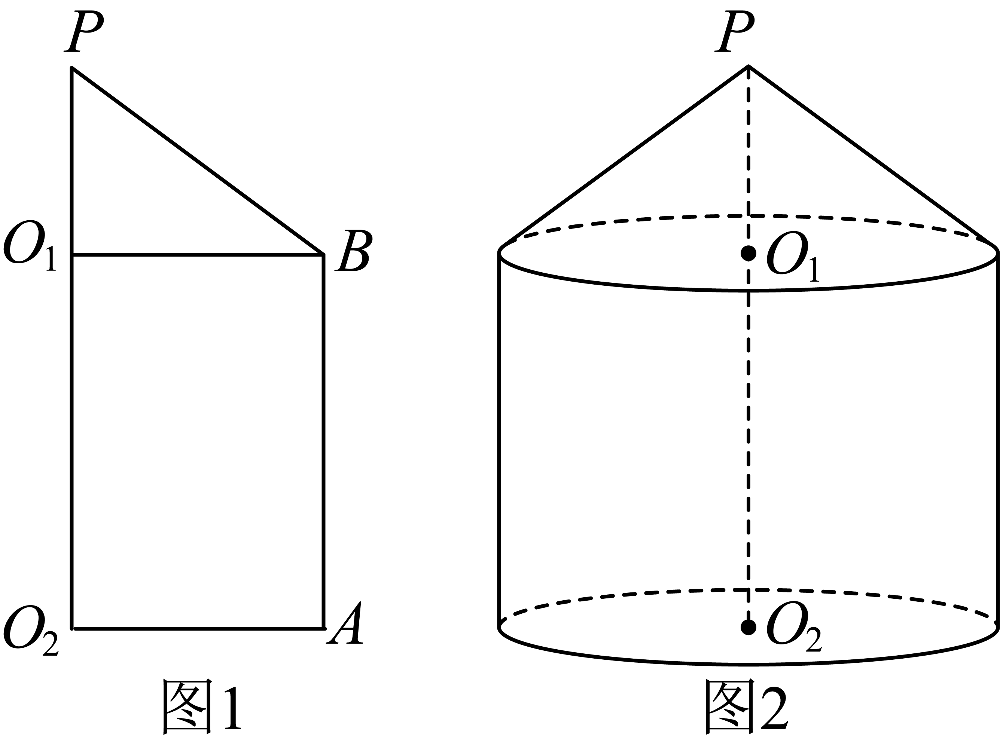

# Mathematics - 题目 3632

**ID**: 6460e639ba704fc6af584b9dd50a7b84
**年级**: Grade 10
**难度**: Medium
**题型**: Calculation

## 题目
如图1，在直角梯形 $PO{{}_{2}}AB$ 中， $AO{{}_{2}}\bot PO{{}_{2}}$ ， $BO{{}_{1}}\bot PO{{}_{1}}$ ．以直角梯形 $PO{{}_{2}}AB$ 的下底 $PO{{}_{2}}$ 所在的直线为旋转轴，其余三边旋转一周形成如图2所示的几何体 ${\rm{Ω}}$ （ ${\rm{Ω}}$ 由圆锥 $PO{{}_{1}}$ 和圆柱 $O{{}_{1}}O{{}_{2}}$ 组合而成），且该几何体 ${\rm{Ω}}$ 内接于半径为 $5$ 的球 $O$ （点 $P$ 和圆柱 $O{{}_{1}}O{{}_{2}}$ 的上下底面圆周均在球 $O$ 的球面上）．（1）若 $AO{{}_{2}}=4$ ，求几何体 ${\rm{Ω}}$ 的体积；​​​​​​​‌（2）若 $PO{{}_{1}}:O{{}_{1}}O{{}_{2}}=1:2$ ，求几何体 ${\rm{Ω}}$ 的表面积；（3）当 $AB$ 为何值时，圆柱 $O{{}_{1}}O{{}_{2}}$ 的侧面积最大．

## 解答

1. （1）如图，设球心为 $O$ ，由题知 $O$ 为 $O{{}_{1}}O{{}_{2}}$ 的中点，且 $OA=OB=OP=R$ （其中 $R$ 为外接球的半径），
2. 又球 $O$ 半径为 $5$ ， $AO{{}_{2}}=4$ ，则 $OO{{}_{2}}=\sqrt {OA{^{2}}-O{{}_{2}}A{^{2}}}=\sqrt {5{^{2}}-4{^{2}}}=3$ ，
3. 所以 $O{{}_{1}}O{{}_{2}}=6,PO{{}_{1}}=5-3=2$ ，则圆柱 $O{{}_{1}}O{{}_{2}}$ 的体积为 $V{{}_{1}}={\rm{π}}\times 4{^{2}}\times 6=96{\rm{π}}$ ，圆锥 $PO{{}_{1}}$ 的体积为 $V{{}_{2}}=\frac {1}{3}{\rm{π}}\times 4{^{2}}\times 2=\frac {32{\rm{π}}}{3}$ ，
4. 则几何体 ${\rm{Ω}}$ 的体积 $V=V{{}_{1}}+V{{}_{2}}=96{\rm{π}}+\frac {32{\rm{π}}}{3}=\frac {{{3}}{{2}}{{0}}{\rm{π}}}{3}$ .
5. 
6. （2）因为 $PO{{}_{1}}:O{{}_{1}}O{{}_{2}}=1:2$ ，不妨设 $PO{{}_{1}}=a,O{{}_{1}}O{{}_{2}}=2a$ ，
7. 由题知 $OP=2a=5$ ，得到 $a=\frac {5}{2}$ ，
8. 则 $AO{{}_{2}}=\sqrt {OA{^{2}}-O{{}_{2}}A{^{2}}}=\sqrt {5{^{2}}-{\left({\frac {5}{2}}\right)^{2}}}=\frac {5\sqrt {3}}{2}$ ，又 $O{{}_{1}}B=O{{}_{2}}A=\frac {5\sqrt {3}}{2}$ ，则 $PB=\sqrt {O{{}_{1}}P{^{2}}+O{{}_{1}}B{^{2}}}=\sqrt {\frac {25}{4}+\frac {75}{4}}=5$ ，
9. 所以圆柱 $O{{}_{1}}O{{}_{2}}$ 的表面积为 $S{{}_{1}}={\rm{π}}O{{}_{2}}A{^{2}}+2{\rm{π}}O{{}_{2}}A·O{{}_{1}}O{{}_{2}}={\rm{π}}\times \frac {75}{4}+2{\rm{π}}\times \frac {5\sqrt {3}}{2}\times 5=25\sqrt {3}{\rm{π}}+\frac {75{\rm{π}}}{4}$ ，
10. 圆锥 $PO{{}_{1}}$ 的表面积为 $S{{}_{2}}={\rm{π}}O{{}_{1}}B·PB={\rm{π}}\times \frac {5\sqrt {3}}{2}\times 5=\frac {25\sqrt {3}{\rm{π}}}{2}$ ，
11. 所以几何体 ${\rm{Ω}}$ 的表面积为 $S=S{{}_{1}}+S{{}_{2}}=\frac {75\sqrt {3}{\rm{π}}}{2}+\frac {{{7}}{{5}}{\rm{π}}}{4}=\frac {75\left ({2\sqrt {3}+1}\right ){\rm{π}}}{4}$ .
12. （3）设 $AB=x$ ，则 $O{{}_{2}}A=\sqrt {25-\frac {x{^{2}}}{4}}$ ，
13. 则圆柱 $O{{}_{1}}O{{}_{2}}$ 的侧面积为 $S{{}_{3}}=2{\rm{π}}O{{}_{2}}A\cdot AB=2{\rm{π}}x\sqrt {25-\frac {x{^{2}}}{4}}={\rm{π}}x\sqrt {100-x{^{2}}}\leqslant {\rm{π}}\times \frac {x{^{2}}+100-x{^{2}}}{2}=50{\rm{π}}$ ，
14. 当且仅当 $x{^{2}}=100-x{^{2}}$ ，即 $x=5\sqrt {2}$ 时取等号，即当 $x=5\sqrt {2}$ 时，圆柱 $O{{}_{1}}O{{}_{2}}$ 的侧面积最大.

## 知识点

**中文**:
  - 简单组合体的表面积与体积

**English**:
  - Area and Volume of Composite Solids

---
