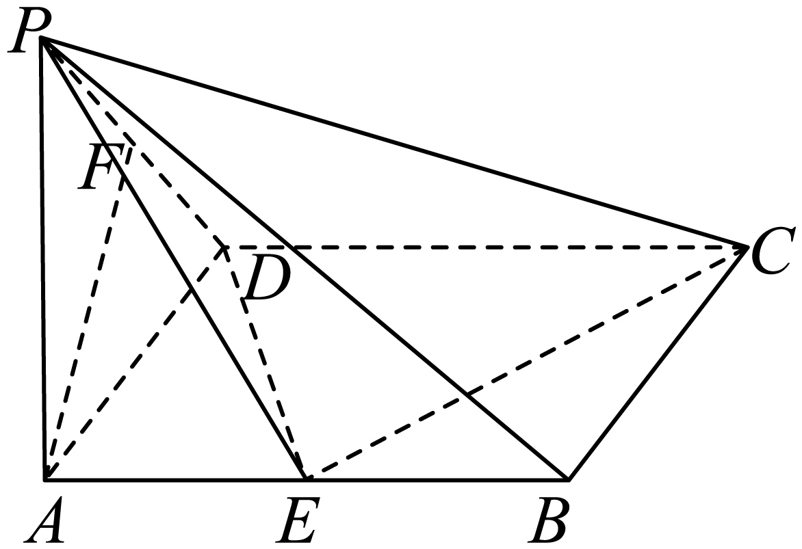

# Mathematics - 题目 2095

**ID**: 67b34fa3015c466f998f1b3c590bda16
**年级**: Grade 10
**难度**: Medium
**题型**: Calculation

## 题目
已知在四棱锥  $P-ABCD$ 中，底面 $ABCD$ 是矩形， $PA\bot $ 平面 $ABCD$ ， $E、F$ 分别是 $AB、PD$ 的中点，且 $PA=AD=2,AB=4$   $.​​​​​​​‌$（1）求证:  $AF\bot $ 平面 $PDC$（2）求点A到平面 $PED$ 的距离.（3）求平面 $PCE$ 与平面 $PAD$ 所成锐二面角的正弦值.

## 解答

1. （1）由 $PA\bot $ 平面 $ABCD$ ， $CD\subset $ 平面 $ABCD$ ， 所以 $PA\bot CD$ ，
2. 又由底面 $ABCD$ 是矩形，则 $AD\bot CD$ ，
3. 又因为 $AD\cap PA=A,AD,PA\subset $ 平面 $PAD$ ，所以 $CD\bot $ 平面 $PAD$ ，
4. 又因为 $AF\subset $ 平面 $PAD$ ，所以 $CD\bot AF$ ，
5. 又由 $F$ 为 $PD$ 的中点，所以 $AF\bot PD$ ，
6. 又因为 $PD\cap CD=D,PD,CD\subset $ 平面 $PCD$ ，所以 $AF\bot $ 平面 $PCD$ ；
7. （2）
8. 
9. 连接 $EF$ ，由 $CD\bot $ 平面 $PAD$ ， $PD\subset $ 平面 $PAD$ ，所以 $CD\bot PD$ ，
10. 又因为 $CD//AB$ ，所以 $PD\bot AB$ ，
11. 又因为 $PD\bot AF$ ， $AB\cap AF=A,AB,AF\subset $ 平面 $AEF$ ，所以 $PD\bot $ 平面 $AEF$ ，
12. 又因为 $EF\subset $ 平面 $AEF$ ，所以 $PD\bot EF$ ，
13. 因为 $PA=AD=2,AB=4$ ，所以 $PD=2\sqrt {2},AF=\sqrt {2},$
14. 又因为 $E$ 是 $AB$ 中点，所以 $AE=2,EF=\sqrt {6}$ ，
15. 则 $S{{}_{\vartriangle PDE}}=\frac {1}{2}\times 2\sqrt {2}\times \sqrt {6}=2\sqrt {3}$ ， $V{{}_{P-ADE}}=\frac {1}{3}\times \frac {1}{2}\times 2\times 2\times 2=\frac {4}{3}$ ，
16. 由等体积法可得点A到平面 $PED$ 的距离 $d$ 满足：
17. $V{{}_{P-ADE}}=\frac {4}{3}{\rm{=}}\frac {1}{3}S{{}_{\vartriangle PDE}}d=\frac {1}{3}\times 2\sqrt {3}d\Rightarrow d=\frac {2\sqrt {3}}{3}$ ；
18. （3）
19. 
20. 延长 $CE,DA$ 相交于点 $N$ ，再过点 $\mathrm{A}$ 作 $PN$ 的垂线，垂足为 $M$ ，连接 $ME$ ，
21. 因为 $CD\bot $ 平面 $PAD$ ， $AB//CD$ ，所以 $AB\bot $ 平面 $PAD$ ，
22. 又因为 $PN\subset $ 平面 $PAD$ ，所以 $AB\bot PN$ ，
23. 又因为 $MA\bot PN$ ， $MA\cap AB=A$ ， $MA,AB\subset $ 平面 $MAB$ ，
24. 所以 $PN\bot $ 平面 $MAB$ ，又因为 $ME\subset $ 平面 $MAB$ ，
25. 即 $PN\bot ME$ ，又由于 $MA\bot PN$ ，
26. 所以平面 $PCE$ 与平面 $PAD$ 所成锐二面角的平面角就是 $\mathrm{∠}AME$ ，
27. 因为 $PA=AD=2,AB=4$ ， $E$ 分别是 $AB$ 的中点，
28. 所以 $NA=AB=2$ ,即 $AM=\sqrt {2}$ ，
29. 所以 $\sin \angle AME=\frac {AE}{ME}=\frac {2}{\sqrt {4+2}}=\frac {\sqrt {6}}{3}$ ，
30. 平面 $PCE$ 与平面 $PAD$ 所成锐二面角的正弦值为 $\frac {\sqrt {6}}{3}$ .

## 知识点

**中文**:
  - 二面角
  - 直线与平面垂直的判定
  - 点与面之间的距离

**English**:
  - Dihedral Angle
  - Line-Plane Perpendicularity Determination
  - Point-Plane Distance

---
