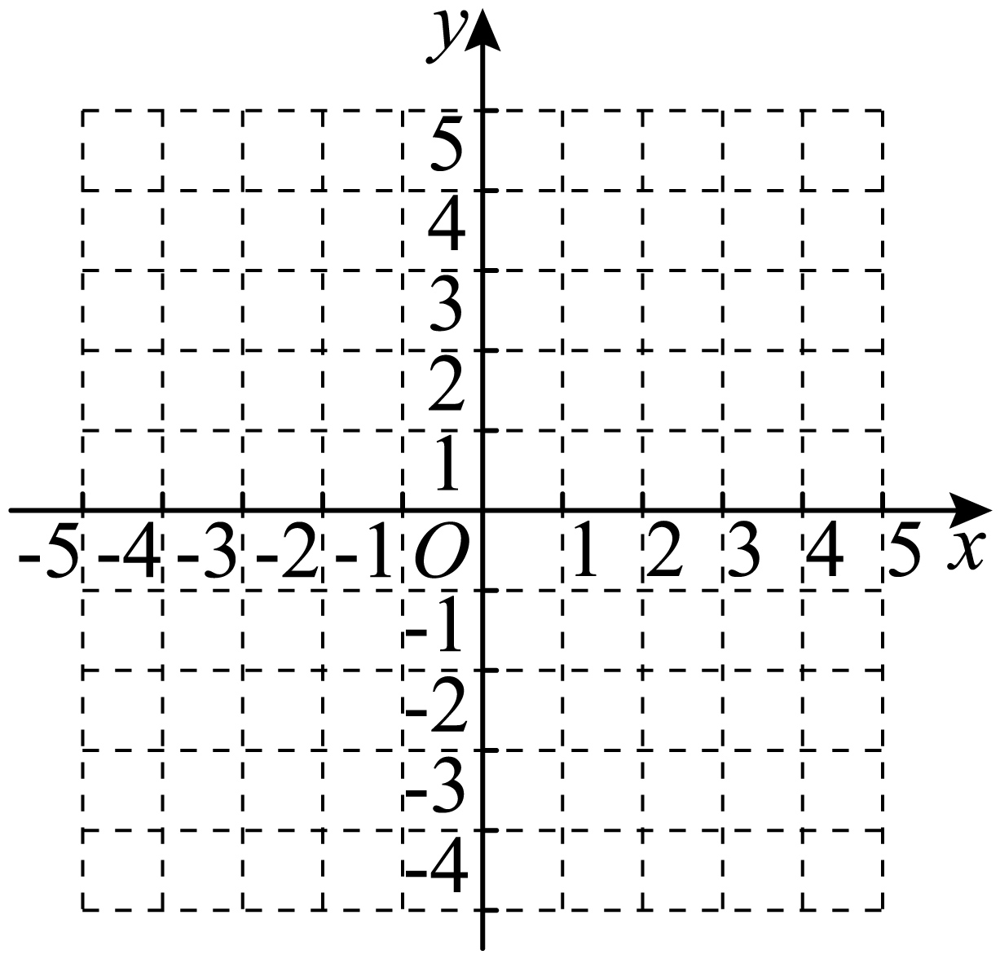

# Mathematics - 题目 655

**ID**: 77c440f0ac7e42af877194c9175b65a6
**年级**: Grade 10
**难度**: Medium
**题型**: Calculation

## 题目
已知函数 $f\left ({x}\right )=x{^{2}}，g\left ({x}\right )=-x+2，x\in {\mathbf{R}}．\forall x\in {\mathbf{R}}$ ，用 $m\left ({x}\right )$ 表示 $f\left ({x}\right )，g\left ({x}\right )$ 中的较小者，记为 $m\left ({x}\right )={\rm{m}}{\rm{i}}{\rm{n}}\left \{f\left ({x}\right )，g\left ({x}\right )\right \}$ ．（1）在给定的坐标系中，画出函数 $m\left ({x}\right )$ 的图象；​​​​​​​‌（2）结合图象写出函数 $m\left ({x}\right )$ 的解析式，并求出 $m\left ({m\left ({-2}\right )}\right )$ 的值（3）根据图象写出函数 $m\left ({x}\right )$ 的单调区间及在每一个单调区间上的单调性．

## 解答

1. （1）由题 $\begin{cases}y=x{^{2}}\\y=-x+2\end{cases}$ ，解得 $\begin{cases}x=1\\y=1\end{cases}$ 或 $\begin{cases}x=-2\\y=4\end{cases}$ ，
2. 画出 $y=x{^{2}}$ ， $y=-x+2$ 的图象如下图所示，
3. 
4. 因为 $m\left ({x}\right )$ 表示 $f\left ({x}\right )$ ， $g\left ({x}\right )$ 中的较小者，所以函数 $m\left ({x}\right )$ 的图象如下图所示：
5. 
6. （2）由（1）可得当 $x\leqslant -2$ 时， $m\left ({x}\right )=-x+2$ ，
7. 当 $-2<x<1$ 时， $m\left ({x}\right )=x{^{2}}$ ，
8. 当 $x\geqslant 1$ 时， $m\left ({x}\right )=-x+2$ ，
9. 综上可得 $m\left ({x}\right )=\begin{cases}-x+2&x\leqslant -2\\x{^{2}}&-2<x<1\\-x+2&x\geqslant 1\end{cases}$
10. 所以 $m\left ({-2}\right )=4$ ，所以 $m\left ({4}\right )=-4+2=-2$ ，故 $m\left ({m\left ({-2}\right )}\right )=-2$ .
11. （3）由（1）可得函数 $m\left ({x}\right )$ 在区间 $\left ({-\infty ,-2}\right ]$ ， $\left ({-2,0}\right )$ ， $\left ({0,1}\right )$ ， $\left [{1,+\infty }\right )$ 上具有单调性；
12. 单调递增区间为： $\left ({0,1}\right )$ ；
13. 单调递减区间为： $\left ({-\infty ,-2}\right ]$ ， $\left ({-2,0}\right )$ ， $\left [{1,+\infty }\right )$ .

## 知识点

**中文**:
  - 函数新定义问题

**English**:
  - New Definition Problems in Functions

---
