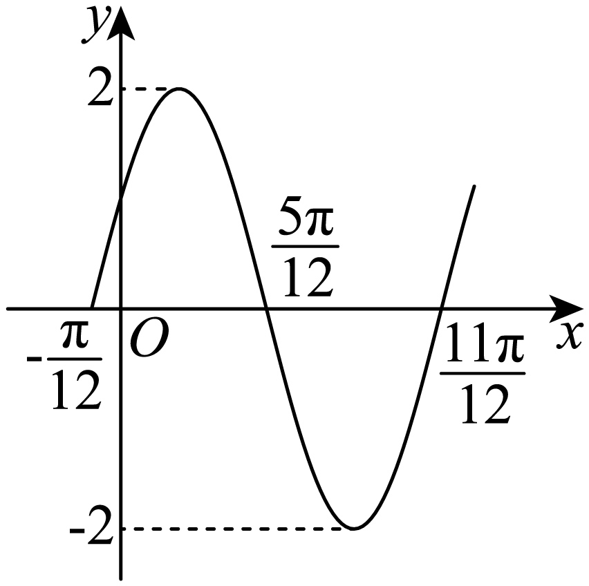

# Mathematics - 题目 2741

**ID**: 8d8a3839b091454d910624bfabfda55d
**年级**: Grade 10
**难度**: Medium
**题型**: Calculation

## 题目
函数 $f\left ({x}\right )=A{\rm{s}}{\rm{i}}{\rm{n}}\left ({ωx+φ}\right )(A>0,ω>0,\left |{φ}\right |<\frac {{\rm{π}}}{2})$ 的部分图象如图所示．（1）求函数 $y=f\left ({x}\right )$ 的解析式，并求出 $f\left ({x}\right )$ 的单调减区间；​​​​​​​‌（2）将函数 $y=f\left ({x}\right )$ 的图象向右平移 $\frac {{\rm{π}}}{12}$ 个单位，得到函数 $y=g\left ({x}\right )$ 的图象，若关于 $x$ 的方程 $k-g\left ({x}\right )=1$ 在 $x\in \left [0{\rm{,}}\frac {{\rm{π}}}{4}\right ]$ 上有解，求实数 $k$ 的取值范围．

## 解答

1. （1）解：由函数 $f\left ({x}\right )$ 的图象，可得 $A=2$ ，且函数 $f\left ({x}\right )$ 的周期为 $T=\frac {11{\rm{π}}}{12}-(-\frac {{\rm{π}}}{12})={\rm{π}}$ ，
2. 所以 $ω=\frac {2{\rm{π}}}{T}=2$ ，即 $f\left ({x}\right )=2{\rm{s}}{\rm{i}}{\rm{n}}\left ({2x+φ}\right )$ ，
3. 又由 $f(-\frac {{\rm{π}}}{12})=2{\rm{s}}{\rm{i}}{\rm{n}}{\rm{(}}-\frac {{\rm{π}}}{6}+φ{\rm{)}}={{0}}$ ，即 ${\rm{s}}{\rm{i}}{\rm{n}}{\rm{(}}-\frac {{\rm{π}}}{6}+φ{\rm{)}}={{0}}$ ，
4. 根据五点对应法，可得 $-\frac {{\rm{π}}}{6}+φ=2k{\rm{π}},k\in {\rm Z}$ ，即 $φ=\frac {{\rm{π}}}{6}+2k{\rm{π}},k\in {\rm Z}$ ，
5. 因为 $\left |{φ}\right |<\frac {π}{2}$ ，所以 $φ=\frac {{\rm{π}}}{6}$ ，所以 $f\left ({x}\right )=2{\rm{s}}{\rm{i}}{\rm{n}}(2x+\frac {{\rm{π}}}{6})$ ，
6. 令 $\frac {{\rm{π}}}{2}+2k{\rm{π}}\leqslant 2x+\frac {{\rm{π}}}{6}\leqslant \frac {{{3}}{\rm{π}}}{2}+2k{\rm{π}},k\in {\rm Z}$ ，解得 $\frac {{\rm{π}}}{6}+k{\rm{π}}\leqslant x\leqslant \frac {{{2}}{\rm{π}}}{3}+k{\rm{π}},k\in {\rm Z}$ ，
7. 所以函数 $f\left ({x}\right )$ 的单调递减区间为 $\left [\frac {{\rm{π}}}{6}+k{\rm{π}},\frac {{{2}}{\rm{π}}}{3}+k{\rm{π}}\right ],k\in {\rm Z}$ .
8. （2）解：将函数 $y=f\left ({x}\right )$ 的图象向右平移 $\frac {{\rm{π}}}{12}$ 个单位，
9. 得到函数 $g\left ({x}\right )=2\sin [2(x-\frac {{\rm{π}}}{12})+\frac {{\rm{π}}}{6}]=2\sin 2x$ ，
10. 关于 $x$ 的方程 $k-g\left ({x}\right )=1$ 在 $x\in \left [0{\rm{,}}\frac {{\rm{π}}}{4}\right ]$ 上有解，即 $k-1=g\left ({x}\right )$ 在 $x\in \left [0{\rm{,}}\frac {{\rm{π}}}{4}\right ]$ 上有解，
11. 即函数 $y=k-1$ 和 $y=g\left ({x}\right )$ 的图象在 $x\in \left [0{\rm{,}}\frac {{\rm{π}}}{4}\right ]$ 上有公共点，
12. 因为 $x\in \left [0{\rm{,}}\frac {{\rm{π}}}{4}\right ]$ ，可得 $2x\in \left [0{\rm{,}}\frac {{\rm{π}}}{2}\right ]$ ，
13. 当 $x=0$ 时，可得 $g\left ({x}\right ){{}_{{\rm \min }}}=0$ ；当 $2x=\frac {{\rm{π}}}{2}$ 时，即 $x=\frac {{\rm{π}}}{4}$ 时，可得 $g\left ({x}\right ){{}_{{\rm \max }}}=2$ ，
14. 所以函数 $y=g\left ({x}\right )$ 的值域为 $[0,2]$ ，所以 $0\leqslant k-1\leqslant 2$ ，解得 $1\leqslant k\leqslant 3$ ，
15. 所以实数 $k$ 的取值范围 $\left [1,3\right ]$

## 知识点

**中文**:
  - 三角函数的图象变换
  - 函数y=Asin（ωx＋φ）的图象和性质

**English**:
  - Transformation of Trigonometric Graphs
  - Graph and Properties of y=Asin(ωx+φ)

---
