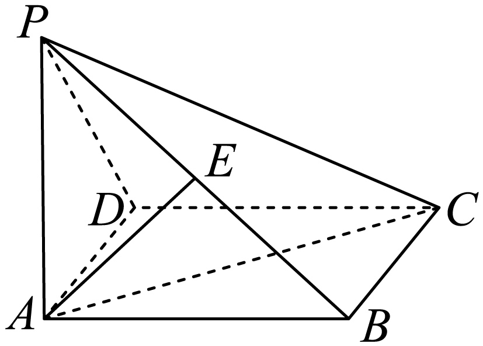

# Mathematics - 题目 2659

**ID**: 9d33f83a7552464d90f16894eac1f048
**年级**: Grade 10
**难度**: Medium
**题型**: Calculation

## 题目
如图，在四棱锥 $P-ABCD$ 中，底面 $ABCD$ 为正方形， $PA\bot $ 底面 $ABCD$ ， $PA=AB{\rm ，\mathit{E}}$ 为线段 $PB$ 的中点．（1）证明： $AE\bot $ 平面 $PBC$ ；​​​​​​​‌（2）求 $AC$ 与平面 $PBC$ 所成角的大小．

## 解答

1. （1）因为 $PA=AB{\rm ，\mathit{E}}$ 为线段 $PB$ 的中点，所以 $AE\bot PB$ ，
2. 又 $PA\bot $ 底面 $ABCD$ ，底面 $ABCD$ 为正方形，
3. 所以 $BC\bot AB$ ， $BC\bot PA$ ， $AB\cap PA=A$ ，
4. 又 $AB$ ， $PA\subset $ 平面 $PAB$ ，所以 $BC\bot $ 平面 $PAB$ ，
5. 又 $AE\subset $ 平面 $PAB$ ，所以 $AE\bot BC$ ， $PB\cap BC=B$ ， $PB,BC\subset $ 平面 $PBC$ ，
6. 所以 $AE\bot $ 平面 $PBC$ ；
7. （2）由（1）知， $AE\bot $ 平面 $PBC$ ，
8. 所以 $∠ACE$ 为直线 $AC$ 与平面 $PBC$ 所成的角，
9. 设 $PA=AB=BC=2$ ，则 $AC=2\sqrt {2}$ ， $AE=\sqrt {2}$ ，
10. 在直角三角形 $AEC$ 中， $\sin \angle ACE=\frac {AE}{AC}=\frac {\sqrt {2}}{2\sqrt {2}}=\frac {1}{2}$ ，
11. 所以直线 $AC$ 与平面 $PBC$ 所成角为 $30\degree $ .

## 知识点

**中文**:
  - 直线与平面垂直的判定
  - 直线与平面所成的角

**English**:
  - Line-Plane Perpendicularity Determination
  - Line-Plane Angle

---
