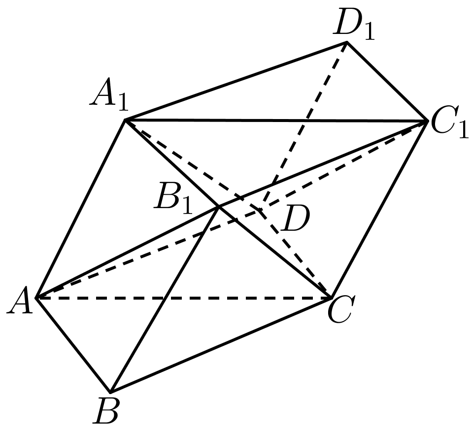

# Mathematics - 题目 3819

**ID**: a66a446c5379456f914a0c0acf433188
**年级**: Grade 10
**难度**: Medium
**题型**: Calculation

## 题目
如图所示，已知四棱柱 $ABCD-A{{}_{1}}B{{}_{1}}C{{}_{1}}D{{}_{1}}$ 的底面 $ABCD$ 为菱形.​​​​​​​‌（1）证明：平面 $AB{{}_{1}}C//$ 平面 $A{{}_{1}}C{{}_{1}}D$ ；（2）在直线 $CC{{}_{1}}$ 上是否存在点 $P$ ，使 $BP//$ 平面 $A{{}_{1}}C{{}_{1}}D$ ？若存在，确定点 $P$ 的位置；若不存在，说明理由.

## 解答

1. （1）由棱柱 $ABCD-A{{}_{1}}B{{}_{1}}C{{}_{1}}D{{}_{1}}$ 的性质可知， $AB{{}_{1}}//DC{{}_{1}}$ ，
2. ∵ $AB{{}_{1}}\not\subset $ 平面 $DA{{}_{1}}C{{}_{1}}$ ， $DC{{}_{1}}\subset $ 平面 $A{{}_{1}}C{{}_{1}}D$ ，
3. ∴ $AB{{}_{1}}//$ 平面 $A{{}_{1}}C{{}_{1}}D$ ，
4. 同理可证 $B{{}_{1}}C//$ 平面 $A{{}_{1}}C{{}_{1}}D$ ，而 $AB{{}_{1}}\cap B{{}_{1}}C=B{{}_{1}}$ ， $AB{{}_{1}}、B{{}_{1}}C\subset $ 平面 $AB{{}_{1}}C$ ，
5. ∴平面 $AB{{}_{1}}C//$ 平面 $A{{}_{1}}C{{}_{1}}D$ ；
6. （2）存在这样的点 $P$ ，使 $BP//$ 平面 $A{{}_{1}}C{{}_{1}}D$ ，
7. ∵ $A{{}_{1}}B{{}_{1}}//CD,A{{}_{1}}B{{}_{1}}=CD$ ，
8. ∴四边形 $A{{}_{1}}B{{}_{1}}CD$ 为平行四边形，
9. ∴ $A{{}_{1}}D//B{{}_{1}}C$ ，
10. 如图所示：
11. 
12. 在 $C{{}_{1}}C$ 的延长线上取点 $P$ ，使 $C{{}_{1}}C=CP$ ，连接 $BP$ ，
13. ∵ $B{{}_{1}}B//C{{}_{1}}C$ ， $B{{}_{1}}B$ = $C{{}_{1}}C$ ，
14. ∴ $B{{}_{1}}B//C{{}_{1}}P,B{{}_{1}}B=C{{}_{1}}P$ ，
15. ∴四边形 $BB{{}_{1}}CP$ 为平行四边形，
16. 则 $BP//B{{}_{1}}C,BP=B{{}_{1}}C$ ，
17. ∴ $BP//A{{}_{1}}D$ ，又 $BP\not\subset $ 平面 $A{{}_{1}}C{{}_{1}}D$  $A{{}_{1}}D\subset $ 平面 $A{{}_{1}}C{{}_{1}}D$ ，
18. ∴ $BP//$ 平面 $A{{}_{1}}C{{}_{1}}D$ .

## 知识点

**中文**:
  - 平面与平面平行的判定
  - 探究性问题

**English**:
  - Plane-Plane Parallelism Determination
  - Inquiry Problems

---
