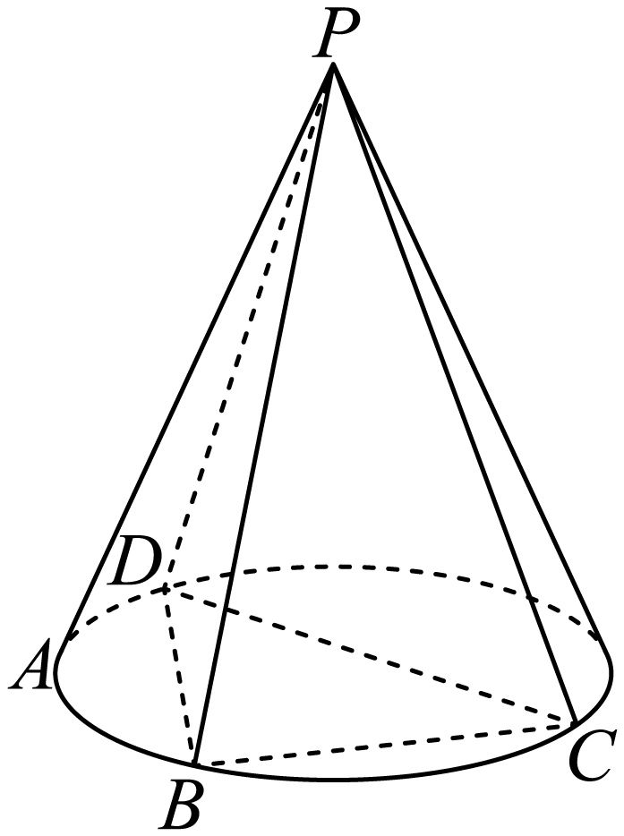

# Mathematics - 题目 3267

**ID**: af2f371e10544653bff307ecea584b54
**年级**: Grade 10
**难度**: Medium
**题型**: Calculation

## 题目
如图， $\mathrm{△}BCD$ 是圆锥底面圆的内接三角形， $BD=4$ ， ${\rm{c}}{\rm{o}}{\rm{s}}\angle BCD=\frac {\sqrt {6}}{3}$ ， $PA$ 为圆锥的母线，且圆锥的侧面展开图是一个半圆.​​​​​​​‌（1）求圆锥的外接球的表面积；（2）求三棱锥 $P-BCD$ 体积的最大值；（3）用平行于底面的平面截去圆锥的上半部分，若剩下的圆台有内切球，求圆台的体积.

## 解答

1. （1）设底面圆心为 $O$ ，半径为 $r{{}_{1}}$ ， ${\rm{c}}{\rm{o}}{\rm{s}}\angle BCD=\frac {\sqrt {6}}{3}$ ，所以 ${\rm{s}}{\rm{i}}{\rm{n}}\angle BCD=\frac {\sqrt {3}}{3}$
2. 由正弦定理可知 $2r{{}_{1}}=\frac {4}{\frac {\sqrt {3}}{3}}=4\sqrt {3}$ ， $r{{}_{1}}=2\sqrt {3}$ ，
3. 又圆锥的侧面展开图是半圆，所以 $2{\rm{π}}r{{}_{1}}={\rm{π}}\cdot PA$ ，所以 $PA=4\sqrt {3}$ ，所以圆锥的高 $h=6$
4. 设圆锥外接球的半径为 $R$ ，则 $(6-R){^{2}}+12=R{^{2}}$ ，解得 $R=4$ ，
5. 所以外接球的表面积为 $64{\rm{π}}$
6. （2）过圆心 $O$ 作弦 $BD$ 的垂线，垂足为 $E$ ，则 $OE=\sqrt {12-4}=2\sqrt {2}$ ，
7. 
8. 那么底面 $\mathrm{△}BCD$ 面积的最大值为 $\frac {1}{2}\times \left ({2\sqrt {3}+2\sqrt {2}}\right )\times 4=4\left ({\sqrt {3}+\sqrt {2}}\right )$ ，
9. 所以三棱锥 $P-BCD$ 的最大值为 $\frac {1}{3}\times 6\times 4\left ({\sqrt {3}+\sqrt {2}}\right )=8\left ({\sqrt {3}+\sqrt {2}}\right )$
10. （3）设圆台的上底面半径为 $r{{}_{2}}$ ，内切球的半径为 $r$ ，
11. 由图根据三角形相似可知 $\frac {r{{}_{2}}}{2\sqrt {3}}=\frac {4\sqrt {3}-\left ({2\sqrt {3}+r{{}_{2}}}\right )}{4\sqrt {3}}$ ，
12. 
13. 解得 $r{{}_{2}}=\frac {2\sqrt {3}}{3}$ ， $r=2$ ，
14. 所以圆台的体积为 $V=\frac {1}{3}\times 4\times \left ({\frac {{{4}}}{{{3}}}{\rm{π}}{{+}}{{1}}{{2}}{\rm{π}}{{+}}{{4}}{\rm{π}}}\right )=\frac {208}{9}{\rm{π}}$

## 知识点

**中文**:
  - 圆柱、圆锥、圆台的体积
  - 棱柱、棱锥、棱台的体积
  - 球的表面积
  - 球的切接问题

**English**:
  - Volume of Revolving Solids
  - Volume of Polyhedra
  - Surface Area of a Sphere
  - Tangency and Inscribed/Circumscribed Spheres

---
