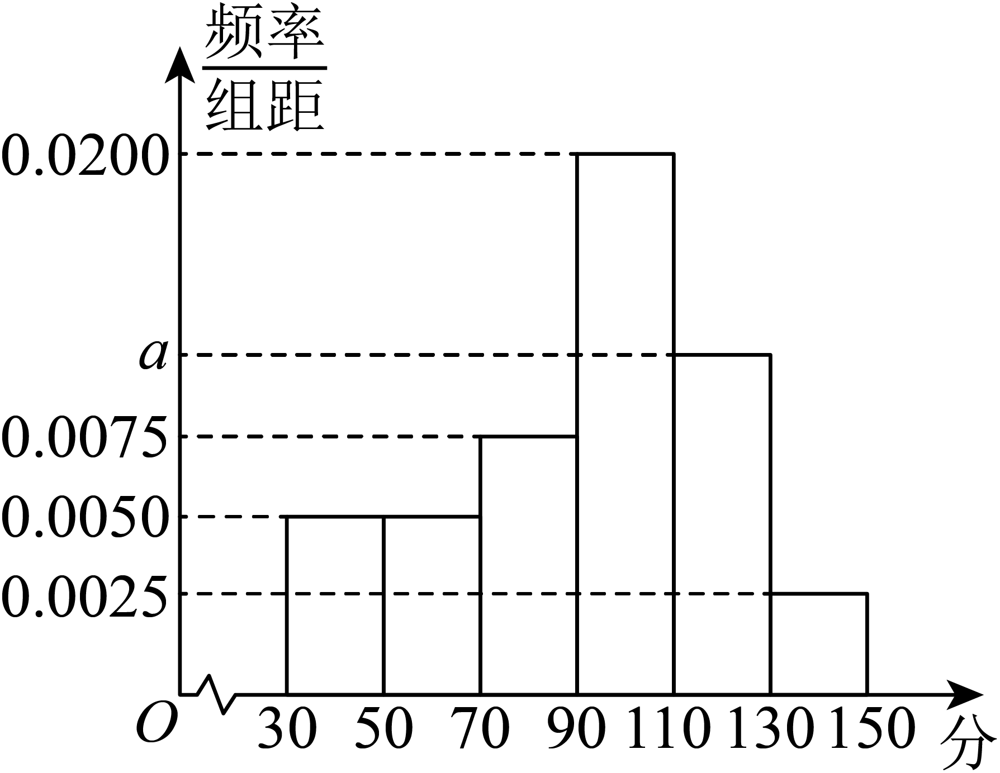

# Mathematics - 题目 3624

**ID**: c60588f2a0e1489d838066232525361e
**年级**: Grade 10
**难度**: Medium
**题型**: Calculation

## 题目
某校对2022年高一上学期期中数学考试成绩（单位：分）进行分析，随机抽取100名学生，将分数按照 $\left [{30,50}\right )$ ， $\left [{50,70}\right )$ ， $\left [{70,90}\right )$ ， $\left [{90,110}\right )$ ， $\left [{110,130}\right )$ ， $\left [130,150\right ]$ 分成6组，制成了如图所示的频率分布直方图：请完成以下问题：（1）估计该校高一期中数学考试成绩的平均数；（2）为了进一步了解学生对数学学习的情况，由频率分布直方图，成绩在 $\left [{50,70}\right )$ 和 $\left [{70,90}\right )$ 的两组中，用按比例分配的分层随机抽样的方法抽取5名学生，再从这5名学生中随机抽取2名学生进行问卷调查，求抽取的这2名学生至少有1人成绩在 $\left [{50,70}\right )$ 内的概率.​​​​​​​‌

## 解答

1. （1）由 $0.005\times 20+0.005\times 20+0.0075\times 20+0.02\times 20+a\times 20+0.0025\times 20=1$ ，
2. 得 $a{\rm{=}}{{0}}{{.}}{{0}}{{1}}$ .
3. 数学成绩在：
4. $\left [{30,50}\right )$ 频率 $0.0050\times 20=0.1$ ，
5. $\left [{50,70}\right )$ 频率 $0.0050\times 20=0.1$ ，
6. $\left [{70,90}\right )$ 频率 $0.0075\times 20=0.15$ ，
7. $\left [{90,110}\right )$ 频率 $0.0200\times 20=0.4$ ，
8. $\left [{110,130}\right )$ 频率 $0.0100\times 20=0.2$ ，
9. $\left [130,150\right ]$ 频率 $0.0025\times 20=0.05$ ，
10. 样本平均值为： $40\times 0.1+60\times 0.1+80\times 0.15+100\times 0.4+120\times 0.2+140\times 0.05=93$
11. 可以估计样本数据中数学成绩均值为93分，
12. 据此可以估计该校高一下学期期中数学考试成绩估计93分．
13. （2）由题意可知，分数段 $\left [{50,70}\right )$ 的人数为 $100\times 0.1=10$ （人），
14. 分数段 $\left [{70,90}\right )$ 的人数为 $100\times 0.15=15$ （人）.
15. 用按比例分配的分层随机抽样的方法抽取5名学生，
16. 则需在分数段 $\left [{50,70}\right )$ 内抽2人，分别记为 $A{{}_{1}},A{{}_{2}}$ ，
17. 需在分数段 $\left [{70,90}\right )$ 内抽3人，分别记为 $B{{}_{1}},B{{}_{2}},B{{}_{3}}$ .
18. 设“从样本中任取2人，至少有1人在分数段 $\left [{50,70}\right )$ 内”为事件 A，
19. 则样本空间 $Ω=\left \{A{{}_{1}}A{{}_{2}},A{{}_{1}}B{{}_{1}},A{{}_{1}}B{{}_{2}},A{{}_{1}}B{{}_{3}},A{{}_{2}}B{{}_{1}},A{{}_{2}}B{{}_{2}},A{{}_{2}}B{{}_{3}},B{{}_{1}}B{{}_{2}},B{{}_{1}}B{{}_{3}},B{{}_{2}}B{{}_{3}}\right \}$ 共包含10个样本点而A的对立事件 $\bar A=\left \{B{{}_{1}}B{{}_{2}},B{{}_{1}}B{{}_{3}},B{{}_{2}}B{{}_{3}}\right \}$ 包含3个样本点，
20. 所以 $P(\bar A)=\frac {3}{10}{\rm{,}}\therefore P(A)=1-P(\bar A)=\frac {7}{10}$ ．
21. 即抽取的这2名学生至少有1人在 $\left [{50,70}\right )$ 内的概率为 $\frac {7}{10}$

## 知识点

**中文**:
  - 分层抽样步骤中的相关运算
  - 对立事件
  - 古典概型的概率计算
  - 频率分布直方图
  - 平均数

**English**:
  - Calculations in Steps
  - Complementary Events
  - Calculation of Classical Probability
  - Frequency Distribution Histogram
  - Mean

---
