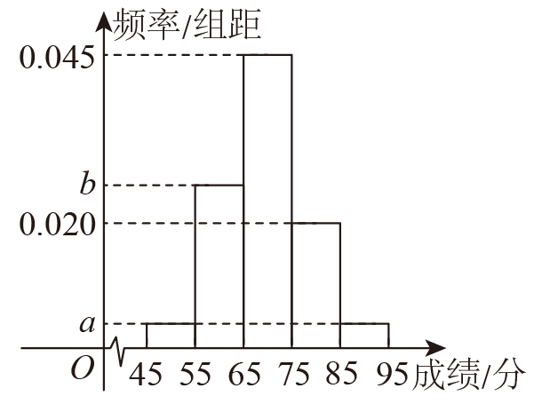

# Mathematics - 题目 2844

**ID**: ecb0971c190a4f3e83ea0048cd138964
**年级**: Grade 10
**难度**: Medium
**题型**: Calculation

## 题目
2023年10月22日，汉江生态城2023襄阳马拉松在湖北省襄阳市成功举行，志愿者的服务工作是马拉松成功举办的重要保障，襄阳市新时代文明实践中心承办了志愿者选拔的面试工作．现随机抽取了100名候选者的面试成绩，并分成五组：第一组 $\left [{45,55}\right )$ ，第二组 $\left [{55,65}\right )$ ，第三组 $\left [{65,75}\right )$ ，第四组 $\left [{75,85}\right )$ ，第五组 $\left [85,95\right ]$ ，绘制成如图所示的频率分布直方图．已知第一、二组的频率之和为0.​​​​​​​‌3，第一组和第五组的频率相同．（1）估计这100名候选者面试成绩的平均数和第25百分位数；（2）在这100名候选者用分层随机抽样的方法从第四组和第五组面试者内抽取10人，再从这10名面试者中随机抽取两名，求两名面试者成绩都在第五组的概率．（3）现从以上各组中用分层随机抽样的方法选取20人，担任本市的宣传者．若本市宣传者中第二组面试者的面试成绩的平均数和方差分别为62和40，第四组面试者的面试成绩的平均数和方差分别为80和70，据此估计这次第二组和第四组所有面试者的面试成绩的方差．

## 解答

1. （1）由题意可知： $\begin{cases}10a+10b=0.3\\10\left ({0.045+0.020+a}\right )=0.7\end{cases}$ ，解得 $\begin{cases}a=0.005\\b=0.025\end{cases}$ ，
2. 可知每组的频率依次为：0.05，0.25，0.45，0.2，0.05，
3. 所以平均数为 $50\times 0.05+60\times 0.25+70\times 0.45+80\times 0.2+90\times 0.05=69.5$ ，
4. 因为 $0.05+0.25=0.3>0.25$ ，
5. 设第25百分位数为 $x$ ，则 $x\in \left [{55,65}\right )$ ，则 $0.05+\left ({x-55}\right )\times 0.025=0.25$ ，解得 $x=63$ ，故第25百分位数为63．
6. （2）10人中，第四组为8人.第五组为2人，记第四组的人的编号为1到8，第五组的人的编号为9和10，
7. 则样本空间 ${\rm{Ω}}=\left \{(1,2),(1,3),(1,4),\cdots (1,10),(2,3),(2,4),\cdots (2,10),(3,4),(3,5),\cdots (3,10),\right.(4,5),$
8. $\left.(4,6),\cdots (4,10),(5,6),\cdots (5,10),(6,7),\cdots (6,10),(7,8),(7,9),(7,10),(8,9),(8,10),(9,10)\right \}$ 共45个样本点，
9. 记两名面试者成绩都在第五组为事件A， 则事件 $A=\left \{(9,10)\right \}$ ，故 $P(A)=\frac {1}{45}$ ；
10. （3）设第二组、第四组面试者的面试成绩的平均数与方差分别为 $\bar x{{}_{1}},\bar x{{}_{2}},s{{}_{1}^{2}},s{{}_{2}^{2}}$ ，
11. 且两组频率之比为 $\frac {0.25}{0.20}=\frac {5}{4}$ ，则第二组和第四组所有面试者的面试成绩的平均数 $\bar x=\frac {5\times 62+4\times 80}{9}=70$ ，
12. 第二组和第四组所有面试者的面试成绩的方差
13. $s{^{2}}=\frac {5}{9}\left [s{{}_{1}^{2}}+{\left({\bar x{{}_{1}}-\bar x}\right)^{2}}\right ]+\frac {4}{9}\left [s{{}_{2}^{2}}+{\left({\bar x{{}_{2}}-\bar x}\right)^{2}}\right ]=\frac {5}{9}\left [40+(62-70){^{2}}\right ]+\frac {4}{9}\left [70+(80-70){^{2}}\right ]=\frac {400}{3}$ ．
14. 故估计第二组和第四组所有面试者的面试成绩的方差是 $\frac {400}{3}$ ．

## 知识点

**中文**:
  - 分层抽样步骤中的相关运算
  - 平均数
  - 百分位数
  - 极差、方差与标准差

**English**:
  - Calculations in Steps
  - Mean
  - Percentile
  - Range, Variance, and Standard Deviation

---
