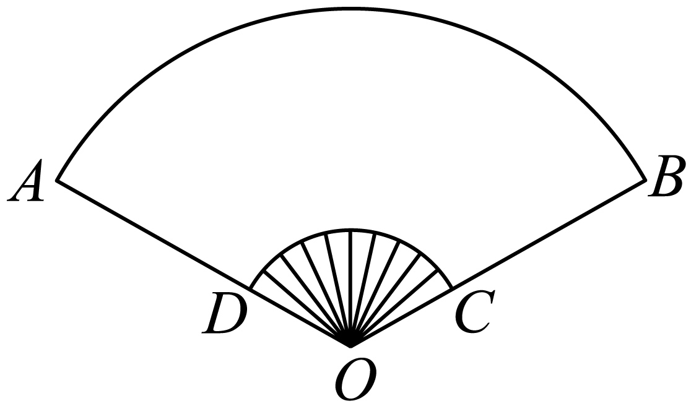

# Mathematics - 题目 2171

**ID**: 1d34e02dda3a4cefb88b59d50b914118
**年级**: Grade 10
**难度**: Medium
**题型**: Fill-in-the-blank

## 题目
如图为某折扇展开后的平面示意图，已知 $AO=3$ ， $OC=1$ ， $\angle AOB=120{^{\circ }}$ ，则 $\left |{\overrightarrow {{AD}}-\overrightarrow {{OC}}}\right |=$．​​​​​​​‌

## 解答

1. 由题意可知 $\left |{\overrightarrow {{AD}}}\right |=\left |{\overrightarrow {{AO}}}\right |-\left |{\overrightarrow {{OC}}}\right |=2$ ， $\overrightarrow {{AD}}$ 与 $\overrightarrow {{OC}}$ 的夹角为 $60{^{\circ }}$ ，
2. 则 $\left |{\overrightarrow {{AD}}-\overrightarrow {{OC}}}\right |=\sqrt {\overrightarrow {{AD}}{^{2}}-2\overrightarrow {{AD}}\cdot \overrightarrow {{OC}}+\overrightarrow {{OC}}{^{2}}}=\sqrt {\left |{\overrightarrow {{AD}}}\right |{^{2}}-2\left |{\overrightarrow {{AD}}}\right |\cdot \left |{\overrightarrow {{OC}}}\right |{\cos}60{^{\circ }}+\left |{\overrightarrow {{OC}}}\right |{^{2}}}$
3. $=\sqrt {4-2\times 2\times 1\times \frac {1}{2}+1}=\sqrt {3}$ .

## 知识点

**中文**:
  - 向量模的计算
  - 向量线性综合运算

**English**:
  - Calculation of Vector Modulus
  - Comprehensive Linear Operations

---
