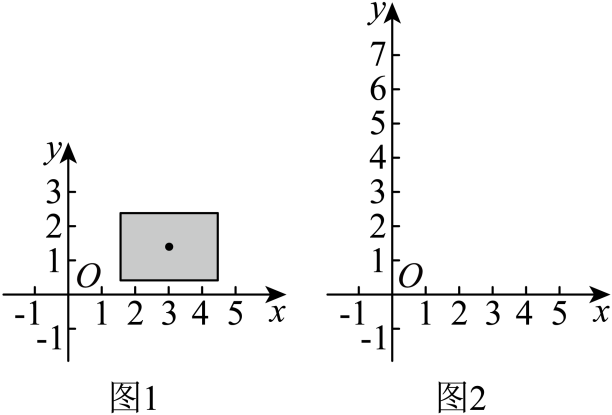

# Mathematics - 题目 2027

**ID**: 2eaf76aaa371456b96fdac4978b0ef50
**年级**: Grade 10
**难度**: Medium
**题型**: Fill-in-the-blank

## 题目
对于正数 $x$ ，用符号 $\left [x\right ]$ 表示 $x$ 的整数部分，例如： $\left [2.​​​​​​​‌5\right ]=2,\left [3\right ]=3$ ．点 $A\left ({a,\,b}\right )$ 在第一象限内，以A为对角线的交点画一个矩形，使它的边分别与两坐标轴垂直，其中垂直于 $y$ 轴的边长为 $a$ ，垂直于 $x$ 轴的边长为 $\left [b\right ]+1$ ，那么把这个矩形覆盖的区域叫做点A的矩形域．例如：点 $\left ({3,\,\frac {3}{2}}\right )$ 的矩形域是一个以 $\left ({3,\,\frac {3}{2}}\right )$ 为对角线交点，长为3，宽为2的矩形所覆盖的区域，如图1所示，它的面积为6．根据上面的定义，回答下列问题：（1）在图2所示的坐标系中画出点 $\left ({2,\frac {7}{2}}\right )$ 的矩形域，该矩形域的面积是；（2）点 $P\left ({2,\frac {7}{2}}\right ),Q\left ({a,\frac {7}{2}}\right )\left ({a>0}\right )$ 的矩形域重叠部分面积为1，则 $a=$；（3）已知点 $B\left ({m,n}\right )\left ({m>0}\right )$ 在直线 $y=x+1$ 上，且点 $B$ 的矩形域的面积S满足 $4<S<5$ ，那么 $m$ 的取值范围是．

## 解答

1. （1）点 $\left ({2{\rm{,}}\frac {7}{2}}\right )$ 的矩形域如图所示，该矩形域的面积是 $2\times \left ({\left [\frac {7}{2}\right ]+1}\right )=2\times 4=8$ ．
2. 
3. （2）∵点 $P\left ({2{\rm{,}}\frac {7}{2}}\right ),Q\left ({a{\rm{,}}\frac {7}{2}}\right )\left ({a>0}\right )$ 的矩形域垂直于 $x$ 轴的边长均为4，且两点纵坐标相同，
4. ∴点 $P\left ({2{\rm{,}}\frac {7}{2}}\right ),Q\left ({a{\rm{,}}\frac {7}{2}}\right )\left ({a>0}\right )$ 的矩形域重叠部分也是一个矩形，且垂直于 $x$ 轴的边长为4，
5. ∵重叠部分面积为1，∴其垂直于 $y$ 轴的边长为 $\frac {1}{4}$ ，
6. ①当 $0<a<2$ 时，如图：
7. 
8. 则 $a\times 4+2\times 4-1=\left [3-\left ({a-\frac {a}{2}}\right )\right ]\times 4$ ，解得 $a=\frac {5}{6}$ ；
9. ②当 $a>2$ 时，如图：
10. 
11. $a\times 4+2\times 4-1=\left [\left ({a+\frac {a}{2}}\right )-1\right ]\times 4$ ，解得 $a=\frac {11}{2}$ ，
12. ∴ $a$ 的值为 $\frac {5}{6}$ 或 $\frac {11}{2}$ ．
13. （3）当 $m=1$ ， $B\left ({1,2}\right )$ ， $S=1\times \left ({2+1}\right )=3$ ，
14. 当 $m=2$ 时， $B\left ({2,3}\right )$ ， $S=2\times \left ({3+1}\right )=8$ ，
15. $\because 4<S<5,$
16. $\therefore 1<m<2,$
17. $\therefore 2<n=m+1<3,$
18. ∴ $[n]=2,$
19. ∴垂直于 $x$ 轴的矩形域的边长为 $\left [n\right ]+1=3$ ，
20. ∴ $S=3m$ ，
21. ∴ $4<3m<5,$
22. ∴ $\frac {4}{3}<m<\frac {5}{3}$ ．

## 知识点

**中文**:
  - 函数

**English**:
  - Functions

---
