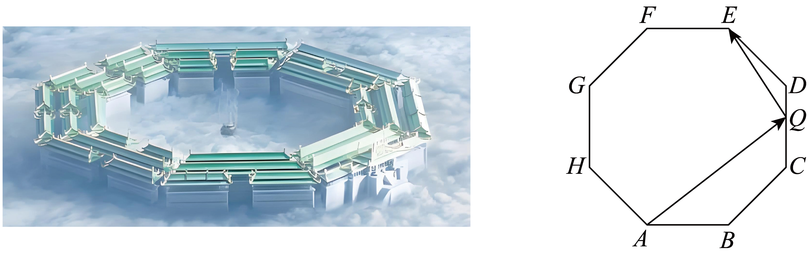

# Mathematics - 题目 888

**ID**: 3172ad031c37435d9b5e4f08fd3088f6
**年级**: Grade 10
**难度**: Medium
**题型**: Fill-in-the-blank

## 题目
《哪吒 $2$ 》的玉虚宫，形态由九宫八卦阵演变而来，设计灵感来源于汉代，内饰充满了中国文化符号．我校高一数学实践小组将玉虚宫轮廓抽象为正八边形，结合向量知识进行主题探究活动．如图，正八边形 $ABCDEFGH$ ，边长为 $2$ ，点 $Q$ 为线段 $CD$ 上的动点，则 $\overrightarrow {{AQ}}\cdot \overrightarrow {{QE}}$ 的最大值为．​​​​​​​‌

## 解答

1. 由 $\overrightarrow {{AQ}}\cdot \overrightarrow {{QE}}=(\overrightarrow {{AB}}+\overrightarrow {{BC}}+\overrightarrow {{CQ}})\cdot (\overrightarrow {{QD}}+\overrightarrow {{DE}})$  $=\overrightarrow {{AB}}\cdot \overrightarrow {{QD}}+\overrightarrow {{AB}}\cdot \overrightarrow {{DE}}+\overrightarrow {{BC}}\cdot \overrightarrow {{QD}}+\overrightarrow {{BC}}\cdot \overrightarrow {{DE}}+\overrightarrow {{CQ}}\cdot \overrightarrow {{QD}}+\overrightarrow {{CQ}}\cdot \overrightarrow {{DE}}$ ，
2. 且 $\left \langle {\overrightarrow {{AB}},\overrightarrow {{QD}}}\right \rangle =\left \langle {\overrightarrow {{BC}},\overrightarrow {{DE}}}\right \rangle =\frac {{\rm{π}}}{2}$ ， $\left \langle {\overrightarrow {{AB}},\overrightarrow {{DE}}}\right \rangle =\frac {3{\rm{π}}}{4}$ ， $\left \langle {\overrightarrow {{BC}},\overrightarrow {{QD}}}\right \rangle =\left \langle {\overrightarrow {{CQ}},\overrightarrow {{DE}}}\right \rangle =\frac {{\rm{π}}}{4}$ ， $\left \langle {\overrightarrow {{CQ}},\overrightarrow {{QD}}}\right \rangle =0$ ，
3. 所以 $\overrightarrow {{AQ}}\cdot \overrightarrow {{QE}}=0+4\times (-\frac {\sqrt {2}}{2})+2|\overrightarrow {{QD}}|\times \frac {\sqrt {2}}{2}+0+(2-|\overrightarrow {{QD}}|)|\overrightarrow {{QD}}|+2(2-|\overrightarrow {{QD}}|)\times \frac {\sqrt {2}}{2}$
4. $=2|\overrightarrow {{QD}}|-|\overrightarrow {{QD}}|{^{2}}=-(|\overrightarrow {{QD}}|-1){^{2}}+1$ ，
5. 当 $|\overrightarrow {{QD}}|=1$ 时， $\overrightarrow {{AQ}}\cdot \overrightarrow {{QE}}$ 的最大值为1.

## 知识点

**中文**:
  - 向量线性综合运算
  - 数量积的计算

**English**:
  - Comprehensive Linear Operations
  - Calculation of Scalar Product

---
