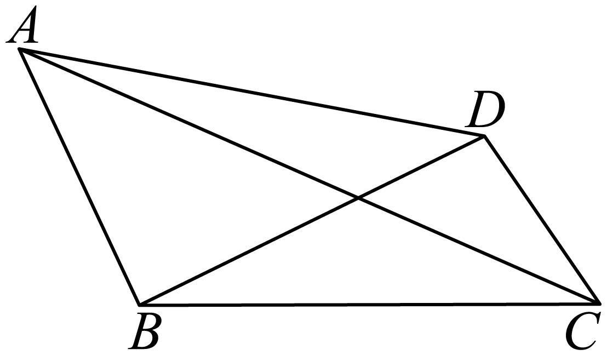

# Mathematics - 题目 3138

**ID**: 9f8e554094c944e08cf1a78e468ae673
**年级**: Grade 10
**难度**: Medium
**题型**: Fill-in-the-blank

## 题目
如图，在平面四边形 $ABCD$ 中， $AB=3$ ， $BC=5$ ， $AC=7$ ， ${\cos}\angle BCD=\frac {3}{5}$ ， $AB\bot BD$ ，则 ${\cos}\angle CBD=$； $BD=$.​​​​​​​‌

## 解答

1. 在 $\vartriangle ABC$ 中，由余弦定理得 ${\cos}\angle ABC=\frac {AB{^{2}}+BC{^{2}}-AC{^{2}}}{2\times AB\times BC}=\frac {3{^{2}}+5{^{2}}-7{^{2}}}{2\times 3\times 5}=-\frac {1}{2}$ ，
2. 所以 $\angle ABC=\frac {2{\rm{π}}}{3}$ ，
3. 因为 $AB\bot BD$ ，所以 $\angle CBD=\frac {2{\rm{π}}}{3}-\frac {{\rm{π}}}{2}=\frac {{\rm{π}}}{6}$ ， ${\cos}\angle CBD=\frac {\sqrt {3}}{2}$ .
4. 因为 ${\cos}\angle BCD=\frac {3}{5}$ ，所以 $\sin \angle BCD=\frac {4}{5}$ ，
5. $\sin \angle BDC=\sin \left ({\angle CBD+\angle BCD}\right )=\frac {1}{2}\times \frac {3}{5}+\frac {\sqrt {3}}{2}\times \frac {4}{5}=\frac {3+4\sqrt {3}}{10}$ ，
6. 在 $\mathrm{△}BCD$ 中，由正弦定理得 $BD=\frac {BC\sin \angle BCD}{\sin \angle BDC}=\frac {5\times \frac {4}{5}}{\frac {3+4\sqrt {3}}{10}}=\frac {40\left ({4\sqrt {3}-3}\right )}{39}$ .

## 知识点

**中文**:
  - 利用余弦定理解三角形
  - 利用正弦定理解三角形

**English**:
  - Solving Triangles using Law of Cosines
  - Solving Triangles using Law of Sines

---
