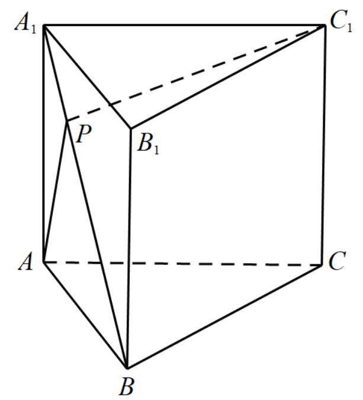

# Mathematics - 题目 792

**ID**: d368ffa87591480d8cb53df31784c530
**年级**: Grade 10
**难度**: Medium
**题型**: Fill-in-the-blank

## 题目
如图所示，在直三棱柱 $ABC-A{{}_{1}}B{{}_{1}}C{{}_{1}}$ 中，棱柱的侧面均为矩形， $AA{{}_{1}}=1$ ， $AB=BC=\sqrt {3}$ ， ${\cos}\angle ABC=\frac {1}{3}{\rm ，\mathit{P}}$ 是 $A{{}_{1}}B$ 上的一动点，则 $AP+PC{{}_{1}}$ 的最小值为.​​​​​​​‌

## 解答

1. 连接 $BC{{}_{1}}$ ，得 $\vartriangle A{{}_{1}}BC{{}_{1}}$ ，以 $A{{}_{1}}B$ 所在直线为轴，将 $\vartriangle A{{}_{1}}BC{{}_{1}}$ 所在平面旋转到平面 $ABB{{}_{1}}A{{}_{1}}$ ，
2. 
3. 设点 $C{{}_{1}}$ 的新位置为 $C^{′}$ ，连接 $AC^{′}$ ，则有 $AP+PC{{}_{1}}\geqslant AC^{′}$ .
4. 当 $A、P、C^{′}$ 三点共线时，则 $AC^{′}$ 即为 $AP+PC{{}_{1}}$ 的最小值.
5. 在三角形ABC中， $AB=BC=\sqrt {3}$ ， ${\cos}\angle ABC=\frac {1}{3}$ ，由余弦定理得： $AC=\sqrt {AB{^{2}}+BC{^{2}}-2AB\centerdot BC{\cos}B}=\sqrt {3+3-2\times 3\times \frac {1}{3}}=2$ ,所以 $A{{}_{1}}C{{}_{1}}=2$ ，即 $A{{}_{1}}C^{′}=2$
6. 在三角形 $A{{}_{1}}AB$ 中， $AA{{}_{1}}=1$ ， $AB=\sqrt {3}$ ，由勾股定理可得： $A{{}_{1}}B=\sqrt {AA{{}_{1}}{^{2}}+AB{^{2}}}=\sqrt {1+3}=2$ ,且 $\angle AA{{}_{1}}B=60{}\degree $ .
7. 同理可求： $C{{}_{1}}B=2$ ，因为 $A{{}_{1}}B=BC{{}_{1}}=A{{}_{1}}C{{}_{1}}=2$ ，所以 $\vartriangle A{{}_{1}}BC{{}_{1}}$ 为等边三角形，所以 $\angle BA{{}_{1}}C{{}_{1}}=60{}\degree $ ，
8. 所以在三角形 $AA{{}_{1}}C^{′}$ 中， $\angle AA{{}_{1}}C^{′}=\angle AA{{}_{1}}B+\angle BA{{}_{1}}C^{′}=120{}\degree $ , $AA{{}_{1}}=1,A{{}_{1}}C^{′}=2$ ,
9. 由余弦定理得： $AC^{′}=\sqrt {1+4-2\times 1\times 2\times \left ({-\frac {1}{2}}\right )}=\sqrt {7}$ .

## 知识点

**中文**:
  - 利用余弦定理解三角形
  - 空间几何体的平面展开图

**English**:
  - Solving Triangles using Law of Cosines
  - Planar Nets

---
