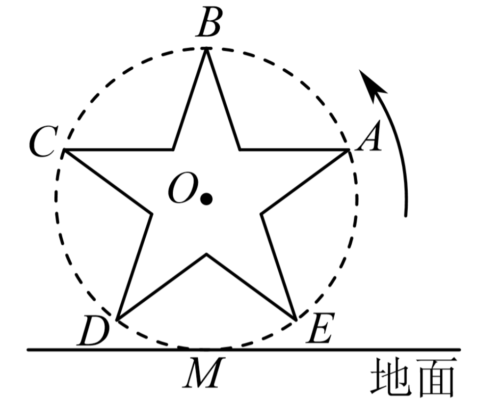

# Mathematics - 题目 3539

**ID**: 2027b75be34b4e7b8240a7584f3e29e5
**年级**: Grade 10
**难度**: Medium-Hard
**题型**: Calculation

## 题目
如图，正五角星 $ABCDE$ 的外接圆 $O$ 与地面相切于 $M$ ，五角星形水车 $ABCDE$ 绕轴心 $O$ 按逆时针（箭头方向）匀速旋转，点 $\mathrm{A}$ 离地面的垂直高度 $f\left ({t}\right )$ （单位：米）与旋转时间 $t$ （单位：秒）满足关系式 $f\left ({t}\right )=10{\rm{s}}{\rm{i}}{\rm{n}}\left ({ωt+\frac {{\rm{π}}}{10}}\right )+10\left ({ω>0,t\geqslant 0}\right )$ ．已知当 $t=0$ 时， $AC$ 与地面平行（此时A在 $C$ 的右侧），且点A首次到达至高点所用的时间为12秒．(1)求圆 $O$ 的半径和 $f\left ({t}\right )$ 的解析式．(2)若存在正实数 $t{{}_{i}}\left ({i=1,2,3,\cdots ,2025}\right )$ 满足 $t{{}_{1}}<t{{}_{2}}<t{{}_{3}}<\cdots <t{{}_{2025}}$ ，使得 $f\left ({t{{}_{1}}}\right )=f\left ({t{{}_{2}}}\right )=$  $f\left ({t{{}_{3}}}\right )=\cdots =f\left ({t{{}_{2025}}}\right )$ ，证明： $t{{}_{2025}}>60720$ ．(3)若在水车 $ABCDE$ 的每个顶点处加装一个浇水桶，当某浇水桶距离地面的垂直高度为 $10\left ({1+{\rm{s}}{\rm{i}}{\rm{n}}\frac {{\rm{π}}}{5}}\right )$ 米时，水车停止旋转60秒便于该浇水桶进行浇水作业，其余时间段均按原始方式匀速旋转，求从0秒到6800秒内浇水作业的次数．​​​​​​​‌

## 解答

1. （1）如图1，设A在 $O$ 的水平方向的射影为 $H$ ，连接 $OA$ ， $OM$ ．
2. 由五角星的性质易知 $\angle AOH=18{}\degree =\frac {{\rm{π}}}{10}$ ．
3. 设圆 $O$ 的半径为 $r$ 米，则 $AH=OA{\rm{s}}{\rm{i}}{\rm{n}}\angle AOH=r{\rm{s}}{\rm{i}}{\rm{n}}\frac {{\rm{π}}}{10}$ ，且 $OM=r$ ，
4. 则 $f\left ({0}\right )=AH+OM=r{\rm{s}}{\rm{i}}{\rm{n}}\frac {{\rm{π}}}{10}+r=10\left ({1+{\rm{s}}{\rm{i}}{\rm{n}}\frac {{\rm{π}}}{10}}\right )$ ，解得 $r=10$ ．
5. 因为点 $\mathrm{A}$ 首次到达至高点需用时12秒，且 $\angle AOB=72{}\degree =\frac {2{\rm{π}}}{5}$ ，
6. 所以 $OA$ 每旋转一周需要60秒，则 $ω=\frac {2{\rm{π}}}{60}=\frac {{\rm{π}}}{30}$ ，
7. 从而 $f\left ({t}\right )$ 的解析式为 $f\left ({t}\right )=10{\rm{s}}{\rm{i}}{\rm{n}}\left ({\frac {{\rm{π}}}{30}t+\frac {{\rm{π}}}{10}}\right )+10\left ({t\geqslant 0}\right )$ ．
8. （2）证明：因为 $\frac {{\rm{π}}}{30}\times 12+\frac {{\rm{π}}}{10}=\frac {{\rm{π}}}{2}$ ，所以 $f\left ({t}\right )$ 在 $\left ({0,12}\right )$ 上单调递增．
9. 由三角函数的图象可知，在一个最小正周期内，最多有两个不同的实数 $a,b$ ，使得 $f\left ({a}\right )=$  $f\left ({b}\right )$ 成立．
10. 由 $f\left ({t}\right )$ 的最小正周期为60，可得当 $t{{}_{1}}\ne 12+30k$ ， $k\in {\mathbf{Z}}$ 时， $t{{}_{2025}}=\frac {2024}{2}\times 60+t{{}_{1}}=60720+t{{}_{1}}>60720$ ；
11. 当 $t{{}_{1}}=12+30k,k\in {\mathbf{Z}}$ 时， $t{{}_{2025}}=2024\times 60+t{{}_{1}}>60720$ ．
12. 故 $t{{}_{2025}}>60720$ ．
13. （3）解：由题可知，当水车完成一周旋转时，每个浇水桶都要进行两次浇水，则水车完成一周旋转所用的时长为 $5\times 2\times 60+60=660$ 秒．
14. 因为 $6800=660\times 10+200$ ，所以水车完成了10周的完整旋转后还剩200秒时间．
15. 下面我们讨论200秒内，水车的浇水情况．
16. 如图2，作 $OP$ 平行于地面，且交圆 $O$ 的右侧于点 $P$ ，设水桶的浇水点为 $Q{{}_{1}},Q{{}_{2}}$ ，连接 $OQ{{}_{1}}$ ， $OQ{{}_{2}},OE,OB$ ，可知 $\angle Q{{}_{1}}OP=\frac {{\rm{π}}}{5},\angle Q{{}_{2}}OP=\frac {4{\rm{π}}}{5}$ ．
17. 因为 $\angle Q{{}_{1}}OA=18{}\degree =\frac {{\rm{π}}}{10}$ ，所以当 $t=3$ 时， $f\left ({3}\right )=10{\rm{s}}{\rm{i}}{\rm{n}}\left ({\frac {3{\rm{π}}}{30}+\frac {{\rm{π}}}{10}}\right )+10=10\left ({1+{\rm{s}}{\rm{i}}{\rm{n}}\frac {{\rm{π}}}{5}}\right )$ ，
18. A处浇水桶距离地面的垂直高度为 $10\left ({1+{\rm{s}}{\rm{i}}{\rm{n}}\frac {{\rm{π}}}{5}}\right )$ 米，且A处浇水桶将进行第一次浇水作业，并停止旋转60秒．
19. 又 $\angle BOQ{{}_{2}}=54{}\degree =\frac {3{\rm{π}}}{10}$ ，所以当 $t=69$ 时， $B$ 处浇水桶距离地面的垂直高度为 $10\left ({1+{\rm{s}}{\rm{i}}{\rm{n}}\frac {{\rm{π}}}{5}}\right )$ 米，且 $B$ 处浇水桶将进行第二次浇水作业，并停止旋转60秒．
20. 又 $\angle Q{{}_{1}}OE=90{}\degree =\frac {{\rm{π}}}{2}$ ，所以当 $t=135$ 时， $E$ 处浇水桶距离地面的垂直高度为 $10\left ({1+{\rm{s}}{\rm{i}}{\rm{n}}\frac {{\rm{π}}}{5}}\right )$ 米，且 $E$ 处浇水桶将进行第三次浇水作业，并停止旋转60秒．
21. 又 $\angle Q{{}_{2}}OA=126{}\degree =\frac {7{\rm{π}}}{10}$ ，所以当 $t=201>200$ 时，A处浇水桶距离地面的垂直高度为 $10\left ({1+{\rm{s}}{\rm{i}}{\rm{n}}\frac {{\rm{π}}}{5}}\right )$ 米，不在规定时间内，且其他位置的浇水桶均未在规定时间内到达浇水点．
22. 故200秒内，水车会进行3次浇水，则从0秒到6800秒内浇水作业的次数为103．
23. 

## 知识点

**中文**:
  - 已知三角函数模型的应用问题

**English**:
  - Applications of Known Models

---
