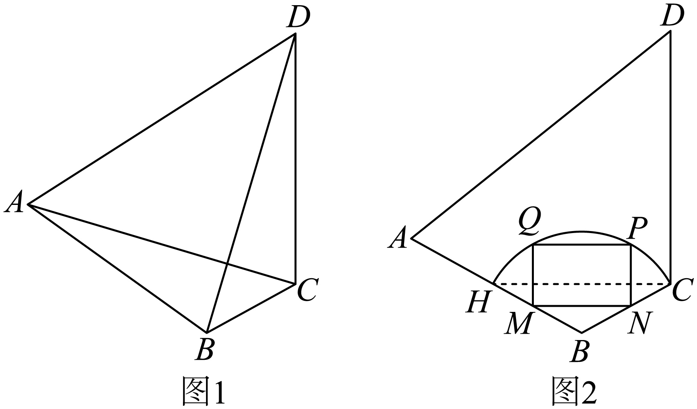

# Mathematics - 题目 3507

**ID**: 2044bcd1007841edbb54e1578988fe34
**年级**: Grade 10
**难度**: Medium-Hard
**题型**: Calculation

## 题目
巴张高速公路（巴东至张家界）于2025年1月开工，计划于2030年正式建成． 该高速公路在巴东境内横跨长江，需要重新修建一座桥梁，称为巴东长江二桥（以下简称二桥），目前二桥的起点和终点已经确定．如图1所示，设二桥起点为C，终点为D，为了测量二桥CD的长度（南北走向），小明同学选择了长江南岸的A，B两个观测点，AB相距2千米． 在A处测得二桥北岸D位于其北偏东60°的方向，二桥南岸C位于其南偏东75°的方向，观测点B位于其南偏东60°．在观测点B处测得南岸C处位于其北偏东60°，北岸D位于其北偏东15°的方向．（1）求二桥CD的长度．（2）为了优化二桥周边环境，政府部门将对扇形区域CBH进行改造．如图2所示，点P,Q在弧 $\overset{\frown}{{CH}}$ 上，点M,N分别在BH,BC上，且 $PQ\mathrm{/\mskip-4mu/}CH$ ，四边形MNPQ为矩形．拟将矩形MNPQ所在区域建成一所主题公园，求公园面积的最大值．​​​​​​​‌

## 解答

1. （1）
2. 
3. 如图所示，过点 $A$ 作 $PQ\mathrm{/\mskip-4mu/}CD$ ，过点 $B$ 作 $BR\mathrm{/\mskip-4mu/}CD$ ，
4. 点 $P$ 在点 $A$ 的正北方向，点 $Q$ 在点 $A$ 的正南方向，点 $R$ 在点 $B$ 的正北方向.
5. 根据题意可知 $\angle PAD=60{^{\circ }},\angle QAC=75{^{\circ }},\angle QAB=60{^{\circ }}$ ，所以 $\angle BAC=75{}\degree -60{}\degree =15{}\degree $ ,
6. 由题意得 $\angle RBD=15{}\degree ,\angle RBC=60{}\degree ,\angle RBA=\angle QAB=60{^{\circ }}$ ，
7. 所以 $\angle ABC=60{}\degree +60{}\degree =120{}\degree $ ，故 $\angle ACB=45{}\degree $ ，
8. 在 $\mathrm{△}ABC$ 中，由正弦定理得 $\frac {AB}{\sin 45{}\degree }=\frac {BC}{\sin 15{}\degree }$ ，即 $\frac {2}{\frac {\sqrt {2}}{2}}=\frac {BC}{\sin 15{}\degree }$  ，故 $BC=2\sqrt {2}\sin 15{}\degree $ ，
9. 因为 $\sin 15{^{\circ }}=\sin (45{^{\circ }}-30{^{\circ }})=\sin 45{^{\circ }}{\cos}30{^{\circ }}-\sin 30{^{\circ }}{\cos}45{^{\circ }}=\frac {\sqrt {2}}{2}\times \frac {\sqrt {3}}{2}-\frac {1}{2}\times \frac {\sqrt {2}}{2}=\frac {\sqrt {6}-\sqrt {2}}{4}$ ，
10. 所以 $BC=\sqrt {3}-1$ .
11. 在 $\mathrm{△}ABD$ 中， $AB=2,\angle DAB=180{}\degree -60{}\degree -60{}\degree =60{}\degree ,\angle ADB=60{}\degree -15{}\degree =45{}\degree $ ，
12. 由正弦定理得 $\frac {AB}{\sin 45{}\degree }=\frac {BD}{\sin 60{}\degree }$ ，解得 $BD=\sqrt {6}$ ．
13. 在 $\mathrm{△}BCD$ 中， $BC=\sqrt {3}-1,BD=\sqrt {6},\angle DBC=60{}\degree -15{}\degree =45{}\degree $ ，
14. 由余弦定理可得 $CD{^{2}}=BC{^{2}}+BD{^{2}}-2BC\cdot BD\cdot {\cos}45{}\degree =4$ ，解得 $CD=2$ ，
15. 所以二桥的长度是2千米.
16. （2）
17. 
18. 由（1）知扇形所在区域半径 $R=BC=\sqrt {3}-1$ ，圆心角 $\angle CBH=120{}\degree $ .
19. 如图，取线段 $PQ$ 的中点 $E$ ，连接 $BE$ 交 $MN$ 于 $F$ ，连接 $BQ$ ．
20. 设 $\angle EBQ=θ,θ\in (0{}\degree ,60{}\degree )$ .
21. 根据垂径定理可知 $\angle BEQ=90{}\degree $ ，故 $EQ=R\sin θ，PQ=2R\sin θ，BE=R{\cos}θ$ ．
22. 在 ${\rm{R}}{\rm{t}}\mathrm{△}BFM$ 中，由 $MF=EQ=R\sin θ,\angle MBF=60{}\degree $ ,得 $BF=\frac {MF}{\sqrt {3}}=\frac {R\sin θ}{\sqrt {3}}$ ，
23. 所以 $EF=BE-BF=R{\cos}θ-\frac {R\sin θ}{\sqrt {3}}$ ，
24. 则矩形 $MNPQ$ 的面积 $S=PQ\cdot EF=2R\sin θ\cdot (R{\cos}θ-\frac {R\sin θ}{\sqrt {3}})=R{^{2}}\sin 2θ+\frac {R{^{2}}}{\sqrt {3}}{\cos}2θ-\frac {R{^{2}}}{\sqrt {3}}$  $=\frac {R{^{2}}}{\sqrt {3}}(\sqrt {3}\sin 2θ+{\cos}2θ)-\frac {R{^{2}}}{\sqrt {3}}=\frac {2R{^{2}}}{\sqrt {3}}\sin (2θ+30{}\degree )-\frac {R{^{2}}}{\sqrt {3}}$ ，
25. 由 $θ\in (0{}\degree ,60{}\degree )$ 得 $2θ+30{}\degree \in (30{}\degree ,150{}\degree )$ ，
26. 所以当 $\sin (2θ+30{}\degree )=1$ ，即 $θ=30{}\degree $ 时，公园面积的最大值为 $\frac {2R{^{2}}}{\sqrt {3}}-\frac {R{^{2}}}{\sqrt {3}}=\frac {{\left({\sqrt {3}-1}\right)^{2}}}{\sqrt {3}}=\frac {4\sqrt {3}}{3}-2$ 平方千米．

## 知识点

**中文**:
  - 复杂图形（多个三角形拼接、四边形）求解
  - 正、余弦定理的实际应用-测量距离问题

**English**:
  - Solving Complex Shapes (Combined Triangles, Quadrilaterals)
  - Measuring Distance

---
