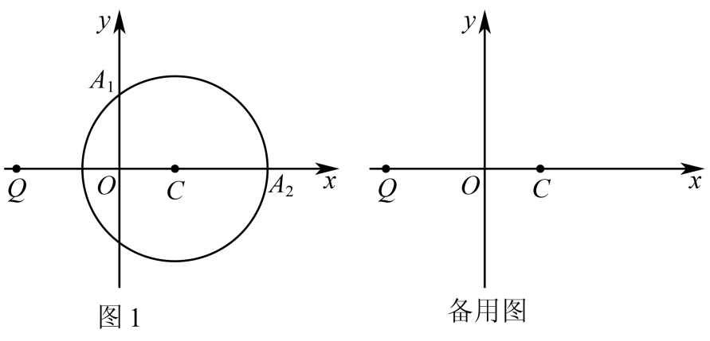

# Mathematics - 题目 2878

**ID**: 241fe91975ba4ffb904e48b76ba0de53
**年级**: Grade 10
**难度**: Medium-Hard
**题型**: 演算步骤或证明过程．

## 题目
对于平面内的 $\odot C$ 和 $\odot C$ 外一点 $Q$ ，给出如下定义：若过点 $Q$ 的直线与 $\odot C$ 存在公共点，记为点 $\mathrm{A}$ ， $B$ ，设 $k=\frac {AQ+BQ}{CQ}$ ，则称点 $\mathrm{A}$ （或点 $B$ ）是 $\odot C$ 的“ $k$ 相关依附点”．特别地，当点 $\mathrm{A}$ 和点 $B$ 重合时，规定 $AQ=BQ$ ， $k=\frac {2AQ}{CQ}$ （或 $\frac {2BQ}{CQ}$ ）．已知在平面直角坐标系 $xOy$ 中， $Q\left ({-1,0}\right )$ ， $C\left ({1,0}\right )$ ， $\odot C$ 的半径为 $r$ ．（1）如图1，当 $r=\sqrt {2}$ 时，①若 $A{{}_{1}}\left ({0,1}\right )$ 是 $\odot C$ 的“ $k$ 相关依附点”，则 $k$ 的值为；​​​​​​​‌② $A{{}_{2}}\left ({1+\sqrt {2},0}\right )$ 是否为 $\odot C$ 的“2相关依附点”？答：是（选“是”或“否”）；（2）若 $\odot C$ 上存在“ $k$ 相关依附点”点 $M$ ，①当 $r=1$ ，直线 $QM$ 与 $\odot C$ 相切时，求 $k$ 的值；②当 $k=\sqrt {3}$ 时，求 $r$ 的取值范围；（3）若存在 $r$ 的值使得直线 $y=\mathrm{-}\sqrt {3}x+b$ 与 $\odot C$ 有公共点，且公共点是 $\odot C$ 的“ $\sqrt {3}$ 相关依附点”，直接写出 $b$ 的取值范围．

## 解答

1. 解：（1）①如图1中，连接 $CA{{}_{1}}$ 、 $QA{{}_{1}}$
2. 
3. 由题意： $OC=OQ=OA{{}_{1}}=1$ ，
4. $\therefore \vartriangle QA{{}_{1}}C$ 是直角三角形，即 $A{{}_{1}}C\bot QA{{}_{1}}$ ，
5. $\therefore QA{{}_{1}}$ 是 $\odot C$ 的切线，
6. $\therefore k=\frac {2A{{}_{1}}Q}{CQ}=\frac {2\sqrt {2}}{2}=\sqrt {2}$ ；
7. ② $\because A{{}_{2}}\left ({1+\sqrt {2},0}\right )$ 在 $\odot C$ 上，
8. $\therefore k=\frac {2-\sqrt {2}+1+\sqrt {2}+1}{2}=2$
9. $\therefore A{{}_{2}}\left ({1+\sqrt {2},0}\right )$ 是 $\odot C$ 的“2相关依附点”，
10. 故答案为：（1）① $\sqrt {2}$ ；②是；
11. （2）①如图2，当 $r=1$ 时，不妨设直线 $QM$ 与 $\odot C$ 相切的切点 $M$ 在 $x$ 轴上方（切点 $M$ 在 $x$ 轴下方时同理），连接 $CM$ ，则 $QM\bot CM$ ．
12. 
13. ∵ $Q\left ({-1,0}\right )$ ， $C\left ({1,0}\right )$ ， $r=1$ ，
14. ∴ $CQ=2$ ， $CM=1$ ．
15. ∴ $MQ=\sqrt {3}$ ．
16. 此时 $k=\frac {2MQ}{CQ}=\frac {2\sqrt {3}}{2}=\sqrt {3}$ ；
17. ②如图3中，
18. 
19. 若直线 $QM$ 与 $\odot C$ 不相切，
20. 设直线 $QM$ 与 $\odot C$ 的另一个交点为 $N$ （不妨设 $QN<QM$ ，点 $N$ ， $M$ 在 $x$ 轴下方时同理）．
21. 作 $CD\bot QM$ 于点 $D$ ，则 $MD=ND$ ．
22. ∴ $MQ+NQ=\left ({MN+NQ}\right )+NQ=2ND+2NQ=2DQ$ ．
23. ∵ $CQ=2$ ，∴ $k=\frac {MQ+NQ}{CQ}=\frac {2DQ}{CQ}=DQ$ ．
24. ∴当 $k=\sqrt {3}$ 时， $DQ=\sqrt {3}$ ．
25. 此时 $CD=\sqrt {CQ{^{2}}-DQ{^{2}}}=1$ ．
26. 又∵点 $Q$ 在 $\odot C$ 外，则 $r<2$
27. ∴ $r$ 的取值范围是 $1\leqslant r<2$ ．
28. （3）如图4中
29. 
30. 由（2）可知， $\odot C$ 的“ $\sqrt {3}$ 相关依附点”， 在直线QM： $y=\sqrt {3}x+\frac {\sqrt {3}}{3}$ 或 $y=-\sqrt {3}x-\frac {\sqrt {3}}{3}$ 上，且r的取值范围是1⩽r＜2，
31. 当r＝2时，易知直线 $y=\sqrt {3}x+\frac {\sqrt {3}}{3}$ 与 $\odot C$ （大圆）的交点 $E\left ({2,\sqrt {3}}\right )$ ，
32. 当r＝1时，易知直线 $y=-\sqrt {3}x-\frac {\sqrt {3}}{3}$ 与 $\odot C$ （小圆）的交点 $F\left ({\frac {1}{2},-\frac {\sqrt {3}}{2}}\right )$ ，
33. 当直线 $y=\mathrm{-}\sqrt {3}x+b$ 与线段QE，线段QF有交点时（线段端点除外），满足条件．
34. 当直线 $y=\mathrm{-}\sqrt {3}x+b$ 经过点 $E\left ({2,\sqrt {3}}\right )$ 时，可得 $b=3\sqrt {3}$ ，
35. 当直线 $y=\mathrm{-}\sqrt {3}x+b$ 经过点 $Q\left ({-1,0}\right )$ 时，可得 $b=-\sqrt {3}$ ，
36. 观察图像可知满足条件的 $b$ 的取值范围 $-\sqrt {3}<b<3\sqrt {3}$ ．

## 知识点

**中文**:
  - 图形的性质

**English**:
  - Properties of Geometric Figures

---
