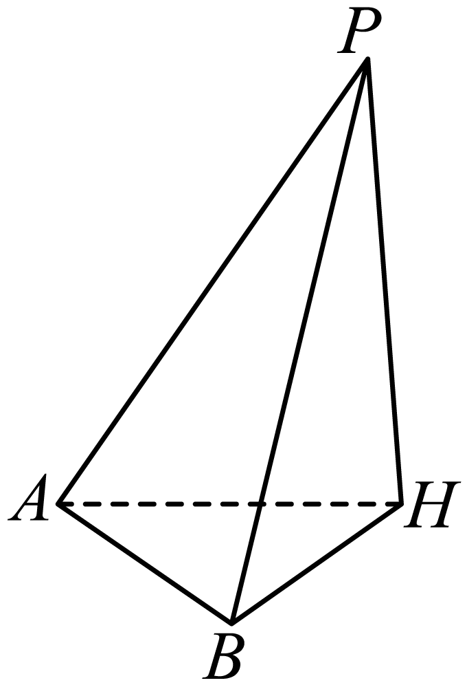

# Mathematics - 题目 1852

**ID**: 2bc4497932d24f0680ec656152277b08
**年级**: Grade 10
**难度**: Medium-Hard
**题型**: Calculation

## 题目
某学校的一个数学兴趣小组在学习了正弦定理、余弦定理的应用后，准备测量学校附近一座建筑物的高度.​​​​​​​‌建筑物最高点 $P$ 在地面上的投影 $H$ 位于建筑物内部，不可到达且不可从外部看到，该小组在学校操场上任意选择了相距30 m的 $\mathrm{A}$ ， $B$ 两点进行测量.有三位同学各自提出了一种方案，并测出了相应的数据.方案一：从 $\mathrm{A}$ ， $B$ 两点分别测得点 $P$ 的仰角 $θ{{}_{1}}$ 和 $θ{{}_{2}}$ ，再从 $B$ 点测得 $\angle PBA$ .其中 $\sin θ{{}_{1}}=\frac {3}{4}$ ， $\sin θ{{}_{2}}=\frac {2}{3}$ ， ${\cos}\angle PBA=\frac {7}{12}$ .方案二：从点 $\mathrm{A}$ 处测得 $∠PAB$ ，从点 $B$ 处测得 $\angle PBA$ 和点 $P$ 的仰角 $θ{{}_{2}}$ .其中 ${\cos}\angle PAB=-\frac {13}{32}$ ， ${\cos}\angle PBA=\frac {7}{12}$ ， $\sin θ{{}_{2}}=\frac {2}{3}$ .方案三：从点 $P$ 处分别测得点 $\mathrm{A}$ 和 $B$ 的俯角 $θ{{}_{1}}$ 和 $θ{{}_{2}}$ ，以及 $∠APB$ .其中 $\sin θ{{}_{1}}=\frac {3}{4}$ ， $\sin θ{{}_{2}}=\frac {2}{3}$ ， ${\cos}\angle APB=\frac {47}{48}$ .从上述三种方案中选择一种你认为能够测出建筑物的高度 $PH$ 的方案，并根据该方案中的数据计算出 $PH$ 的长.（注意：只能使用你所选择的方案中的数据，不能使用未选择的方案中的数据.如果选择多个方案，则按照所选的第一个方案的解答计分.）

## 解答

1. 选择方案二，则 $\sin \angle PAB=\sqrt {1-{\cos}{^{2}}\angle PAB}=\frac {3\sqrt {95}}{32}$ ，
2. $\sin \angle PBA=\sqrt {1-{\cos}{^{2}}\angle PBA}=\frac {\sqrt {95}}{12}$ .
3. 由于 $\angle PAB+\angle PBA+\angle APB=180{}\degree $ ，
4. 所以 $\sin \angle APB=\sin \left ({\angle PAB+\angle PBA}\right )$
5. $=\sin \angle PAB{\cos}\angle PBA+{\cos}\angle PAB\sin \angle PBA=\frac {\sqrt {95}}{48}$ .
6. 在 $\vartriangle PAB$ 中，由正弦定理可得 $\frac {AB}{\sin \angle APB}=\frac {PB}{\sin \angle PAB}$ ，
7. 因此 $PB=\frac {AB\sin \angle PAB}{\sin \angle APB}=135{\rm{m}}$ ，
8. 从而 $PH=PB\sin θ{{}_{2}}=90{\rm{m}}$ .
9. 选择方案三：设 $PH=x{\rm{m}}$ ，则 $PA=\frac {PH}{\sin θ{{}_{1}}}=\frac {4}{3}x$ ， $PB=\frac {PH}{\sin θ{{}_{2}}}=\frac {3}{2}x$ .
10. 在 $\vartriangle PAB$ 中，由余弦定理可得 $AB{^{2}}=PA{^{2}}+PB{^{2}}-2PA\cdot PB\cdot {\cos}\angle APB$ ，
11. 即 $\frac {16}{9}x{^{2}}+\frac {9}{4}x{^{2}}-2\times \frac {4}{3}x\cdot \frac {3}{2}x\cdot \frac {47}{48}=900$ ，解得 $x=90$ （舍去负根）.
12. 所以 $PH=90{\rm{m}}$ .
13. 如果选择方案一，因为 ${\cos}\angle PBA=\frac {7}{12}$ ，所以 $\sin \angle PBA=\sqrt {1-{\cos}{^{2}}\angle PBA}=\frac {\sqrt {95}}{12}$ ，
14. 设 $PH=x{\rm{m}}$ ，则 $PA=\frac {PH}{\sin θ{{}_{1}}}=\frac {4}{3}x$ ， $PB=\frac {PH}{\sin θ{{}_{2}}}=\frac {3}{2}x$ .
15. 由正弦定理计算可得 $\sin \angle PAB=\frac {PB}{PA}\sin \angle PBA=\frac {3\sqrt {95}}{32}>\frac {\sqrt {95}}{12}$ ，
16. 则 $∠PAB$ 有两种可能取值，
17. 所以 ${\cos}\angle PAB=\pm \sqrt {1-{\cos}{^{2}}\angle PAB}=\pm \frac {13}{32}$ ，
18. 故不能唯一确定 $PH$ 的值.

## 知识点

**中文**:
  - 正、余弦定理的实际应用-测量高度问题

**English**:
  - Measuring Height

---
