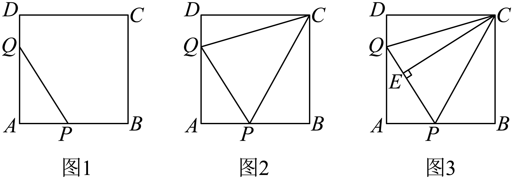

# Mathematics - 题目 2226

**ID**: 2f24b985667c4093a18bf63b80f91ef5
**年级**: Grade 10
**难度**: Medium-Hard
**题型**: Calculation

## 题目
某高一数学研究小组，在研究边长为1的正方形 $ABCD$ 某些问题时，发现可以在不作辅助线的情况下，用高中所学知识解决或验证下列有趣的现象．若 $P,Q$ 分别为边 $AB,DA$ 上的动点，当 $△APQ$ 的周长为2时， $PQ$ 有最小值（图1）、 $\angle PCQ$ 为定值（图2）、 $C$ 到 $PQ$ 的距离为定值（图3）．请你分别解以上问题．(1)如图1，求 $PQ$ 的最小值；​​​​​​​‌(2)如图2，证明： $\angle PCQ$ 为定值；(3)如图3，证明： $C$ 到 $PQ$ 的距离为定值．

## 解答

1. （1）设 $\angle QPA=θ$ ， $θ\in \left ({0,\frac {{\rm{π}}}{2}}\right )$ ，则 $AP=PQ{\cos}θ$ ， $AQ=PQ\sin θ$ ，
2. $\because \vartriangle APQ$ 的周长为 $2$ ，
3. $\therefore PQ\sin θ+PQ{\cos}θ+PQ=2$ ，
4. 所以 $PQ=\frac {2}{\sin θ+{\cos}θ+1}=\frac {2}{\sqrt {2}\sin \left ({θ+\frac {{\rm{π}}}{4}}\right )+1}$ ，
5. 又 $θ\in \left ({0,\frac {{\rm{π}}}{2}}\right )$ ， $\therefore $  $θ+\frac {{\rm{π}}}{4}\in \left ({\frac {{\rm{π}}}{4},\frac {3{\rm{π}}}{4}}\right )$ ，
6. $\therefore $  $\frac {\sqrt {2}}{2}<\sin \left ({θ+\frac {{\rm{π}}}{4}}\right )\leqslant 1$ ，
7. $\therefore $ 当 $\sin \left ({θ+\frac {{\rm{π}}}{4}}\right )=1$ ，即 $θ=\frac {{\rm{π}}}{4}$ 时， $PQ$ 取得最小值，且 $PQ$ 的最小值为 $\frac {2}{\sqrt {2}+1}=2\sqrt {2}-2$ ；
8. （2）设 $\angle PCB=α$ ， $\angle QCD=β$ ， $α,β\in \left ({0,\frac {{\rm{π}}}{2}}\right )$ ，
9. 则 $PB={\tan}α$ ， $DQ={\tan}β$ ，
10. $\therefore AP=1-{\tan}α$ ， $AQ=1-{\tan}β$ ， $PQ=\sqrt {{\left({1-{\tan}α}\right)^{2}}+{\left({1-{\tan}β}\right)^{2}}}$ ，
11. $\therefore \mathrm{△}APQ$ 的周长为 $2$ ，
12. $\therefore $  $2=1-{\tan}α+1-{\tan}β+\sqrt {{\left({1-{\tan}α}\right)^{2}}+{\left({1-{\tan}β}\right)^{2}}}$ ，
13. ${\tan}α+{\tan}β=\sqrt {{\left({1-{\tan}α}\right)^{2}}+{\left({1-{\tan}β}\right)^{2}}}$ ，
14. $\therefore {\tan}α+{\tan}β=1-{\tan}α\cdot {\tan}β$ ，
15. $\therefore {\tan}\left ({α+β}\right )=\frac {{\tan}α+{\tan}β}{1-{\tan}α{\tan}β}=1$ ，又 $0<α<\frac {{\rm{π}}}{2}$ ， $0<β<\frac {{\rm{π}}}{2}$ ，
16. $\therefore 0<α+β<{\rm{π}}$ ，
17. $\therefore $  $α+β=\frac {{\rm{π}}}{4}$ ，
18. $\therefore $  $\angle PCQ=\frac {{\rm{π}}}{2}-\left ({α+β}\right )=\frac {{\rm{π}}}{4}$ ，为定值；
19. （3） $\because $  $S{{}_{\vartriangle CPQ}}=\frac {1}{2}PQ\cdot CE=\frac {1}{2}CQ\cdot CP\sin \angle PCQ$ ，
20. $\therefore $  $PQ\cdot CE=\frac {\sqrt {2}}{2}CQ\cdot CP$ ，
21. $\because AP=1-{\tan}α$ ， $AQ=1-{\tan}β$ ，
22. $\therefore PQ=2-(AP+AQ)=2-(2-{\tan}α-{\tan}β)={\tan}α+{\tan}β$ ，
23. 又 $CP=\frac {1}{{\cos}α}$ ， $CQ=\frac {1}{{\cos}β}$ ，
24. $\therefore \left ({{\tan}α+{\tan}β}\right )\cdot CE=\frac {1}{{\cos}α}\times \frac {1}{{\cos}β}\times \frac {\sqrt {2}}{2}$ ，
25. $\therefore \frac {\sin α{\cos}β+{\cos}α\sin β}{{\cos}α{\cos}β}\cdot CE=\frac {1}{{\cos}α}\times \frac {1}{{\cos}β}\times \frac {\sqrt {2}}{2}$ ，
26. $\therefore $  $\frac {\sin (α+β)}{{\cos}α{\cos}β}\cdot CE=\frac {1}{{\cos}α{\cos}β}\times \frac {\sqrt {2}}{2}$ ，
27. 由（2）知 $α+β=\frac {{\rm{π}}}{4}$ ，
28. $\therefore $  $\frac {\frac {\sqrt {2}}{2}}{{\cos}α{\cos}β}\cdot CE=\frac {1}{{\cos}α{\cos}β}\times \frac {\sqrt {2}}{2}$ ，
29. $\therefore CE=1$ ，即 $C$ 到 $PQ$ 的距离的定值为 $1$ ．

## 知识点

**中文**:
  - 两角和与差的正切公式
  - 两角和与差的正弦公式

**English**:
  - Tangent of Sum and Difference
  - Sine of Sum and Difference

---
