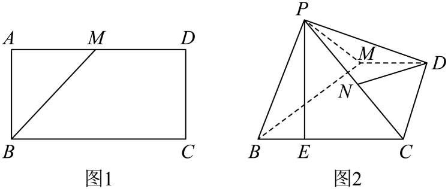

# Mathematics - 题目 427

**ID**: 3a417dbfa0af45ff9160af57961b6bbe
**年级**: Grade 10
**难度**: Medium-Hard
**题型**: Calculation

## 题目
如图1，在矩形  $ABCD$ 中， $AB=1，BC=\sqrt {2}，M$ 是线段 $AD$ 上（包括端点）的一动点，如图2，将 $\vartriangle ABM$ 沿着 $BM$ 折起，使点 $\mathrm{A}$ 到达点 $P$ 的位置，满足点  $P\notin $ 平面  $BCDM$ .​​​​​​​‌(1)如图2，当 $BC=2MD$ 时，点 $N$ 是线段 $PC$ 上点的， $DN//$ 平面  $PBM$ ，求  $\frac {PN}{PC}$ 的值；(2)如图2，若点  $P$ 在平面  $BCDM$ 内的射影 $E$ 落在线段 $BC$ 上.①是否存在点 $M$ ，使得 $BP\bot $ 平面 $PCM$ ，若存在，求 $PM$ 的长；若不存在，请说明理由；②当三棱锥 $E-PBM$ 的体积最大值时，求点 $E$ 到平面 $PCD$ 的距离.

## 解答

1. （1）取 $BC$ 的中点 $F$ ，连接 $DF,FN$ ，
2. 因为 $BC=2MD$ ，所以 $BF=FC=DM$ ，
3. 因为 $MD//BF$ ，所以四边形 $MDFB$ 为平行四边形，
4. 所以 $DF//BM$ ，
5. 因为 $DF\not\subset $ 平面 $PBM$ ， $BM\mathrm{⊂}$ 平面 $PBM$ ，
6. 所以 $DF//$ 平面 $PBM$ ，
7. 因为 $DN//$ 平面 $PBM$ ， $DF\cap DN=D$ ， $DF,DN\subset $ 平面 $DNF$ ，
8. 所以平面 $DNF//$ 平面 $PBM$ ，
9. 因为平面 $DNF\cap $ 平面 $PBC=NF$ ，平面 $PBM\cap $ 平面 $PBC=PB$ ，
10. 所以 $FN//PB$ ，
11. 因为 $F$ 是 $BC$ 的中点，所以 $\frac {PN}{PC}=\frac {BF}{BC}=\frac {1}{2}$ ；
12. 
13. （2）①存在点 $M$ ，当点 $M$ 与点 $D$ 重合，即 $PM=\sqrt {2}$ 时， $PB\bot $ 平面 $PCM$ ，
14. 理由如下：当点 $M$ 与点 $D$ 重合时，则 $CM\bot BC$ ，
15. 因为 $PE\bot $ 平面 $BCD$ ， $CM\subset $ 平面 $BCD$ ，所以 $PE\bot CM$ ，
16. 因为 $BC\cap PE=E$ ， $BC,PE\subset $ 平面 $PBC$ ，
17. 所以 $CM\bot $ 平面 $PBC$ ，
18. 因为 $PB\subset $ 平面 $PBC$ ，所以 $CM\bot PB$ ，
19. 因为 $PB\bot PM$ ， $PM\cap MC=M$ ， $PM,MC\subset $ 平面 $PMC$ ，
20. 所以 $PB\bot $ 平面 $PCM$ ，
21. 即当点 $M$ 与点 $D$ 重合， $PM=\sqrt {2}$ 时， $PB\bot $ 平面 $PCM$ ；
22. ②在矩形 $ABCD$ 中作 $AO\bot BM$ 于 $O$ ，延长 $AO$ 交 $BC$ 于点 $G$ ，折起后得 $PO\bot BM$ ，
23. 
24. 设 $AM=PM=x$ ，则 $BM=\sqrt {1+x{^{2}}},AO=\frac {x}{\sqrt {1+x{^{2}}}}$ ，
25. 因为 $\angle ABM+\angle MBG=90{}\degree ,\angle ABM+\angle BAG=90{}\degree $ ，
26. 所以 $\angle MBG=\angle BAG$ ，
27. 因为 $\angle MBG=\angle AMB$ ，所以 $\angle BAG=\angle AMB$ ，
28. 因为 $\angle BAM=\angle ABG=90{}\degree $ ，
29. 所以 $\vartriangle ABM{\rm ∽}$  $\mathrm{△}BGA$ ，得 $\frac {AB}{AM}=\frac {BG}{AB}$ ，即 $\frac {1}{x}=\frac {BG}{1}$ ，得 $BG=\frac {1}{x}$ ，
30. 所以 $OG=AG-AO=\sqrt {1+\frac {1}{x{^{2}}}}-\frac {x}{\sqrt {1+x{^{2}}}}=\frac {1}{x\sqrt {1+x{^{2}}}}$ ，
31. 因为 $PO\bot BM,OG\bot BM,OP\cap OG=O$ ， $OP,OG\subset $ 平面 $POG$ ，
32. 所以 $BM\mathrm{⊥}$ 平面 $POG$ ，
33. 因为 $PG\subset $ 平面 $POG$ ，所以 $BM\bot PG$ ，
34. 因为 $PE\bot $ 平面 $BCDM$ ， $BM\mathrm{⊂}$ 平面 $BCDM$ ，所以 $BM\mathrm{⊥}PE$ ，
35. 所以点 $E$ 与点 $G$ 重合，
36. 因为要使得点 $P$ 的射影落在线段 $BC$ 上，所以 $AO>OG$ ，
37. 则 $\frac {x}{\sqrt {1+x{^{2}}}}>\frac {1}{x\sqrt {1+x{^{2}}}}$ ，解得 $x\in (1,\sqrt {2}]$ ，
38. 在 ${\rm{R}}{\rm{t}}\mathrm{△}PBE$ 中， $PE=\sqrt {1-\frac {1}{x{^{2}}}}$ ，
39. 所以 $V{{}_{E-PBM}}=V{{}_{P-BEM}}=\frac {1}{3}S{{}_{\vartriangle BEM}}\cdot PE$
40. $=\frac {1}{3}\times \frac {1}{2}\times \frac {1}{x}\times 1\times \sqrt {1-\frac {1}{x{^{2}}}}$
41. $=\frac {1}{6}\sqrt {\left ({1-\frac {1}{x{^{2}}}}\right )\cdot \frac {1}{x{^{2}}}}\leqslant \frac {1}{6}\cdot \frac {1-\frac {1}{x{^{2}}}+\frac {1}{x{^{2}}}}{2}=\frac {1}{12}$ ，
42. 当且仅当 $1-\frac {1}{x{^{2}}}=\frac {1}{x{^{2}}}$ ，即 $x=\sqrt {2}$ 时， $\left ({V{{}_{E-PBM}}}\right ){{}_{{\rm \max }}}=\frac {1}{12}$ ，
43. 当 $PM=\sqrt {2}$ 时， $PE=\sqrt {1-\frac {1}{x{^{2}}}}=\frac {\sqrt {2}}{2}$ ， $BE=EC=\frac {\sqrt {2}}{2}$ ，则 $E$ 是 $BC$ 的中点，
44. 所以点 $E$ 到平面 $PCD$ 的距离为 $\frac {1}{2}BP=\frac {1}{2}$ .

## 知识点

**中文**:
  - 点与面之间的距离
  - 直线与平面平行的判定
  - 直线与平面垂直的判定
  - 翻折问题

**English**:
  - Point-Plane Distance
  - Line-Plane Parallelism Determination
  - Line-Plane Perpendicularity Determination
  - Folding Problems

---
