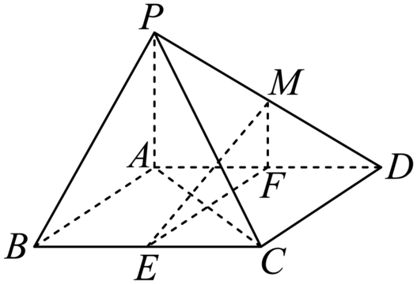

# Mathematics - 题目 1688

**ID**: 3f5e5006c2e244e6902de8210f4d6459
**年级**: Grade 10
**难度**: Medium-Hard
**题型**: Calculation

## 题目
如图，在四棱锥 $P-ABCD$ 中，底面 $ABCD$ 是平行四边形， $\angle BCD=135{^{\circ }}$ ，侧面 $PAB\bot $ 底面 $ABCD,∠BAP=90{^{\circ }},AB=AC=PA=2$ ，点 $E,F$ 分别为 $BC,AD$ 的中点，点 $M$ 在线段 $PD$ 上.​​​​​​​‌（1）求证： $EF\bot $ 平面 $PAC$ ；（2）若 $M$ 为 $PD$ 的中点，求点 $M$ 到平面 $PBC$ 的距离；（3）如果直线 $ME$ 与平面 $PBC$ 所成的角和直线 $ME$ 与平面 $ABCD$ 所成的角相等，求 $\frac {PM}{PD}$ 的值.

## 解答

1. （1）在平行四边形 $ABCD$ 中，
2. 因为 $AB=AC$ ， $\angle BCD=135{}\degree $ ，则 $\angle ABC=\angle ACB=45{}\degree $ ，可得 $AB\mathrm{⊥}AC$ ，
3. 又因为 $E$ ， $F$ 分别为 $BC$ ， $AD$ 的中点，则 $EF$∥$AB$ ，所以 $EF\bot AC$ ，
4. 因为 $\angle BAP=90{}\degree $ ，即 $AB\bot AP$ ，
5. 且侧面 $PAB\bot $ 底面 $ABCD$ ，侧面 $PAB\mathrm{∩}$ 底面 $ABCD=AB$ ， $AP\mathrm{⊂}$ 侧面 $PAB$ ，
6. 可得 $PA\bot $ 底面 $ABCD$ ，
7. 由 $EF\subset $ 底面 $ABCD$ ，可得 $PA\bot EF$ ，
8. 且 $PA\cap AC=A$ ， $PA,AC\subset $ 平面 $PAC$ ，所以 $EF\bot $ 平面 $PAC$ ．
9. （2）因为 $PA\bot $ 底面 $ABCD$ ， $AB,AC\subset $ 底面 $ABCD$ ，可得 $PA\bot AB,PA\bot AC$ ，
10. 由题意可得： $PB=PC=BC=2\sqrt {2}$ ，
11. 设点 $A$ 到平面 $PBC$ 的距离为 $d$ ，
12. 由 $V{{}_{A-PBC}}=V{{}_{P-ABC}}$ 可得 $\frac {1}{3}d\times \frac {1}{2}\times 2\sqrt {2}\times 2\sqrt {2}\times \frac {\sqrt {3}}{2}=\frac {1}{3}\times 2\times \frac {1}{2}\times 2\times 2$ ，解得 $d=\frac {2\sqrt {3}}{3}$ ，
13. 因为 $AD$∥$BC$ ， $AD\not\subset $ 平面 $PBC$ ， $BC\subset $ 平面 $PBC$ ，则 $AD$∥平面 $PBC$ ，
14. 可得点 $D$ 到平面 $PBC$ 的距离即为点 $A$ 到平面 $PBC$ 的距离为 $d=\frac {2\sqrt {3}}{3}$ ，
15. 又因为 $M$ 为 $PD$ 的中点，所以点 $M$ 到平面 $PBC$ 的距离为 $\frac {1}{2}d=\frac {\sqrt {3}}{3}$ .
16. （3）设 $\frac {PM}{PD}=λ\in \left [0,1\right ]$ ，直线 $ME$ 与平面 $PBC$ ，直线 $ME$ 与平面 $ABCD$ 所成的角分别为 $α,β$ ，
17. 由（2）可知：点 $M$ 到平面 $PBC$ 的距离为 $λd=\frac {2\sqrt {3}}{3}λ$ ，点 $M$ 到平面 $ABCD$ 的距离为 $\left ({1-λ}\right )PA=2\left ({1-λ}\right )$ ，
18. 由题意可知： $α=β$ ，即 $\sin α=\sin β$ ，
19. 可得 $\frac {\frac {2\sqrt {3}}{3}λ}{ME}=\frac {2\left ({1-λ}\right )}{ME}$ ，解得 $λ=\frac {\sqrt {3}}{\sqrt {3}+1}=\frac {3-\sqrt {3}}{2}$ ，
20. 所以 $\frac {PM}{PD}$ 的值为 $\frac {3-\sqrt {3}}{2}$ .

## 知识点

**中文**:
  - 点与面之间的距离
  - 直线与平面垂直的判定
  - 直线与平面所成的角

**English**:
  - Point-Plane Distance
  - Line-Plane Perpendicularity Determination
  - Line-Plane Angle

---
