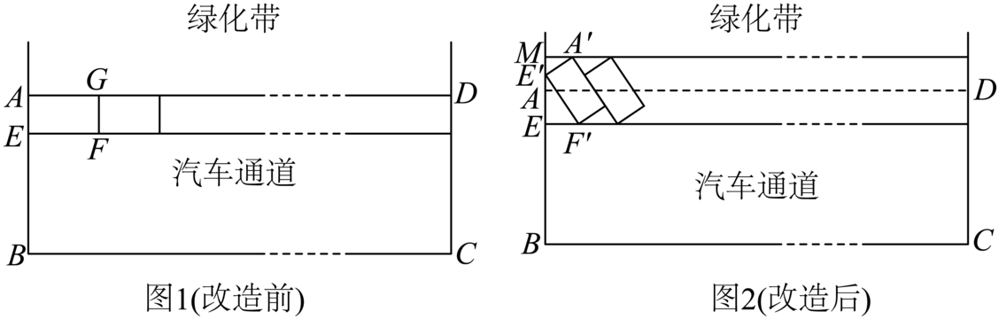

# Mathematics - 题目 1275

**ID**: 4c9a3004cd0446959774fb5664fcceff
**年级**: Grade 10
**难度**: Medium-Hard
**题型**: Calculation

## 题目
我市某大型综合商场门前有条长120米，宽6米的道路（如图1所示的矩形 $ABCD$ ），路的一侧划有24个长5米，宽2.​​​​​​​‌5米的停车位（如矩形 $AEFG$ ）．由于停车位不足，高峰期时段道路拥堵，该商场郭经理提出一个改造方案：在不改变停车位形状大小、不改变汽车通道宽度的条件下，可通过压缩道路旁边的绿化带及改变停车位的方向来增加停车位．记绿化带被压缩的宽度 $AM=d$ 米，停车位相对道路倾斜的角度 $\angle E\prime A\prime M=θ$ ，其中 $θ\in \left ({\frac {{\rm{π}}}{6},\frac {{\rm{π}}}{3}}\right )$ ．（1）若 ${\tan}θ=\frac {4}{3}$ ，求 $EE\prime $ 和 $E\mathrm{′}M$ 的长；（2）求 $d$ 关于 $θ$ 的函数表达式 $d(θ)$ ；（3）若 $d=3$ ，按照郭经理的方案，该路段改造后的停车位比改造前增加了多少个？

## 解答

1. （1）由题意得 $E\prime F\prime =EF=5$ 米， $A\prime E\prime =2.5$ 米， $\angle A\prime E\prime F\prime =\angle A\prime ME\prime =\frac {{\rm{π}}}{2}$ ，
2. 则 $\angle EE\prime F\prime +\angle A\prime E\prime M=\angle MA\prime E\prime +\angle A\prime E\prime M=\frac {{\rm{π}}}{2}$ ，即 $\angle EE\prime F\prime =\angle MA\prime E\prime =θ$ ．
3. 由 ${\tan}θ=\frac {\sin θ}{{\cos}θ}=\frac {4}{3}$ ，且 $\sin {^{2}}θ+{\cos}{^{2}}θ=1$ ， $θ\in \left ({\frac {{\rm{π}}}{6},\frac {{\rm{π}}}{3}}\right )$ ，可得 $\sin θ=\frac {4}{5}$ ， ${\cos}θ=\frac {3}{5}$ ，
4. 则 $EE\prime =E\prime F\prime {\cos}θ=5\times \frac {3}{5}=3$ 米， $E\prime M=A\prime E\prime \sin θ=\frac {5}{2}\times \frac {4}{5}=2$ 米．
5. （2）由（1）可得 $EE\prime =E\prime F\prime {\cos}θ=5{\cos}θ$ ， $E\prime M=A\prime E\prime \sin θ=\frac {5}{2}\sin θ$ ，
6. $AM=EE\prime +E\prime M-AE=5{\cos}θ+\frac {5}{2}\sin θ-\frac {5}{2}$ ，
7. 故 $d(θ)=5{\cos}θ+\frac {5}{2}\sin θ-\frac {5}{2}$ ， $θ\in \left ({\frac {{\rm{π}}}{6},\frac {{\rm{π}}}{3}}\right )$ ．
8. （3）由 $d=3$ ，可得 $5{\cos}θ+\frac {5}{2}\sin θ-\frac {5}{2}=3$ ，即 $10{\cos}θ+5\sin θ=11$ ．
9. 设 $5{\cos}θ-10\sin θ=m$ ，则 $(10{\cos}θ+5\sin θ){^{2}}+(5{\cos}θ-10\sin θ){^{2}}=121+m{^{2}}$ ，
10. 整理得 $125=121+m{^{2}}$ ，解得 $m=\pm 2$ ．
11. 由 $θ\in \left ({\frac {{\rm{π}}}{6},\frac {{\rm{π}}}{3}}\right )$ ，可得 $\sin θ\in \left ({\frac {1}{2},\frac {\sqrt {3}}{2}}\right )$ ．
12. 当 $m=2$ 时，解得 $\sin θ=\frac {7}{25}<\frac {1}{2}$ ， ${\cos}θ=\frac {24}{25}$ ，不符合题意；
13. 当 $m=\mathrm{-}2$ 时，解得 $\sin θ=\frac {3}{5}$ ， ${\cos}θ=\frac {4}{5}$ ，符合题意．
14. 设改造后停车位数量的最大值为 $n$ ，如图，过停车位顶点 $G{{}_{n}}$ 作 $MA\prime $ 的垂线，垂足为 $H{{}_{n}}$ ，
15. 则顶点 $G{{}_{n}}$ 到线段 $ME$ 的距离为 $d{{}_{n}}=MA\prime +A\prime A{{}_{2}}+A{{}_{2}}A{{}_{3}}+\cdots $  $+A{{}_{n-1}}A{{}_{n}}+A{{}_{n}}H{{}_{n}}$ ．
16. 由图及题意可知 $A\prime A{{}_{2}}=A{{}_{2}}A{{}_{3}}=\cdots =A{{}_{n-1}}A{{}_{n}}$ ， $A{{}_{n}}H{{}_{n}}=A{{}_{2}}H{{}_{2}}$ ，
17. 则 $d{{}_{n}}=MA\prime +(n-1)A\prime A{{}_{2}}+A{{}_{2}}H{{}_{2}}$ ．
18. 因为 $\angle A\prime A{{}_{2}}E{{}_{2}}=\angle A{{}_{2}}G{{}_{2}}H{{}_{2}}=\angle MA\prime E\prime =θ$ ，
19. 所以 $MA\prime =A\prime E\prime {\cos}θ=2$ ， $A\prime A{{}_{2}}=\frac {A{{}_{2}}E{{}_{2}}}{{\cos}θ}=\frac {25}{8}$ ， $A{{}_{2}}H{{}_{2}}=A{{}_{2}}G{{}_{2}}\sin θ=3$ ，
20. 则 $d{{}_{n}}=2+\frac {25}{8}(n-1)+3=\frac {25n+15}{8}$ ．
21. 由题可知 $d{{}_{n}}\leqslant 120$ ，即 $\frac {25n+15}{8}\leqslant 120$ ，解得 $n\leqslant 37.8$ ，则取 $n=37$ ，
22. 故该路段改造后的停车位比改造前增加了 $37-24=13$ 个．
23. 

## 知识点

**中文**:
  - 在实际问题中建立三角函数模型

**English**:
  - Modeling Real-world Problems

---
