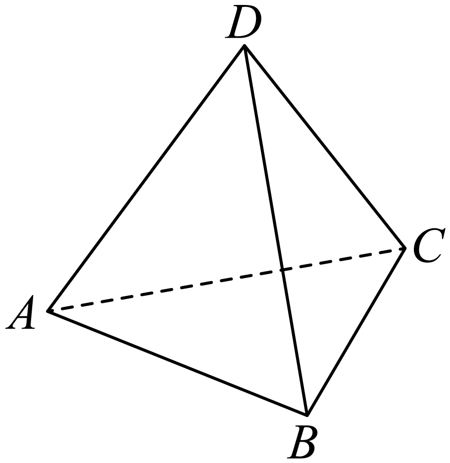

# Mathematics - 题目 2628

**ID**: 5290f9816b7d48d197d9242abd165fa3
**年级**: Grade 10
**难度**: Medium-Hard
**题型**: Calculation

## 题目
如图，在三棱锥 $D-ABC$ 中，由 $AB$ ， $AC$ ， $AD$ 三条射线所构成的图形被称为“三面角”，设 $\angle BAC=θ{{}_{1}}$ ， $\angle CAD=θ{{}_{2}}$ ， $\angle DAB=θ{{}_{3}}$ ，设二面角 $C-AB-D$ 的平面角为 $θ$ ，则有 ${\cos}θ=\frac {{\cos}θ{{}_{2}}-{\cos}θ{{}_{1}}{\cos}θ{{}_{3}}}{\sin θ{{}_{1}}\sin θ{{}_{3}}}$ .​​​​​​​‌（1）已知三棱锥 $D-ABC$ 的所有棱长均为1，求二面角 $C-AB-D$ 的余弦值.（2）设直线 $AD$ 与平面 $ABC$ 所成的角为 $α$ ，证明 ${\cos}{^{2}}α=\frac {{\cos}{^{2}}θ{{}_{2}}+{\cos}{^{2}}θ{{}_{3}}-2{\cos}θ{{}_{1}}{\cos}θ{{}_{2}}{\cos}θ{{}_{3}}}{\sin {^{2}}θ{{}_{1}}}$ .（3）若 $θ{{}_{1}}=60{}\degree $ ， ${\cos}θ{{}_{2}}=\frac {1}{3}$ ， ${\cos}θ{{}_{3}}=\frac {1}{4}$ ， $AB=AD=2$ ， $AC=3$ ，求点 $\mathrm{A}$ 到平面 $BCD$ 的距离.

## 解答

1. （1）三棱锥 $D-ABC$ 的所有棱长均为1，
2. 故 $θ{{}_{1}}=θ{{}_{2}}=θ{{}_{3}}=\frac {{\rm{π}}}{3}$ ，
3. 由已知得 ${\cos}θ=\frac {{\cos}θ{{}_{2}}-{\cos}θ{{}_{1}}{\cos}θ{{}_{3}}}{\sin θ{{}_{1}}\sin θ{{}_{3}}}=\frac {\frac {1}{2}-\frac {1}{2}\times \frac {1}{2}}{\frac {\sqrt {3}}{2}\times \frac {\sqrt {3}}{2}}=\frac {1}{3}$ ；
4. （2）证明：过点 $D$ 作平面 $ABC$ 的垂线，垂足为 $H$ ，连接 $AH$ ，则 $\angle DAH=α$ ，
5. 设 $\angle CAH=β$ .
6. 
7. 在三面角 $A-CDH$ 中， 过点 $H$ 做 $HT{\rm ⊥}$  $AC$ 于点 $T$ ，连接 $DT$ ，
8. 因为 $DH{\rm ⊥}$ 平面 $ABC$ ， $AC\subset $ 平面 $ABC$ ，所以 $DH{\rm ⊥}$  $AC$ ，
9. 又 $HT\cap DH=H$ ， $HT,DH\subset $ 平面 $DHT$ ，所以 $AC{\rm ⊥}$ 平面 $DHT$ ，
10. 因为 $DT\subset $ 平面 $DHT$ ，所以 $AC{\rm ⊥}$  $DT$ ，
11. 故 ${\cos}\angle CAD=\frac {AT}{AD}$ ，
12. 其中 ${\cos}α=\frac {AH}{AD}$ ， ${\cos}β=\frac {AT}{AH}$ ，
13. 即 ${\cos}α{\cos}β=\frac {AT}{AH}\cdot \frac {AH}{AD}=\frac {AT}{AD}$ ，
14. 所以 ${\cos}θ{{}_{2}}={\cos}α{\cos}β$ ，①
15. 在三面角 $A-BDH$ 中，同理可得 ${\cos}θ{{}_{3}}={\cos}α{\cos}\left ({θ{{}_{1}}-β}\right )$ .②
16. 由①得 ${\cos}β=\frac {{\cos}θ{{}_{2}}}{{\cos}α}$ ，从而 $\sin β=\frac {\sqrt {{\cos}{^{2}}α-{\cos}{^{2}}θ{{}_{2}}}}{{\cos}α}$ ，
17. 由②得 ${\cos}θ{{}_{3}}={\cos}α\left ({{\cos}θ{{}_{1}}{\cos}β+\sin θ{{}_{1}}\sin β}\right )$ ，
18. 所以 ${\cos}θ{{}_{3}}={\cos}α\left ({{\cos}θ{{}_{1}}\cdot \frac {{\cos}θ{{}_{2}}}{{\cos}α}+\sin θ{{}_{1}}\cdot \frac {\sqrt {{\cos}{^{2}}α-{\cos}{^{2}}θ{{}_{2}}}}{{\cos}α}}\right )$
19. $={\cos}θ{{}_{1}}{\cos}θ{{}_{2}}+\sin θ{{}_{1}}\sqrt {{\cos}{^{2}}α-{\cos}{^{2}}θ{{}_{2}}}$ ，
20. 所以 $\sqrt {{\cos}{^{2}}α-{\cos}{^{2}}θ{{}_{2}}}=\frac {{\cos}θ{{}_{3}}-{\cos}θ{{}_{1}}{\cos}θ{{}_{2}}}{\sin θ{{}_{1}}}$ ，
21. 所以 ${\cos}{^{2}}α={\cos}{^{2}}θ{{}_{2}}+{\left({\frac {{\cos}θ{{}_{3}}-{\cos}θ{{}_{1}}{\cos}θ{{}_{2}}}{\sin θ{{}_{1}}}}\right)^{2}}$
22. $=\frac {{\cos}{^{2}}θ{{}_{2}}+{\cos}{^{2}}θ{{}_{3}}-2{\cos}θ{{}_{1}}{\cos}θ{{}_{2}}{\cos}θ{{}_{3}}}{\sin {^{2}}θ{{}_{1}}}$ ；
23. （3）方法一：在 $\vartriangle ACD$ 中，由 $CD{^{2}}=2{^{2}}+3{^{2}}-2\times 2\times 3\times \frac {1}{3}=9$ ，得 $CD=3$ ，
24. 故 ${\cos}\angle ADC=\frac {AD{^{2}}+DC{^{2}}-AC{^{2}}}{2AD\cdot DC}=\frac {4+9-9}{2\times 2\times 3}=\frac {1}{3}$ .
25. 在 $\mathrm{△}ABD$ 中，由 $BD{^{2}}=2{^{2}}+2{^{2}}-2\times 2\times 2\times \frac {1}{4}=6$ ，得 $BD=\sqrt {6}$ ，
26. 故 ${\cos}\angle ADB=\frac {AD{^{2}}+DB{^{2}}-AB{^{2}}}{2AD\cdot DB}=\frac {\sqrt {6}}{4}$ .
27. 在 $\vartriangle ABC$ 中，由 $BC{^{2}}=2{^{2}}+3{^{2}}-2\times 2\times 3\times \frac {1}{2}=7$ ，得 $BC=\sqrt {7}$ ，
28. 所以 ${\cos}\angle BDC=\frac {BD{^{2}}+DC{^{2}}-BC{^{2}}}{2BD\cdot DC}=\frac {2\sqrt {6}}{9}$ ，从而 $\sin \angle BDC=\frac {\sqrt {57}}{9}$ .
29. 设直线 $DA$ 与平面 $BCD$ 所成的角为 $γ$ ，
30. 由（2）知 ${\cos}{^{2}}γ=\frac {{\cos}{^{2}}\angle ADC+{\cos}{^{2}}\angle ADB-2{\cos}\angle ADC{\cos}\angle ADB{\cos}\angle BDC}{\sin {^{2}}\angle BDC}=\frac {3}{8}$ ，
31. 所以 $\sin γ=\frac {\sqrt {10}}{4}$ ，所以点 $\mathrm{A}$ 到平面 $BCD$ 的距离为 $AD\sin γ=\frac {\sqrt {10}}{2}$ .
32. 方法二：因为 $θ{{}_{1}}=60{}\degree $ ， ${\cos}θ{{}_{2}}=\frac {1}{3}$ ， ${\cos}θ{{}_{3}}=\frac {1}{4}$ ，
33. 所以 ${\cos}{^{2}}α=\frac {\frac {1}{9}+\frac {1}{16}-2\times \frac {1}{2}\times \frac {1}{3}\times \frac {1}{4}}{{\left({\frac {\sqrt {3}}{2}}\right)^{2}}}=\frac {13}{108}$ ，故 $\sin α=\sqrt {1-{\cos}{^{2}}α}=\frac {\sqrt {95}}{\sqrt {108}}$ ，
34. 所以点 $D$ 到平面 $ABC$ 的距离为 $AD\sin α=2\sin α=\frac {\sqrt {95}}{\sqrt {27}}$ .
35. $S{{}_{\vartriangle ABC}}=\frac {1}{2}AB\cdot AC\sin \angle BAC=\frac {1}{2}\times 2\times 3\sin \frac {{\rm{π}}}{3}=\frac {3\sqrt {3}}{2}$ .
36. 所以 $V{{}_{D-ABC}}=\frac {1}{3}S{{}_{\vartriangle ABC}}\cdot \frac {\sqrt {95}}{\sqrt {27}}=\frac {1}{3}\times \frac {3\sqrt {3}}{2}\times \frac {\sqrt {95}}{\sqrt {27}}=\frac {\sqrt {95}}{6}$ ，
37. 在 $\vartriangle ACD$ 中，由 $CD{^{2}}=2{^{2}}+3{^{2}}-2\times 2\times 3\times \frac {1}{3}=9$ ，得 $CD=3$ ，
38. 在 $\mathrm{△}ABD$ 中，由 $BD{^{2}}=2{^{2}}+2{^{2}}-2\times 2\times 2\times \frac {1}{4}=6$ ，得 $BD=\sqrt {6}$ ，
39. 在 $\vartriangle ABC$ 中，由 $BC{^{2}}=2{^{2}}+3{^{2}}-2\times 2\times 3\times \frac {1}{2}=7$ ，得 $BC=\sqrt {7}$ ，
40. 所以 ${\cos}\angle BCD=\frac {BC{^{2}}+CD{^{2}}-BD{^{2}}}{2BC\cdot CD}=\frac {7+9-6}{2\times 3\sqrt {7}}=\frac {5}{3\sqrt {7}}$ ，
41. 故 $\sin \angle BCD=\sqrt {1-{\left({\frac {5}{3\sqrt {7}}}\right)^{2}}}=\frac {\sqrt {38}}{3\sqrt {7}}$ ，
42. 所以 $\mathrm{△}BCD$ 的面积为 $\frac {1}{2}BC\cdot CD\sin \angle BCD=\frac {1}{2}\times \sqrt {7}\times 3\times \frac {\sqrt {38}}{3\sqrt {7}}=\frac {\sqrt {38}}{2}$ .
43. $V{{}_{D-ABC}}=\frac {1}{3}S{{}_{\vartriangle ABC}}\cdot \frac {\sqrt {95}}{\sqrt {27}}=\frac {1}{3}\times \frac {3\sqrt {3}}{2}\times \frac {\sqrt {95}}{\sqrt {27}}=\frac {\sqrt {95}}{6}$
44. 设点A到平面 $BCD$ 的距离为 $h$ ，则 $\frac {1}{3}\times \frac {\sqrt {38}}{2}h=\frac {\sqrt {95}}{6}$ ，
45. 解得 $h=\frac {\sqrt {10}}{2}$ ，
46. 所以点 $\mathrm{A}$ 到平面 $BCD$ 的距离为 $\frac {\sqrt {10}}{2}$ .

## 知识点

**中文**:
  - 新定义问题
  - 直线与平面所成的角
  - 点与面之间的距离

**English**:
  - New Definition Problems
  - Line-Plane Angle
  - Point-Plane Distance

---
