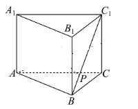

# Mathematics - 题目 3429

**ID**: 557123c32c3e4167b8e213d5d9ee037f
**年级**: Grade 10
**难度**: Medium-Hard
**题型**: Calculation

## 题目
如图，在三棱柱 $ABC-A{{}_{1}}B{{}_{1}}C{{}_{1}}$ 中，平面 $AA{{}_{1}}B{{}_{1}}B\bot $ 平面 $ABC$ ，平面 $AA{{}_{1}}C{{}_{1}}C\bot $ 平面 $ABC$ ， $AB\bot BC,AB=AA{{}_{1}}=\sqrt {3},BC=1$ ， $P$ 是线段 $BC{{}_{1}}$ 上一动点， $\overrightarrow {{BP}}=λ\overrightarrow {{BC{{}_{1}}}}$ ， $λ\in \left ({0,1}\right )$ .​​​​​​​‌（1）证明：三棱柱 $ABC-A{{}_{1}}B{{}_{1}}C{{}_{1}}$ 是直三棱柱；（2）若 $λ=\frac {1}{4}$ ，求平面 $A{{}_{1}}B{{}_{1}}P$ 截三棱柱 $ABC-A{{}_{1}}B{{}_{1}}C{{}_{1}}$ 所得截面的面积；（3）是否存在 $λ$ ，使得直线 $B{{}_{1}}P$ 与平面 $ACC{{}_{1}}A{{}_{1}}$ 所成角的正切值为 $\frac {\sqrt {3}}{7}$ ，若存在，求出 $λ$ 的值，若不存在，请说明理由.

## 解答

1. （1）如图：
2. 
3. 在 $AB$ 上任取一点 $D$ ，过 $D$ 作 $DD{{}_{1}}\bot AB$ 交 $A{{}_{1}}B{{}_{1}}$ 于 $D{{}_{1}}$ ，
4. 在 $AC$ 上任取一点 $E$ ，过 $E$ 作 $EE{{}_{1}}\bot AC$ 交 $A{{}_{1}}C{{}_{1}}$ 于 $E{{}_{1}}$ ，
5. 由平面 $AA{{}_{1}}B{{}_{1}}B\bot $ 平面 $ABC$ ，平面 $AA{{}_{1}}B{{}_{1}}B\cap $ 平面 $ABC=AB$ ， $DD{{}_{1}}\subset $ 平面 $AA{{}_{1}}B{{}_{1}}B$
6. 所以： $DD{{}_{1}}\bot $ 平面 $ABC$ ，
7. 同理有 $EE{{}_{1}}\bot $ 平面 $ABC$ ，从而有 $DD{{}_{1}}//EE{{}_{1}}$ ，
8. $DD{{}_{1}}\not\subset $ 平面 $ACC{{}_{1}}A{{}_{1}}$ ， $EE{{}_{1}}\subset $ 平面 $ACC{{}_{1}}A{{}_{1}}$ ，所以 $DD{{}_{1}}//$ 平面 $ACC{{}_{1}}A{{}_{1}}$ ，
9. 又因为平面 $ACC{{}_{1}}A{{}_{1}}\cap $ 平面 $ABB{{}_{1}}A{{}_{1}}=AA{{}_{1}}$ ， $DD{{}_{1}}\subset $ 平面 $ABB{{}_{1}}A{{}_{1}}$ ，
10. 从而有 $DD{{}_{1}}//AA{{}_{1}}$ ，即 $AA{{}_{1}}\bot $ 平面 $ABC$ .
11. 从而三棱柱 $ABC-A{{}_{1}}B{{}_{1}}C{{}_{1}}$ 是直三棱柱.
12. （2）
13. 
14. 当 $λ=\frac {1}{4}$ 时，连接 $B{{}_{1}}P$ 延长交直线 $BC$ 于 $F$ ，所以 $\frac {BP}{PC{{}_{1}}}=\frac {1}{3}$ ，
15. 又因为 $B{{}_{1}}C{{}_{1}}//BC$ ，所以 $\frac {BF}{B{{}_{1}}C{{}_{1}}}=\frac {BP}{PC{{}_{1}}}=\frac {1}{3}$ ，所以 $F$ 为线段 $BC$ 上靠近 $B$ 的一个三等分点，
16. 过 $F$ 作 $FM//AB$ ，交 $AC$ 于点 $M$ ，连接 $AM$ ，
17. 因为三棱柱 $ABC-A{{}_{1}}B{{}_{1}}C{{}_{1}}$ 为直棱柱，所以平面 $B{{}_{1}}BCC{{}_{1}}\bot $ 平面 $ABC$ ，
18. 又 $AB\bot BC$ ， $AB\subset $ 平面 $ABC$ ，平面 $B{{}_{1}}BCC{{}_{1}}\cap $ 平面 $ABC=BC$ ，
19. 所以 $AB\bot $ 平面 $B{{}_{1}}BCC{{}_{1}}$ ，所以 $MF\bot $ 平面 $B{{}_{1}}BCC{{}_{1}}$ ，
20. 从而截面为直角梯形 $MFB{{}_{1}}A{{}_{1}}$ ， $AB=AA{{}_{1}}=\sqrt {3},BC=1$ ，
21. 所以 $MF=\frac {2\sqrt {3}}{3},B{{}_{1}}F=\sqrt {B{{}_{1}}B{^{2}}+BF{^{2}}}=\frac {2\sqrt {7}}{3}$ ，
22. 从而直角梯形 $MFB{{}_{1}}A{{}_{1}}$ 的面积为 $\frac {1}{2}\times \left ({\sqrt {3}+\frac {2\sqrt {3}}{3}}\right )\times \frac {2\sqrt {7}}{3}=\frac {5\sqrt {21}}{9}$ .
23. （3）
24. 
25. 延长 $B{{}_{1}}P$ 交 $CC{{}_{1}}$ 于点 $N$ ，过 $B{{}_{1}}$ 作 $B{{}_{1}}K\bot C{{}_{1}}A{{}_{1}}$ 于 $K$ ，
26. 因为三棱柱 $ABC-A{{}_{1}}B{{}_{1}}C{{}_{1}}$ 为直棱柱，所以平面 $A{{}_{1}}ACC{{}_{1}}⊥$ 平面 $A{{}_{1}}B{{}_{1}}C{{}_{1}}$ ，
27. 又 $B{{}_{1}}K\subset $ 平面 $A{{}_{1}}B{{}_{1}}C{{}_{1}}$ ，平面 $A{{}_{1}}ACC{{}_{1}}\cap $ 平面 $A{{}_{1}}B{{}_{1}}C{{}_{1}}=A{{}_{1}}C{{}_{1}}$ ，
28. 所以 $B{{}_{1}}K\bot $ 平面 $A{{}_{1}}ACC{{}_{1}}$ ，连接 $NK$ ，
29. 则 $\angle B{{}_{1}}NK$ 为 $B{{}_{1}}P$ 与平面 $ACC{{}_{1}}A{{}_{1}}$ 所成的角，
30. 由 $AB\bot BC$ ， $AB=AA{{}_{1}}=\sqrt {3}$ ， $BC=1$ 可知， $B{{}_{1}}K=\frac {\sqrt {3}}{2},C{{}_{1}}K=\frac {1}{2}$ ，
31. 若直线 $B{{}_{1}}P$ 与平面 $ACC{{}_{1}}A{{}_{1}}$ 所成角的正切值为 $\frac {\sqrt {3}}{7}$ ，即 ${\tan}\angle B{{}_{1}}NK=\frac {\sqrt {3}}{7}$ ，
32. 从而 $NK=\frac {7}{2},C{{}_{1}}N=2\sqrt {3}$ ，即 $C{{}_{1}}C=CN$ ， $C{{}_{1}}N=2BB{{}_{1}}$ ，从而易得 $BP=\frac {1}{3}BC{{}_{1}}$ ，
33. 即点 $P$ 为 $BC{{}_{1}}$ 上靠近 $B$ 的一个三等分点， $λ=\frac {1}{3}$ .

## 知识点

**中文**:
  - 截面问题
  - 棱柱
  - 直线与平面所成的角

**English**:
  - Cross-section Problems
  - Prism
  - Line-Plane Angle

---
