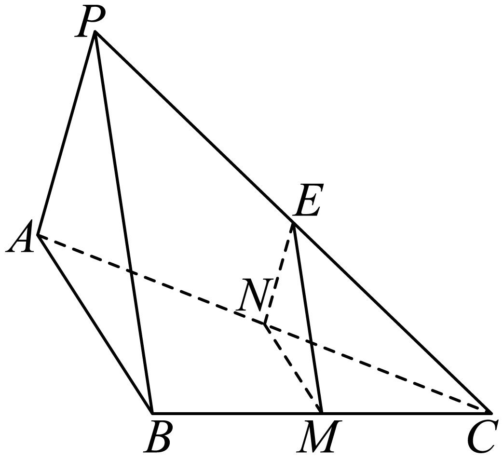

# Mathematics - 题目 853

**ID**: 67f26de4d5fc4aa2892009006761594d
**年级**: Grade 10
**难度**: Medium-Hard
**题型**: Calculation

## 题目
如图，在三棱锥 $P-ABC$ 中，平面 $PAB\bot $ 平面 $ABC$ ， $AB=BC=2$ ， $\angle ABC=120{}\degree {\rm ，\mathit{M}，\mathit{N}，\mathit{E}}$ 分别为BC，AC，PC的中点.​​​​​​​‌（1）证明：平面 $MNE//$ 平面 $PAB$ ；（2）若 $PA\bot PB$ ， $PA=PB$ ，三棱锥 $P-ABC$ 的外接球为球O.（ⅰ）证明：A，B，C，O四点共面；（ⅱ）求直线PO与平面 $PBC$ 所成角的正弦值.

## 解答

1. （1）因为M，N，E分别为BC，AC，PC的中点，
2. 所以 $MN//AB,ME//BP$ ，因为 $MN,ME$ 在平面 $PAB$ 外， $AB,BP\subset $ 平面 $PAB$ ，
3. 所以 $MN//$ 平面 $PAB$ ， $ME//$ 平面 $PAB$ ，又 $MN\cap ME=M$ ，所以平面 $MNE{\rm{/}}{\rm{/}}$ 平面 $PAB$ ；
4. （2）（ⅰ）证明：取 $AB$ 中点 $H$ ，连接 $PH$ ，因为 $PA\bot PB$ ， $PA=PB$ ，所以 $PH\bot AB$ ，
5. 因为平面 $PAB\bot $ 平面 $ABC$ ，平面 $PAB\cap $ 平面 $ABC=AB$ ， $PH\subset $ 平面 $PAB$ ，
6. 所以 $PH\bot $ 平面 $ABC$ ，且 $PH=\frac {1}{2}AB=1$ ，
7. 设 $\vartriangle ABC$ 外接圆圆心为 $Q$ ，半径为 $r$ ，则 $r=\frac {AB}{2\sin 30{^{\circ }}}=2$ ，
8. 所以 $HQ=\sqrt {QA{^{2}}-{\left({\frac {AB}{2}}\right)^{2}}}=\sqrt {2{^{2}}-1}=\sqrt {3}$ ，所以 $QP=\sqrt {PH{^{2}}+QH{^{2}}}=\sqrt {1{^{2}}+\sqrt {3}{^{2}}}=2=r$ ，
9. 所以Q点即为球心O，所以A，B，C，O四点共面；
10. （ⅱ）由（ⅰ）可得 $PB=\sqrt {PH{^{2}}+HB{^{2}}}=\sqrt {2}$ ，
11. 在 $\vartriangle HBC$ 中， $HC{^{2}}=HB{^{2}}+BC{^{2}}-2HB·BC{\cos}120{}\degree =1+4+2=7$ ，
12. 在 ${\rm{R}}{\rm{t}}\vartriangle PHC$ 中 $PC{^{2}}=PH{^{2}}+HC{^{2}}=8$ ，
13. 在 $\vartriangle PBC$ 中， ${\cos}\angle PBC=\frac {PB{^{2}}+BC{^{2}}-PC{^{2}}}{2PB·BC}=\frac {2+4-8}{2\times \sqrt {2}\times 2}=-\frac {\sqrt {2}}{4}$ ，故 $\sin \angle PBC=\frac {\sqrt {14}}{4}$ ，
14. 设 $O$ 到平面 $PBC$ 的距离为 $h$ ，则 $V{{}_{O-PBC}}=\frac {1}{3}\times \frac {1}{2}\times \sqrt {2}\times 2\times \frac {\sqrt {14}}{4}h=\frac {\sqrt {7}}{6}h$ ，
15. 又 $V{{}_{O-PBC}}=V{{}_{P-OBC}}=\frac {1}{3}\times S{{}_{\vartriangle OBC}}\times PH=\frac {1}{3}\times \frac {1}{2}\times 2{^{2}}\times \frac {\sqrt {3}}{2}\times 1=\frac {\sqrt {3}}{3}$ ，
16. 所以 $\frac {\sqrt {7}}{6}h=\frac {\sqrt {3}}{3}\Rightarrow h=\frac {2\sqrt {21}}{7}$ ，
17. 设直线与平面所成的角为 $θ$ ，故 $\sin θ=\frac {h}{OP}=\frac {\sqrt {21}}{7}$ .
18. 

## 知识点

**中文**:
  - 平面与平面平行的判定
  - 球的切接问题
  - 直线与平面所成的角

**English**:
  - Plane-Plane Parallelism Determination
  - Tangency and Inscribed/Circumscribed Spheres
  - Line-Plane Angle

---
