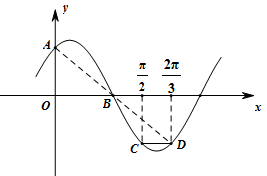

# Mathematics - 题目 1161

**ID**: 6c08be7871dc478989b516fd94b73048
**年级**: Grade 10
**难度**: Medium-Hard
**题型**: Calculation

## 题目
如图，已知函数 $f\left ({x}\right )=\sin \left ({ωx+φ}\right )\left ({ω>0,0<φ<π}\right )$ ，点A､ $B$ 分别是 $f\left ({x}\right )$ 的图象与 $y$ 轴、 $x$ 轴的交点， $C,D$ 分别是 $f\left ({x}\right )$ 的图象上横坐标为 $\frac {π}{2}$ 、 $\frac {2π}{3}$ 的两点， $CD{\rm{/}}{\rm{/}}x$ 轴，且点A关于点 $B$ 的对称点恰为点 $D$ .​​​​​​​‌（1）求函数 $y=f\left ({x}\right )$ 的解析式；（2）若 $f\left ({α}\right )=\frac {12}{13}$ ， $α\in \left [\frac {π}{12},\frac {π}{3}\right ]$ ，求 $f\left ({α-\frac {π}{4}}\right )$ ；（3）若关于 $x$ 的函数 $g\left ({x}\right )=f\left ({x-\frac {π}{4}}\right )-{\log}{{}_{2}}k$ 在区间 $\left [0,\frac {π}{2}\right ]$ 上恰好有一个零点，求实数 $k$ 的取值范围.

## 解答

1. 解：（1）∵点A与点 $D$ 关于点 $B$ 对称， $\therefore B$ 点的横坐标为 $\frac {1}{2}\times \left ({0+\frac {2π}{3}}\right )=\frac {π}{3}$ .
2. 又点 $C$ 与点 $D$ 关于直线 $x=\frac {1}{2}\times \left ({\frac {π}{2}+\frac {2π}{3}}\right )=\frac {7π}{12}$ 对称，
3. $\therefore $ 函数 $y=f\left ({x}\right )$ 的最小正周期 $T=4\times \left ({\frac {7π}{12}-\frac {π}{3}}\right )=π$ ， $\therefore ω=\frac {2π}{T}=2$ ，
4. 又代入B点， $f\left ({\frac {π}{3}}\right )=\sin \left ({\frac {2π}{3}+φ}\right )=0$ ， $\therefore \frac {2π}{3}+φ=π$ ，得 $φ=\frac {π}{3}$ ，符合 $0<φ<π$ ，
5. 因此 $f\left ({x}\right )=\sin \left ({2x+\frac {π}{3}}\right )$ ；
6. （2）由 $f\left ({α}\right )=\sin \left ({2α+\frac {π}{3}}\right )=\frac {12}{13}$ ， $\because α\in \left [\frac {π}{12},\frac {π}{3}\right ]$ ， $\therefore 2α+\frac {π}{3}\in \left [\frac {π}{2},π\right ]$ ，
7. 所以 ${\cos}\left ({2α+\frac {π}{3}}\right )=-\sqrt {1-\sin {^{2}}\left ({2α+\frac {π}{3}}\right )}=-\frac {5}{13}{\rm ，·}$
8. 所以 $f\left ({α-\frac {π}{4}}\right )=\sin \left [2\left ({α-\frac {π}{4}}\right )+\frac {π}{3}\right ]=\sin \left [\left ({2α+\frac {π}{3}}\right )-\frac {π}{2}\right ]=-{\cos}\left ({2α+\frac {π}{3}}\right )=\frac {5}{13}$ ；
9. （3） $\because g\left ({x}\right )=f\left ({x-\frac {π}{4}}\right )-{\log}{{}_{2}}k=-{\cos}\left ({2x+\frac {π}{3}}\right )-{\log}{{}_{2}}k$ 在区间 $\left [0,\frac {π}{2}\right ]$ 上恰好有一个零点，令 $g\left ({x}\right )=0$ ，得 $-{\log}{{}_{2}}k={\cos}\left ({2x+\frac {π}{3}}\right )$ 在区间 $\left [0,\frac {π}{2}\right ]$ 上恰好有一个根，
10. 当 $x\in \left [0,\frac {π}{2}\right ]$ 时，设 $t=2x+\frac {π}{3}\in \left [\frac {π}{3},\frac {4π}{3}\right ]$ ，由于方程恰好仅一根，如图 $y={\cos}t$ ， $t\in \left [\frac {π}{3},\frac {4π}{3}\right ]$ 可知， ${\rm{c}}{\rm{o}}{\rm{s}}\left ({2x+\frac {π}{3}}\right )\in \left ({-\frac {1}{2},\frac {1}{2}}\right ]$ 或 ${\rm{c}}{\rm{o}}{\rm{s}}\left ({2x+\frac {π}{3}}\right )=-1$ 时，方程在区间 $\left [0,\frac {π}{2}\right ]$ 上恰好有一个根，
11. $\therefore -\frac {1}{2}<-{\rm{l}}{\rm{o}}{\rm{g}}{{}_{2}}k\leqslant \frac {1}{2}$ 或 $-{\rm{l}}{\rm{o}}{\rm{g}}{{}_{2}}k=-1$ ，
12. $\therefore -\frac {1}{2}\leqslant {\rm{l}}{\rm{o}}{\rm{g}}{{}_{2}}k<\frac {1}{2}$ 或 ${\rm{l}}{\rm{o}}{\rm{g}}{{}_{2}}k=1$ ，即 ${\rm{l}}{\rm{o}}{\rm{g}}{{}_{2}}2{^{-\frac {1}{2}}}\leqslant {\rm{l}}{\rm{o}}{\rm{g}}{{}_{2}}k<{\rm{l}}{\rm{o}}{\rm{g}}{{}_{2}}2{^{\frac {1}{2}}}$ 或 $k=2$ ，
13. 解得 $\frac {\sqrt {2}}{2}\leqslant k<\sqrt {2}$ 或 $k=2$ .
14. 所以实数 $k$ 的取值范围是 $\left [{\frac {\sqrt {2}}{2},\sqrt {2}}\right )\cup \left \{2\right \}$ .

## 知识点

**中文**:
  - 三角函数的图象和性质的综合应用

**English**:
  - Comprehensive Application of Graphs and Properties

---
