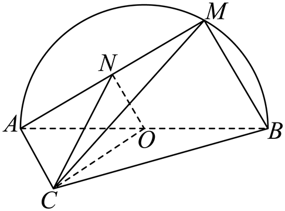

# Mathematics - 题目 87

**ID**: 6cfbfa5488db4864ba74116e0b9606e6
**年级**: Grade 10
**难度**: Medium-Hard
**题型**: Calculation

## 题目
如图，等腰直角三角形 $ABC$ 所在平面与半圆弧 $\overset{\frown}{{AB}}$ 所在平面垂直， $O$ 为 $AB$ 的中点，且 $AC=BC$ ，  $M$ 是 $\overset{\frown}{{AB}}$ 上异于 $\mathrm{A}$ 、 $B$ 的点， $N$ 是 $AM$ 的中点.​​​​​​​‌（1）证明： $AM\bot $ 平面 $OCN$（2）若圆 $O$ 的半径为 $1$ ， 设 $\angle MAB=α$ ，${\rm （i）}$ 当 $α=30{^{\circ }}$ 时， 求二面角 $C-AM-B$ 的平面角的正切值；${\rm （ii）}$ 当 $M$ 在弧 $\overset{\frown}{{AB}}$ 上运动时 （不与 $\mathrm{A}$ 、 $B$ 重合），证明：点 $O$ 到平面 $BCM$ 的距离  $d=\frac {{\cos}α}{\sqrt {1+{\cos}{^{2}}α}}$ .

## 解答

1. （1）因为 $M$ 是半圆弧 $\overset{\frown}{{AB}}$ 上一点，所以 $\angle AMB=\frac {{\rm{π}}}{2}$ ，即 $AM\bot BM$ ，
2. 因为 $O$ 、 $N$ 分别是 $AB$ 、 $AM$ 的中点，所以 $ON{\rm{/}}{\rm{/}}BM$ ， $ON\mathrm{⊥}AM$ ，
3. 因为 $△ACB$ 是等腰直角三角形， $AC=BC$ ，所以 $OC\bot AB$ ，
4. 因为平面 $ACB⊥$ 平面 $ABM$ ，平面 $ACB\cap $ 平面 $ABM=AB$ ， $CO\subset $ 平面 $ABC$ ，
5. 所以 $CO\bot $ 平面 $ABM$ ，又因为 $AM\subset $ 平面 $ABM$ ，所以 $AM\bot CO$ ，
6. 因为 $OC$ 、 $ON\subset $ 平面 $OCN$ ， $ON\cap OC=O$ ，所以 $AM\bot $ 平面 $OCN$ .
7. （2）（i）由（1）可知 $AM\bot $ 平面 $OCN$ ，且 $CN$ 、 $ON\subset $ 平面 $OCN$ ，故 $CN\bot AM$ ， $ON\mathrm{⊥}AM$ ，
8. 所以，二面角 $C-AM-B$ 的平面角为 $\angle CNO$ ，
9. 当 $α=30{^{\circ }}$ 时， $ON=\frac {1}{2}OA=\frac {1}{2}$ ，
10. 因为 $\vartriangle ABC$ 为等腰直角三角形，且 $AC=BC$ ，则 $\angle ACB=\frac {{\rm{π}}}{2}$ ，
11. 因为 $O$ 为 $AB$ 的中点，所以 $OC=\frac {1}{2}AB=1$ ，
12. 因为 $CO\bot $ 平面 $ABM$ ， $ON\subset $ 平面 $ABM$ ，故 $CO\bot ON$ ，
13. 所以 ${\tan}\angle CNO=\frac {CO}{ON}=\frac {1}{\frac {1}{2}}=2$ ，即二面角 $C-AM-B$ 的平面角的正切值为 $2$ ；
14. ${\rm （ii）}$ 过点 $M$ 在平面 $ABM$ 内作 $MG\bot AB$ 交 $AB$ 于点 $G$ ，如图所示，
15. 
16. 因为平面 $ABM\bot $ 平面 $ABC$ ，且平面 $ABM\cap $ 平面 $ABC=AB$ ， $MG\subset $ 平面 $ABM$ ，
17. 所以 $MG\bot $ 平面 $ABC$ ，
18. 由（ⅰ）知 $OA=OB=OC=OM=1$ ，
19. 当 $\angle MAB=α$ 时， $\angle ABM=\frac {{\rm{π}}}{2}-α$ ，则 $BM=AB\sin α=2\sin α$ ，
20. 所以 $MG=BM\cdot \sin \angle ABM=2\sin α\cdot \sin \left ({\frac {{\rm{π}}}{2}-α}\right )=\sin 2α$ ，
21. 由等腰三角形 $ABC$ 得， $BC=\sqrt {2}$ ，
22. 因为 $CO\bot $ 平面 $ABM$ ， $OM\subset $ 平面 $ABM$ ，所以 $CO\bot OM$ ，
23. 所以 $CM=\sqrt {CO{^{2}}+OM{^{2}}}=\sqrt {2}$ ，
24. 在 $\vartriangle BCM$ 中， $BC=CM=\sqrt {2}$ ， $BM=2\sin α$ ，
25. 所以 $S{{}_{\mathrm{△}BCM}}=\frac {1}{2}BM\sqrt {BC{^{2}}-\frac {BM{^{2}}}{4}}=\frac {1}{2}\times 2\sin α\times \sqrt {2-\sin {^{2}}α}=\sin α\sqrt {2-\sin {^{2}}α}$ ，
26. 又因为 $V{{}_{O-BCM}}=\frac {1}{3}S{{}_{\mathrm{△}BCM}}\times d=\frac {1}{3}S{{}_{\mathrm{△}BCO}}\times MG$ ，
27. 所以 $d=\frac {S{{}_{\mathrm{△}BCO}}\times MG}{S{{}_{\mathrm{△}BCM}}}=\frac {\frac {1}{2}\times 1\times 1\times \sin 2α}{\sin α\sqrt {2-\sin {^{2}}α}}=\frac {{\cos}α}{\sqrt {2-\sin {^{2}}α}}=\frac {{\cos}α}{\sqrt {1+{\cos}{^{2}}α}}$ .

## 知识点

**中文**:
  - 二面角
  - 直线与平面垂直的判定
  - 点与面之间的距离

**English**:
  - Dihedral Angle
  - Line-Plane Perpendicularity Determination
  - Point-Plane Distance

---
