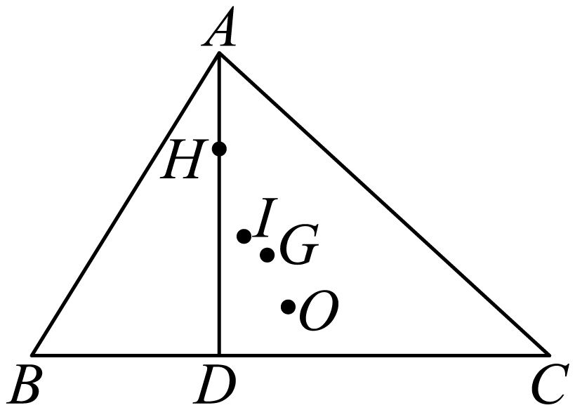

# Mathematics - 题目 3671

**ID**: 7473ca2a51d84134a08b6658d91b6d2a
**年级**: Grade 10
**难度**: Medium-Hard
**题型**: Calculation

## 题目
已知a，b，c为 $\vartriangle ABC$ 三个内角A，B，C的对边，且 $c=4,b=5,a=6$ ，线段 $BC$ 边对应的高为 $AD$ ， $\vartriangle ABC$ 内心、重心、外心、垂心依次为点I、G、O、H．(1)求 $\vartriangle ABC$ 中高 $AD$ 的长度；​​​​​​​‌(2)若 $∠BAC$ 的角平分线交 $BC$ 于E，求证 $\overrightarrow {{AE}}=\frac {AC}{AB+AC}\overrightarrow {{AB}}+\frac {AB}{AB+AC}\overrightarrow {{AC}}$ ；(3)欧拉线定理：设 $\vartriangle ABC$ 的重心，外心，垂心分别是G，O，H，则G，O，H三点共线，且 $\left |{OH}\right |=3\left |{OG}\right |$ ．请合理运用欧拉线定理，求 $\overrightarrow {{AH}}·\overrightarrow {{AI}}$ 的值．

## 解答

1. （1） $\because c=4,b=5,a=6,\therefore {\cos}A=\frac {b{^{2}}+c{^{2}}-a{^{2}}}{2bc}=\frac {1}{8}>0$ ，故 $\mathrm{A}$ 是锐角， $\therefore \sin A=\sqrt {1-{\cos}{^{2}}A}=\frac {3\sqrt {7}}{8}$ ，
2. 由三角形的面积相等得， $\frac {1}{2}AD\cdot BC=\frac {1}{2}bc\sin A$ ，则 $AD=\frac {bc\sin A}{a}=\frac {4\times 5}{6}\times \frac {3\sqrt {7}}{8}=\frac {5\sqrt {7}}{4}$ ；
3. （2）因为内心是三角形三条角平分线的交点，故连接 $AI$ 延长交 $BC$ 于点 $E$ ，如图所示：
4. 
5. 在 $\vartriangle ABE$ 中由正弦定理可得 $\frac {AB}{\sin \angle AEB}=\frac {BE}{\sin \angle BAE}$ ，在 $\vartriangle ACE$ 中由正弦定理可得 $\frac {AC}{\sin \angle AEC}=\frac {CE}{\sin \angle CAE}$ ，
6. 又 $\angle BAE=\angle CAE,\angle AEB+\angle AEC={\rm{π}}$ ，所以 $\sin \angle BAE=\sin \angle CAE,\sin \angle AEB=\sin \angle AEC$ ，
7. 所以 $\frac {AB}{AC}=\frac {BE}{CE}$ ，即 $\overrightarrow {{BE}}=-\frac {AB}{AC}\overrightarrow {{CE}}$ ，
8. 则 $\overrightarrow {{AE}}-\overrightarrow {{AB}}=-\frac {AB}{AC}\left ({\overrightarrow {{AE}}-\overrightarrow {{AC}}}\right ),\therefore \overrightarrow {{AE}}=\frac {AC}{AB+AC}\overrightarrow {{AB}}+\frac {AB}{AB+AC}\overrightarrow {{AC}}$ ；
9. （3）又因为在 $\vartriangle ABE$ 中， $BI$ 平分 $\angle ABC$ ，由（2）同理可得
10. $\frac {BA}{BE}=\frac {AI}{IE}=\frac {4}{6\times \frac {4}{9}}=\frac {3}{2},\quad \overrightarrow {{AI}}=\frac {3}{5}\overrightarrow {{AE}}=\frac {3}{5}\left ({\frac {5}{9}\overrightarrow {{AB}}+\frac {4}{9}\overrightarrow {{AC}}}\right )=\frac {1}{3}\overrightarrow {{AB}}+\frac {4}{15}\overrightarrow {{AC}}$ ，
11. 因为 $G,O,H$ 三点共线， $|OH|=3|OG|$ ，所以 $\overrightarrow {{OH}}=3\overrightarrow {{OG}}$ ，
12. 由重心的性质可知 $\overrightarrow {{AG}}=\frac {1}{3}\times \frac {1}{2}\left ({\overrightarrow {{AB}}+\overrightarrow {{AC}}}\right )=\frac {1}{3}\left ({\overrightarrow {{AB}}+\overrightarrow {{AC}}}\right )$ ，
13. 故由欧拉线定理可知，
14. $\overrightarrow {{AH}}=\overrightarrow {{AO}}+\overrightarrow {{OH}}=\overrightarrow {{AO}}+3\overrightarrow {{OG}}=\overrightarrow {{AO}}+3(\overrightarrow {{OA}}+\overrightarrow {{AG}})=-2\overrightarrow {{AO}}+3\overrightarrow {{AG}}=-2\overrightarrow {{AO}}+\overrightarrow {{AB}}+\overrightarrow {{AC}}$ ，
15. $\therefore \overrightarrow {{AH}}\cdot \overrightarrow {{AI}}=[-2\overrightarrow {{AO}}+(\overrightarrow {{AB}}+\overrightarrow {{AC}})]\cdot \overrightarrow {{AI}}=-2\overrightarrow {{AO}}\cdot \overrightarrow {{AI}}+(\overrightarrow {{AB}}+\overrightarrow {{AC}})\cdot \overrightarrow {{AI}}$ ，
16. 而 $\overrightarrow {{AO}}\cdot \overrightarrow {{AI}}=\overrightarrow {{AO}}\cdot \left ({\frac {1}{3}\overrightarrow {{AB}}+\frac {4}{15}\overrightarrow {{AC}}}\right )=\frac {1}{3}\left |{\overrightarrow {{AB}}}\right |·\left |{\overrightarrow {{AO}}}\right |{\cos}\angle BAO+\frac {4}{15}\left |{\overrightarrow {{AC}}}\right |·\left |{\overrightarrow {{AO}}}\right |{\cos}\angle CAO=\frac {1}{3}\times \frac {1}{2}AB{^{2}}+\frac {4}{15}\times \frac {1}{2}AC{^{2}}=\frac {1}{3}\times 8+\frac {4}{15}\times \frac {25}{2}=6,$
17. $\overrightarrow {{AB}}\cdot \overrightarrow {{AC}}=|\overrightarrow {{AB}}|\cdot |\overrightarrow {{AC}}|{\cos}A=4\times 5\times \frac {1}{8}=\frac {5}{2}$ ，
18. $\left ({\overrightarrow {{AB}}+\overrightarrow {{AC}}}\right )\cdot \overrightarrow {{AI}}=\left ({\overrightarrow {{AB}}+\overrightarrow {{AC}}}\right )\cdot \left ({\frac {1}{3}\overrightarrow {{AB}}+\frac {4}{15}\overrightarrow {{AC}}}\right )=\frac {1}{3}\overrightarrow {{AB}}{^{2}}+\frac {4}{15}\overrightarrow {{AC}}{^{2}}+\frac {3}{5}\overrightarrow {{AB}}·\overrightarrow {{AC}}=\frac {1}{3}\times 16+\frac {4}{15}\times 25+\frac {3}{5}\times \frac {5}{2}=\frac {27}{2},$
19. 故 $\overrightarrow {{AH}}\cdot \overrightarrow {{AI}}=-2\times 6+\frac {27}{2}=\frac {3}{2}$ ．

## 知识点

**中文**:
  - 向量线性综合运算
  - 数量积的计算

**English**:
  - Comprehensive Linear Operations
  - Calculation of Scalar Product

---
