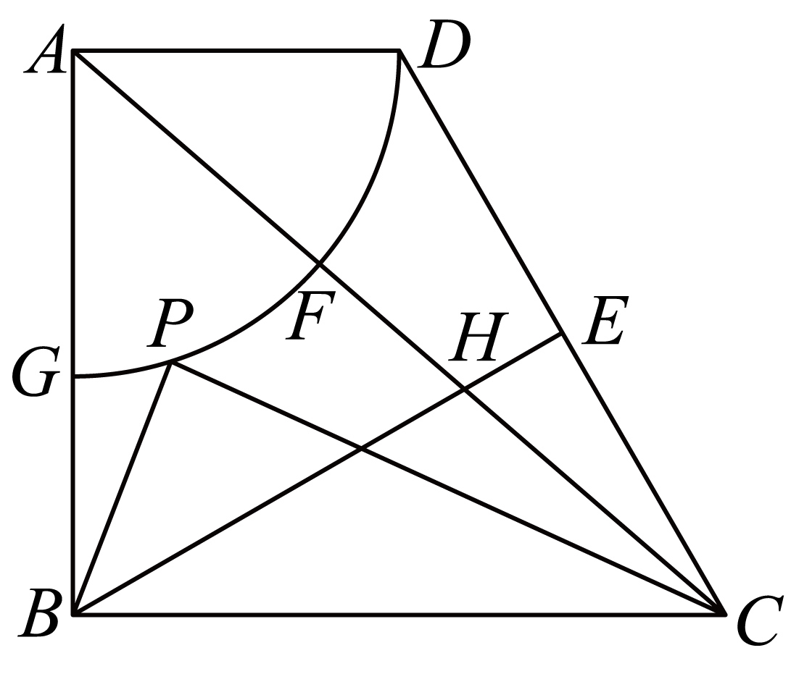

# Mathematics - 题目 3152

**ID**: 84e5aa4a74f3495ca03b7ae52997be68
**年级**: Grade 10
**难度**: Medium-Hard
**题型**: Calculation

## 题目
如图在直角梯形 $ABCD$ 中， $\overrightarrow {{BC}}=2\overrightarrow {{AD}}$ ， $BC=CD=2$ ，点E为CD的中点，以A为圆心AD为半径作圆交AB于点G，点P为劣弧DG（包含D，G两点）上的一点，AC与劣弧、BE分别交于点F，H.​​​​​​​‌（1）求向量 $\overrightarrow {{AF}}$ 与 $\overrightarrow {{BE}}$ 夹角 $α$ 的余弦值；（2）若向量 $\overrightarrow {{BH}}=x\overrightarrow {{BD}}+y\overrightarrow {{AC}}$ ，求实数x，y的值；（3）求 $\overrightarrow {{BP}}\cdot \overrightarrow {{BE}}$ 的取值范围.

## 解答

1. （1）易得 $\angle ABC=\angle BAD=90\degree $ ，且 $\mathrm{△}BCD$ 为正三角形，所以 $AB=\sqrt {3},AC=\sqrt {7}$ ，
2. 以点 $B$ 为原点， $\overrightarrow {{BC}}$ 、 $\overrightarrow {{BA}}$ 分别为 $x$ 、 $y$ 轴正方向建立平面直角坐标系，
3. 所以 $A\left ({0,\sqrt {3}}\right ),C\left ({2,0}\right ),B\left ({0,0}\right ),D\left ({1,\sqrt {3}}\right ),E\left ({\frac {3}{2},\frac {\sqrt {3}}{2}}\right ),\overrightarrow {{AC}}=\left ({2,-\sqrt {3}}\right ),$
4. 所以 $\overrightarrow {{AF}}=\frac {1}{\sqrt {7}}\overrightarrow {{AC}}=\frac {1}{\sqrt {7}}\left ({2,-\sqrt {3}}\right )=\left ({\frac {2\sqrt {7}}{7},-\frac {\sqrt {21}}{7}}\right ),\overrightarrow {{BE}}=\left ({\frac {1+2}{2},\frac {\sqrt {3}}{2}}\right )=\left ({\frac {3}{2},\frac {\sqrt {3}}{2}}\right )$ ，
5. 所以 ${\cos}α=\frac {\overrightarrow {{AF}}\cdot \overrightarrow {{BE}}}{\left |{\overrightarrow {{AF}}}\right |\left |{\overrightarrow {{BE}}}\right |}=\frac {\frac {2\sqrt {7}}{7}\times \frac {3}{2}+\left ({-\frac {\sqrt {21}}{7}\times \frac {\sqrt {3}}{2}}\right )}{1\times \sqrt {3}}=\frac {\sqrt {3}}{2\sqrt {7}}=\frac {\sqrt {21}}{14}$ ，
6. 
7. （2） $\overrightarrow {{BH}}=λ\overrightarrow {{BE}}=\frac {λ}{2}\left ({\overrightarrow {{BD}}+\overrightarrow {{BC}}}\right )=\frac {λ}{2}\left ({\overrightarrow {{BA}}+\frac {1}{2}\overrightarrow {{BC}}+\overrightarrow {{BC}}}\right )=\frac {λ}{2}\overrightarrow {{BA}}+\frac {3λ}{4}\overrightarrow {{BC}}$ ，
8. 又因为 $A,H,C$ 三点共线，所以 $\frac {λ}{2}+\frac {3λ}{4}=1$ ，解得 $λ=\frac {4}{5}$ .
9. 因为 $\overrightarrow {{BH}}=x\overrightarrow {{BD}}+y\overrightarrow {{AC}}=x\left ({\overrightarrow {{BA}}+\frac {1}{2}\overrightarrow {{BC}}}\right )+y\left ({\overrightarrow {{BC}}-\overrightarrow {{BA}}}\right )=\left ({x-y}\right )\overrightarrow {{BA}}+\left ({\frac {x}{2}+y}\right )\overrightarrow {{BC}}$ ，
10. 所以 $\begin{cases}x-y=\frac {2}{5}\\\frac {x}{2}+y=\frac {3}{5}\end{cases}\Rightarrow \begin{cases}x=\frac {2}{3}\\y=\frac {4}{15}\end{cases}$ ，所以 $x=\frac {2}{3},y=\frac {4}{15}$ ，
11. （3）设 $\angle BPC=θ,\left ({θ\in \left [0,\frac {{\rm{π}}}{2}\right ]}\right )$ ，且如（1）所建平面直角坐标系，则 $P\left ({{\cos}θ,\sqrt {3}-\sin θ}\right )$ ，
12. 所以 $\overrightarrow {{BP}}=\left ({{\cos}θ,\sqrt {3}-\sin θ}\right ),\overrightarrow {{BE}}=\left ({\frac {3}{2},\frac {\sqrt {3}}{2}}\right )$ ，
13. 所以 $\overrightarrow {{BP}}\cdot \overrightarrow {{BE}}=\frac {3}{2}{\cos}θ+\frac {\sqrt {3}}{2}\left ({\sqrt {3}-\sin θ}\right )=\frac {3}{2}{\cos}θ-\frac {\sqrt {3}}{2}\sin θ+\frac {3}{2}=\sqrt {3}{\cos}\left ({θ+\frac {{\rm{π}}}{6}}\right )+\frac {3}{2}$ ，
14. 又因为 $0\leqslant θ\leqslant \frac {{\rm{π}}}{2}$ ，所以 $\frac {{\rm{π}}}{6}\leqslant θ+\frac {{\rm{π}}}{6}\leqslant \frac {2{\rm{π}}}{3}$ ，所以 $-\frac {1}{2}\leqslant {\cos}\left ({θ+\frac {{\rm{π}}}{6}}\right )\leqslant \frac {\sqrt {3}}{2}$ ，
15. 所以 $\frac {3-\sqrt {3}}{2}\leqslant \sqrt {3}{\cos}\left ({θ+\frac {{\rm{π}}}{6}}\right )+\frac {3}{2}\leqslant 3$ ，
16. 所以 $\overrightarrow {{BP}}\cdot \overrightarrow {{BE}}$ 的取值范围为 $\left [\frac {3-\sqrt {3}}{2},3\right ]$ .

## 知识点

**中文**:
  - 向量夹角的坐标计算
  - 平面向量的坐标运算
  - 数量积的坐标表示

**English**:
  - Coordinate Calculation of Angle
  - Coordinate Operations
  - Coordinate Representation

---
