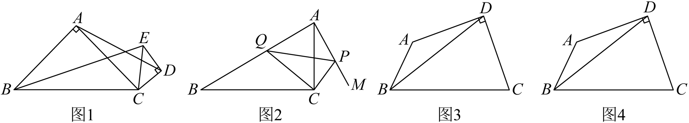

# Mathematics - 题目 1269

**ID**: 8756431617eb4279b976bf7a9de8e85d
**年级**: Grade 10
**难度**: Medium-Hard
**题型**: Calculation

## 题目
（1）问题提出：如图 ${\rm 1，}\vartriangle ABC$ 和 $\vartriangle DEC$ 均为等腰直角三角形，且 $\angle BAC=\angle CDE=90{}\degree $ ， $AB=AC=3$ ， $DE=CD=1$ ，连接 $AD$ 、 $BE$ ，求 $\frac {AD}{BE}$ 的值；（2）问题探究：如图2，在 ${\rm{R}}{\rm{t}}\mathrm{△}ABC$ 中， $\angle ACB\mathrm{=}90{}\degree $ ， $\angle B=30{}\degree $ ， $BC=4$ ，过点A作 $AM\bot AB$ ，点 $P$ 是射线 $AM$ 上一动点，连接 $CP$ ，作 $CQ\bot CP$ 交线段 $AB$ 于点 $Q$ ，求 $PQ$ 的最小值；（3）问题解决：如图3，四边形 $ABCD$ ， $BC=4$ ， $\angle BAD=135{}\degree $ ， $\angle ADC=90{}\degree $ ， $AD=CD$ .​​​​​​​‌求 $BD$ 的最大值；（4）分班点题：如图4，四边形 $ABCD$ ， $BC=4$ ， $\angle BAD=135{}\degree $ ， $\angle ADC=90{}\degree $ ， $AD=CD$ .求 $S{{}_{△BCD}}$ 的最大值.

## 解答

1. （1）由等腰直角三角形性质可得 $\frac {CE}{CD}=\sqrt {2}$ 、 $\frac {CB}{CA}=\sqrt {2}$ ， $\therefore \frac {CE}{CD}=\frac {CB}{CA}$ ，
2. 又 $\because \angle ACB=\angle DCE$ ，
3. $\therefore \angle BCE=\angle ACB+\angle ACE=\angle DCE+\angle ACE=\angle ACD$ ，
4. $\therefore △ECB∽△DCA$ ， $\therefore \frac {AD}{BE}=\frac {AC}{BC}=\frac {1}{\sqrt {2}}=\frac {\sqrt {2}}{2}$ ；
5. （2） $\because \angle ACB=90{}\degree $ ， $\angle B=30{}\degree $ ， $BC=4$ ，
6. $\therefore AC=\frac {4\sqrt {3}}{3}$ ， $AB=2AC=\frac {8\sqrt {3}}{3}$ ，
7. $\because \angle QAP=\angle QCP=90{}\degree $ ，
8. $\therefore $ 点 $\mathrm{A}$ ， $Q$ ， $C$ ， $P$ 四点共圆，
9. $\therefore \angle QAC=\angle QPC$ ，且 $\angle ACB=\angle QCP=90{}\degree $ ，
10. $\therefore \vartriangle ABC∽\vartriangle PQC$ ， $\therefore \frac {PQ}{AB}=\frac {QC}{BC}$ ，
11. $\therefore PQ=\frac {AB}{BC}\cdot QC=\frac {2\sqrt {3}}{3}QC$ ，
12. $\therefore $ 当 $QC$ 的长度最小时， $PQ$ 的长度最小，
13. 即当 $QC\bot AB$ 时， $PQ$ 的值最小，
14. 此时 $QC=\frac {AC·BC}{AB}=2$ ， $PQ$ 的最小值为 $\frac {4\sqrt {3}}{3}$ ；
15. （3）如图，作 $\angle DCE=\angle ACB$ ，交射线 $DA$ 于点 $E$ ，
16. 取 $CE$ 中点 $F$ ，连接 $AC$ ， $BE$ ， $DF$ ， $BF$ ，
17. $\because \angle ADC=90{}\degree $ ， $AD=CD$ ，
18. $\therefore \angle CAD=45{}\degree $ ， $\angle BAC=\angle BAD-\angle CAD=90{}\degree $ ，
19. $\therefore \vartriangle ABC∽\vartriangle DEC$ ， $\therefore \frac {BC}{AC}=\frac {CE}{CD}$ ，
20. $\because \angle DCE=\angle ACB$ ， $\therefore ∠BCE=∠ACD$ ，
21. $\therefore \vartriangle BCE∽\vartriangle ACD$ ， $\therefore \angle BEC=\angle ADC=90{}\degree $ ，
22. $\therefore $  $BE=CE=\frac {\sqrt {2}}{2}BC=2\sqrt {2}$ ,
23. $\because $ 点 $F$ 是 $EC$ 中点， $\therefore DF=EF=\frac {1}{2}CE=\sqrt {2}$ ，
24. $\therefore BF=\sqrt {BE{^{2}}+EF{^{2}}}=\sqrt {10}$ ，
25. $\therefore BD\leqslant DF+BF=\sqrt {10}+\sqrt {2}$ ，当 $B$ 、 $F$ 、 $D$ 三点共线时取等；
26. （4）在（3）的基础上作 $FH\bot BC$ 于点 $H$ ，连接 $DH$ ，
27. 
28. 则 $FH=\frac {\sqrt {2}}{2}CF=\frac {\sqrt {2}}{4}CE=1$ ，
29. 设 $\mathrm{△}BCD$ 中以 $BC$ 为底的高为 $h$ ，
30. 则 $h\leqslant DH\leqslant DF+FH=\sqrt {2}+1$ ，
31. 当 $B$ 、 $F$ 、 $H$ 三点共线时取等，
32. 则 $S{{}_{△BCD}}$ 的最大值为 $\frac {1}{2}\times 4\times \left ({\sqrt {2}+1}\right )=2+2\sqrt {2}$ .

## 知识点

**中文**:
  - 图形的变化
  - 图形的性质

**English**:
  - Transformations of Shapes
  - Properties of Geometric Figures

---
