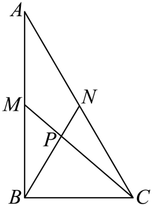

# Mathematics - 题目 2425

**ID**: 89b7c49c595c4b47a6c52dd86d26444c
**年级**: Grade 10
**难度**: Medium-Hard
**题型**: Calculation

## 题目
如图，在 $\vartriangle ABC$ 中， $\angle ABC=90{}\degree $ ， $AB=2\sqrt {3}$ ， $BC=2$ ， $\overrightarrow {{AM}}=x\overrightarrow {{AB}}(0<x<1)$ ， $\overrightarrow {{AN}}=y\overrightarrow {{AC}}(0<y<1)$ ，设 $CM$ 与 $BN$ 交于点 $P$ ，且 $\overrightarrow {{CP}}=2\overrightarrow {{PM}}$ ．（1）求 $2xy-3y$ 的值；​​​​​​​‌（2）定义平面非零向量之间的一种运算“ $\oplus $ ”： $\overrightarrow a\oplus \overrightarrow b=\frac {\left |{\overrightarrow a}\right |{\rm{s}}{\rm{i}}{\rm{n}}θ}{\left |{\overrightarrow b}\right |}$ （其中 $θ$ 是两非零向量 $\overrightarrow a$ 和 $\overrightarrow b$ 的夹角）．（ⅰ）若 $M$ 为 $AB$ 的中点，求 $\overrightarrow {{PB}}\oplus \overrightarrow {{PC}}$ 的值；（ⅱ）若 $\overrightarrow {{AP}}\oplus \overrightarrow {{BC}}=\frac {\sqrt {3}}{2}$ ，求 $x+y$ 的值．

## 解答

1. （1）因为 $\overrightarrow {{CP}}=2\overrightarrow {{PM}}$ ， $\overrightarrow {{AM}}=x\overrightarrow {{AB}},\overrightarrow {{AN}}=y\overrightarrow {{AC}}$ ，
2. 所以 $\overrightarrow {{AP}}=\overrightarrow {{AM}}+\overrightarrow {{MP}}=\overrightarrow {{AM}}+\frac {1}{3}\overrightarrow {{MC}}=\overrightarrow {{AM}}+\frac {1}{3}\left ({\overrightarrow {{AC}}-\overrightarrow {{AM}}}\right )$
3. $=\frac {1}{3}\overrightarrow {{AC}}+\frac {2}{3}\overrightarrow {{AM}}=\frac {1}{3y}\overrightarrow {{AN}}+\frac {2x}{3}\overrightarrow {{AB}}$ ，
4. 又 $B,P,N$ 三点共线，
5. 所以 $\frac {1}{3y}+\frac {2x}{3}=1$ ，即 $2xy-3y=-1$ .
6. （2）（ⅰ）因为 $M$ 为 $AB$ 的中点，所以 $x=\frac {1}{2}$ ，
7. 由（1）知， $2xy-3y=-1$ ，则 $y=\frac {1}{2}$ ，即 $P$ 为 $\vartriangle ABC$ 的重心．
8. 建立如图所示的平面直角坐标系，则 $B\left ({0,0}\right ),C\left ({2,0}\right ),A\left ({0,2\sqrt {3}}\right )$ ，
9. 所以 $P\left ({\frac {2}{3},\frac {2\sqrt {3}}{3}}\right )$ ，
10. 
11. 所以 $\overrightarrow {{PB}}=\left ({-\frac {2}{3},-\frac {2\sqrt {3}}{3}}\right ),\overrightarrow {{PC}}=\left ({\frac {4}{3},-\frac {2\sqrt {3}}{3}}\right )$ ，
12. 所以 ${\rm{c}}{\rm{o}}{\rm{s}}\angle BPC=\frac {\overrightarrow {{PB}}\cdot \overrightarrow {{PC}}}{\left |{\overrightarrow {{PB}}}\right |\left |{\overrightarrow {{PC}}}\right |}=\frac {\frac {4}{9}}{\frac {4}{3}\cdot \frac {2\sqrt {7}}{3}}=\frac {\sqrt {7}}{14},{\rm{s}}{\rm{i}}{\rm{n}}\angle BPC=\frac {3\sqrt {21}}{14}$ ，
13. 所以 $\overrightarrow {{PB}}\oplus \overrightarrow {{PC}}=\frac {\left |{\overrightarrow {{PB}}}\right |}{\left |{\overrightarrow {{PC}}}\right |}{\rm{s}}{\rm{i}}{\rm{n}}\angle BPC=\frac {\frac {4}{3}}{\frac {2\sqrt {7}}{3}}\cdot \frac {3\sqrt {21}}{14}=\frac {3\sqrt {3}}{7}$ .
14. （ⅱ）建立与（ⅰ）相同的平面直角坐标系，
15. 则 $B\left ({0,0}\right ),C\left ({2,0}\right ),A\left ({0,2\sqrt {3}}\right )$ ，
16. 所以 $\overrightarrow {{AC}}=\left ({2,-2\sqrt {3}}\right ),\overrightarrow {{AB}}=\left ({0,-2\sqrt {3}}\right ),\overrightarrow {{BC}}=\left ({2,0}\right )$ ，
17. 所以 $\overrightarrow {{AM}}=x\overrightarrow {{AB}}=\left ({0,-2\sqrt {3}x}\right )$ ，
18. 所以 $\overrightarrow {{AP}}=\frac {1}{3}\overrightarrow {{AC}}+\frac {2}{3}\overrightarrow {{AM}}=\left ({\frac {2}{3},-\frac {2\sqrt {3}}{3}\left ({1+2x}\right )}\right )$ ，
19. 则 $\overrightarrow {{AP}}\cdot \overrightarrow {{BC}}=\frac {4}{3},\left |{\overrightarrow {{BC}}}\right |=2$ ，
20. 所以 $\overrightarrow {{AP}}\oplus \overrightarrow {{BC}}=\frac {\left |{\overrightarrow {{AP}}}\right |}{\left |{\overrightarrow {{BC}}}\right |}\cdot \sqrt {1-{\left({\frac {\overrightarrow {{AP}}\cdot \overrightarrow {{BC}}}{\left |{\overrightarrow {{AP}}}\right |\cdot \left |{\overrightarrow {{BC}}}\right |}}\right)^{2}}}=\frac {\left |{\overrightarrow {{AP}}}\right |}{2}\cdot \sqrt {1-\frac {{\left({\overrightarrow {{AP}}\cdot \overrightarrow {{BC}}}\right)^{2}}}{4\left |{\overrightarrow {{AP}}}\right |{^{2}}}}=\frac {1}{4}\cdot \sqrt {4\left |{\overrightarrow {{AP}}}\right |{^{2}}-{\left({\overrightarrow {{AP}}\cdot \overrightarrow {{BC}}}\right)^{2}}}$
21. $=\frac {1}{4}\sqrt {4\left |{\overrightarrow {{AP}}}\right |{^{2}}-\frac {16}{9}}=\frac {\sqrt {3}}{2}$ ，
22. 即 $\left |{\overrightarrow {{AP}}}\right |{^{2}}=\frac {31}{9}$ ，所以 $\frac {4}{9}+\frac {12}{9}(1+2x){^{2}}=\frac {31}{9}$ ，即 $x=\frac {1}{4}$ 或 $x=-\frac {5}{4}$ ，
23. 因为 $0<x<1$ ，所以 $x=\frac {1}{4}$ ，又因为 $2xy-3y=-1$ ，
24. 所以 $y=\frac {2}{5}$ ，则 $x+y=\frac {13}{20}$ ．

## 知识点

**中文**:
  - 平面向量的新定义问题

**English**:
  - New Definition Problems

---
